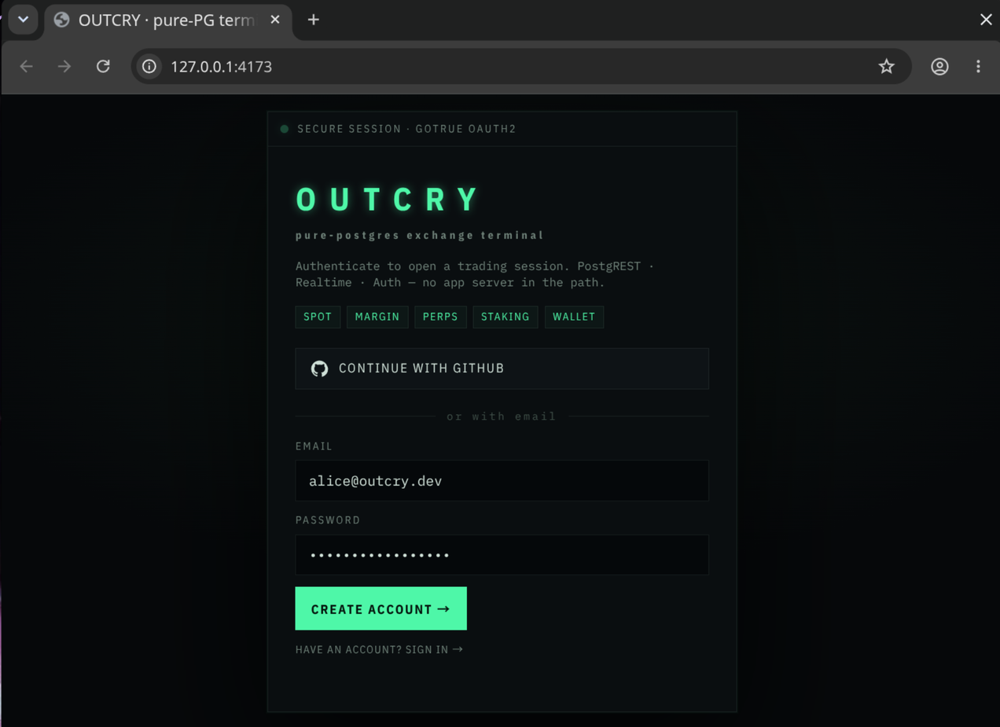
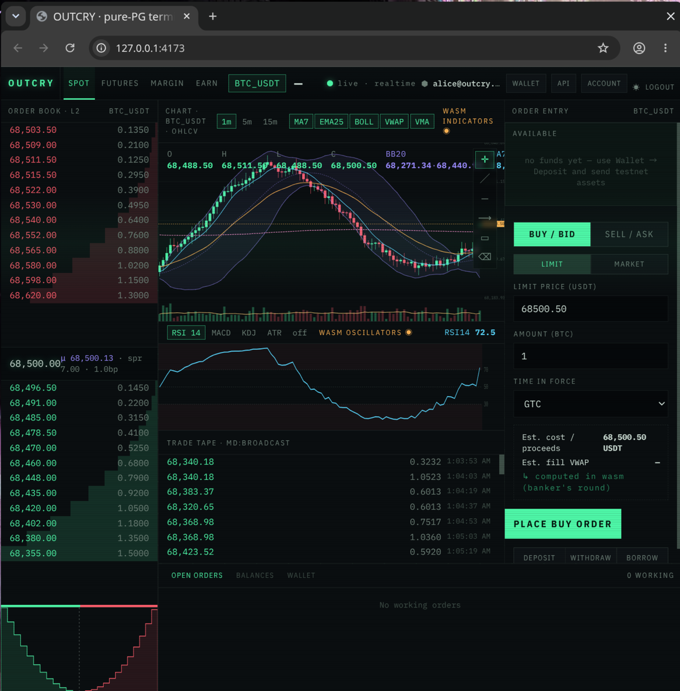
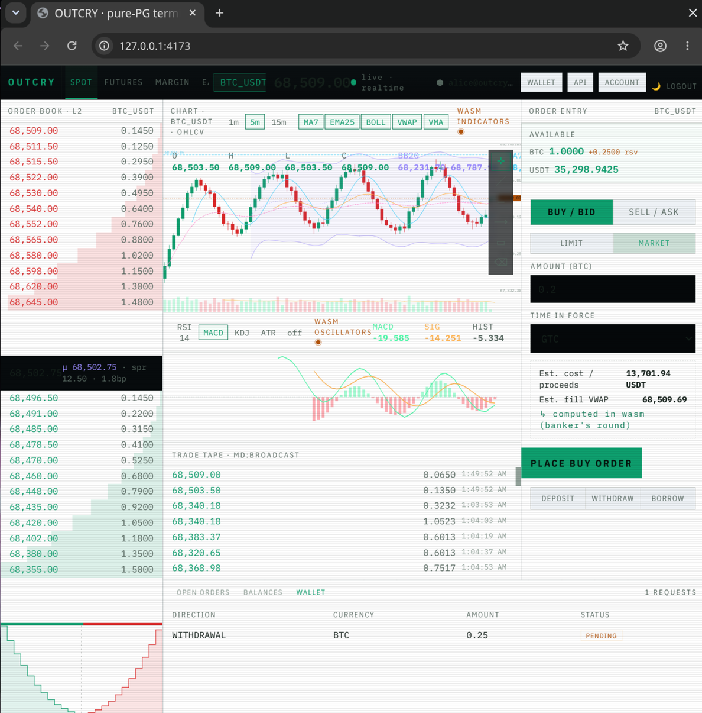
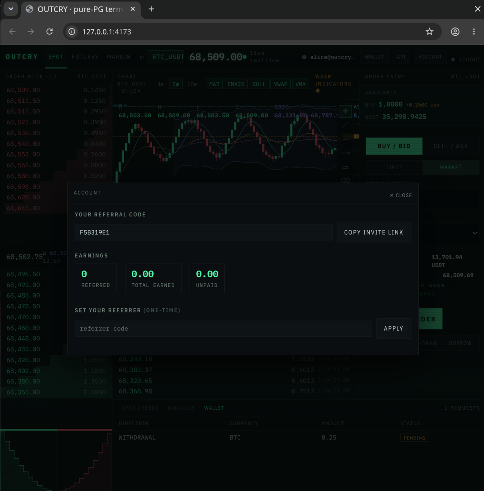

**English** · [中文](./01-onboarding-and-security.md)

# Chapter 1: Onboarding, Authentication & Security Baseline

[← Wiki Master Index](./README.en.md) · **Chapter 1** · [Next: On-Chain Deposits →](./02-deposit-guide.en.md)

---

Before sending your first satoshi or stablecoin to the exchange, understanding how your account is provisioned, how your session is isolated by PostgreSQL Row-Level Security (RLS), and how the terminal layout is organized will prevent costly operational mistakes.

---

## 1.1 Accessing the Terminal & Backend Configuration

- **Local stack**: Open `http://127.0.0.1:4173` after starting local Supabase and the static web server.
- **Hosted GitHub Pages demo**: Open the Pages link carrying `?api=<Supabase_URL>&anon=<Publishable_Key>`.

> [!TIP]
> **Automatic Backend Persistence**: When opened with `?api=...&anon=...` query parameters, the terminal persists `oc_api` and `oc_anon` in `localStorage` so subsequent page reloads or new tabs automatically connect to the same Supabase backend.

---

## 1.2 Anatomy of the Auth Gate

When you open the terminal without an active session, the full-screen **Auth Gate** greets you:

1. **Session Status Bar (`SECURE SESSION · GOTRUE OAUTH2`)**: The blinking phosphor-green indicator confirms WebAssembly initialization and GoTrue connectivity.
2. **Unified Product Badges (`SPOT` · `MARGIN` · `PERPS` · `STAKING` · `WALLET`)**: All five modules share a single unified cash ledger — no cumbersome internal sub-account transfers required.
3. **GitHub OAuth2 (`CONTINUE WITH GITHUB`)**:
   - **Delegated 2FA Architecture**: Rather than storing sensitive TOTP secrets inside the exchange database, OUTCRY delegates strong multi-factor authentication (hardware FIDO2 Passkeys / YubiKeys / WebAuthn) directly to hardened identity providers like GitHub and Google.
4. **Email & Password Credentials (`EMAIL` / `PASSWORD`)**: Supports instant email + password sign-up and sign-in.
5. **Mode Toggle (`NO ACCOUNT? REGISTER →`)**: Switches the primary button between sign-in (`ACCESS TERMINAL →`) and instant account creation (`CREATE ACCOUNT →`).

---

## 1.3 Step-by-Step: Registering a New Trading Account in 30 Seconds

Let's walk through registering our live demonstration trader **`alice@outcry.dev`**:

1. Click **`NO ACCOUNT? REGISTER →`** at the bottom of the Auth Gate. The primary green action button changes to **`CREATE ACCOUNT →`**.
2. Enter your email address in **`EMAIL`** (e.g., `alice@outcry.dev`).
3. Enter a strong password in **`PASSWORD`** (at least 12 characters recommended; minimum 6 characters enforced by GoTrue).

4. Click **`CREATE ACCOUNT →`**.

### What Happens Under the Hood? (Single-Transaction Provisioning)
In one atomic PostgreSQL transaction triggered by `handle_new_user()`, the database:
- Creates your encrypted `auth.users` record and mints an `authenticated` **JWT `access_token`**;
- Creates your `app_entity` (assigning a unique `pub_id`), `app_user` mapping, `instrument_account`, and default `USDT` / `EUR` currency accounts (additional asset accounts like `BTC` and `USDC` are opened automatically upon your first confirmed deposit via migration `00150`);
- Binds your JWT to Supabase Realtime (`sb.realtime.setAuth(access_token)`), enforcing **PostgreSQL RLS** so you receive real-time order and wallet events strictly for your own entity.

---

## 1.4 Terminal Orientation: The 8 Core Workspaces

Immediately after registration, you enter the live trading workspace:

| Zone | Panel Name | Function |
|---|---|---|
| **① Top Header (Left)** | Product & Symbol Bar | Switch between `SPOT` (main view) and modal workspaces (`FUTURES`, `MARGIN`, `EARN`), pick active trading pairs (`BTC_USDT`), and monitor the live last-trade price ticker. |
| **② Top Header (Right)** | Connectivity & Account Controls | `● live · realtime` confirms live WebSocket streaming; `⬢ alice@outcry...` displays your identity; followed by **`WALLET`**, **`API`**, **`ACCOUNT`**, **`Wiki`**, **`☀`** (Day/Night toggle), and **`LOGOUT`**. |
| **③ Left Column** | `ORDER BOOK · L2` & Depth | Coral asks (top, ascending away from mid), phosphor-green bids (bottom, descending), mid price, **WASM Microprice $\mu$**, spread in bps, bid/ask imbalance bar, and cumulative step-depth chart. **Click any price row to auto-populate the order ticket!** |
| **④ Center Main** | `CHART · BTC_USDT · OHLCV` | `1m` / `5m` / `15m` candlesticks with WASM-computed `MA7`, `EMA25`, `BOLL`, `VWAP`, `VMA` overlays and **6 persistent drawing tools** on the right edge. |
| **⑤ Center Sub-Pane** | `WASM OSCILLATORS` | Toggle between `RSI 14`, `MACD`, `KDJ`, `ATR`, or `off`. |
| **⑥ Center Bottom** | `TRADE TAPE · MD:BROADCAST` | Live time-and-sales stream flashing green on upticks and coral on downticks. |
| **⑦ Right Column** | `ORDER ENTRY` | Live **`AVAILABLE`** balance & reserved hold (`+rsv`) bar, `BUY / SELL`, `LIMIT / MARKET`, price/amount inputs, `GTC / IOC / FOK` selector, WASM cost/VWAP preview, submit button, and `DEPOSIT | WITHDRAW | BORROW` shortcuts. |
| **⑧ Bottom Span** | `BLOTTER` | Three real-time operational tabs: **`OPEN ORDERS`** (with one-click `✕` cancel), **`BALANCES`** (`Total / Reserved / Available`), and **`WALLET`** (withdrawal request status). |

---

## 1.5 Theme Customization & Referral Program

### Daytime Light Theme (`☀` / `🌙`)
Click **`☀`** in the top-right header to toggle between the default phosphor Night theme and the high-contrast **Daytime Light** theme (saved automatically in `localStorage`):

### Referral Code & Commission Tracking (`ACCOUNT`)
Click **`ACCOUNT`** in the top header to open the referral workspace:

- **`YOUR REFERRAL CODE`**: Copy your unique invite link (`?ref=F5B319E1`) via **`COPY INVITE LINK`**.
- **`EARNINGS`**: Tracks referred traders, total commissions accrued (`0.02%` default via ledger trigger `accrue_referral_commission()`), and unpaid balances awaiting operator payout.
- **`SET YOUR REFERRER (ONE-TIME)`**: Bind a friend's code once; self-referrals and circular loops are rejected at the database layer.

---

## 1.6 Four Pre-Trading Security Rules

> [!WARNING]
> 1. **Enable Hardware 2FA on Your OAuth2 Provider**: Use Passkeys / YubiKeys on your GitHub/Google account in production deployments.
> 2. **Copy API Secrets Offline Immediately**: Bot secrets in the `API` modal are hashed in PostgreSQL and never displayed a second time.
> 3. **Always Click `LOGOUT` on Shared Machines**: Explicitly clear the persisted JWT session when finished.
> 4. **Verify First 6 & Last 6 Characters of Every Blockchain Address**: Defend against clipboard-hijacking malware whenever copying deposit or withdrawal addresses.

---

**Previous: [← Wiki Master Index](./README.en.md)** · **Next: [Chapter 2: On-Chain Deposits →](./02-deposit-guide.en.md)**
