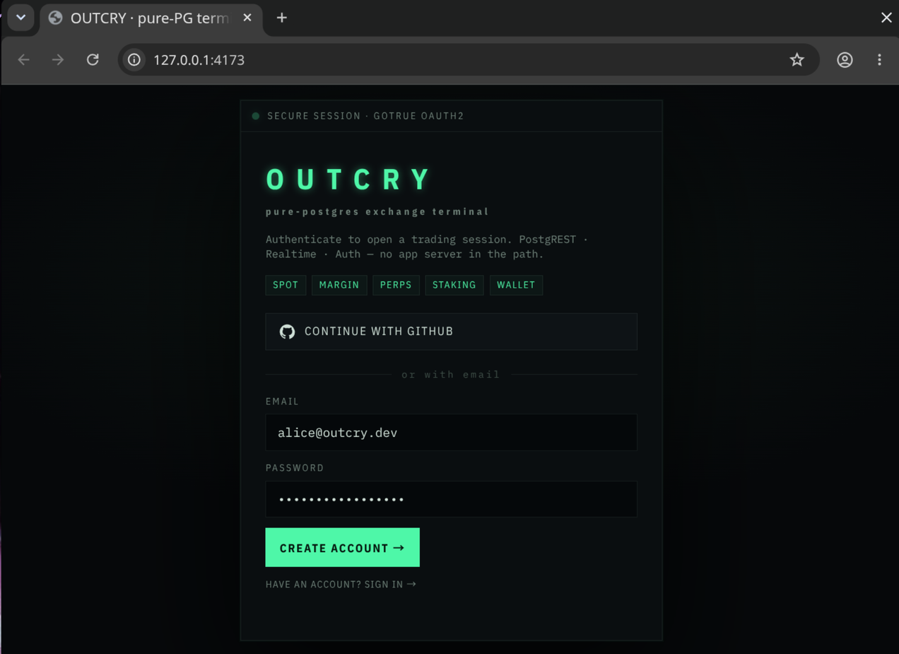
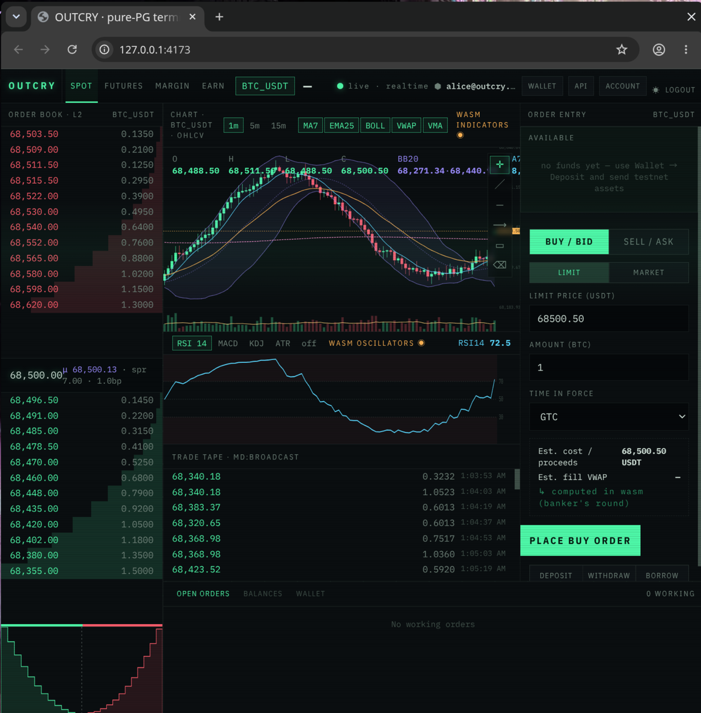
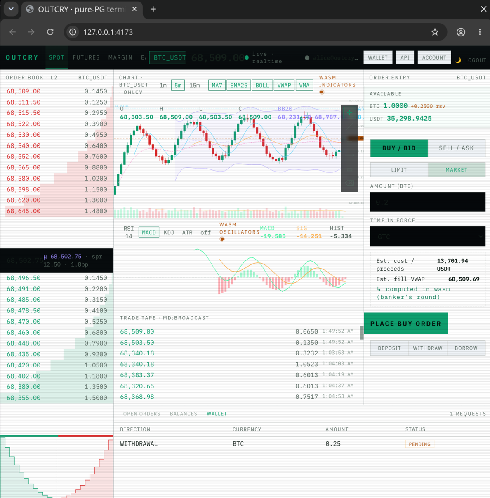
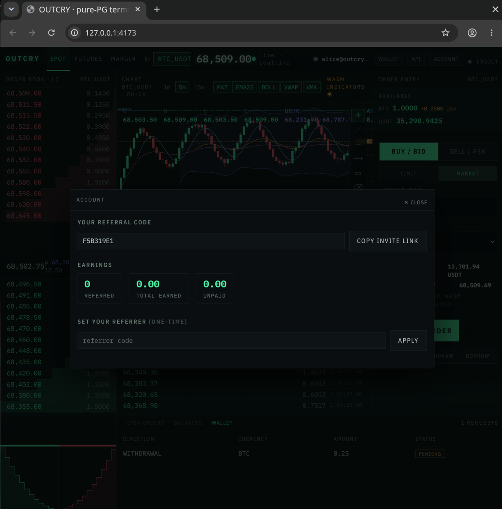

[English](./01-onboarding-and-security.en.md) · **中文**

# 第 1 章：账户注册、登录鉴权与安全基线

[← Wiki 总目录](./README.md) · **第 1 章** · [下一章：链上充值全流程精讲 →](./02-deposit-guide.md)

---

在正式向交易所转入第一笔资产之前，理解账户是如何创建、会话如何隔离、界面各个面板承担什么职责，是保障资金与操作零失误的第一步。本章将带你完成账户注册、登录鉴权、终端全貌导览与基础账户设置。

---

## 1.1 访问交易终端与配置后端连接

### 访问地址
- **本地运行环境**：启动本地栈后，在浏览器访问 `http://127.0.0.1:4173`
- **托管在线演示**：访问 GitHub Pages 托管终端（URL 自动携带 `?api=<Supabase_URL>&anon=<Publishable_Key>` 参数）

> [!TIP]
> **连接参数自动记忆机制**：OUTCRY 终端支持通过 URL 查询参数 `?api=https://...&anon=sb_publishable_...` 指向任意托管或自建的 Supabase 后端。首次打开后，前端会将 `api` 与 `anon` 持久化保存在浏览器的 `localStorage`（键名 `oc_api`、`oc_anon`）中，后续刷新页面无需重复拼接参数。如果页面底部黄字提示 `No backend reachable`，请检查本地 `supabase start` 是否运行或 URL 参数是否正确。

---

## 1.2 登录门禁（Auth Gate）详解

打开终端首页后，首先看到的是全屏鉴权门禁（Auth Gate）：

门禁界面从上到下依次包含以下核心元素：

1. **会话安全状态栏（`SECURE SESSION · GOTRUE OAUTH2`）**：左上角闪烁的荧光绿圆点代表客户端已加载 WebAssembly 引擎并与 Supabase GoTrue 鉴权服务建立连接。
2. **产品矩阵徽章（`SPOT` · `MARGIN` · `PERPS` · `STAKING` · `WALLET`）**：展示同一个账户登录后即可直接使用的五大核心业务模块，无需在多个子账户间繁琐划转现货与钱包资金。
3. **GitHub OAuth2 一键登录（`CONTINUE WITH GITHUB`）**：
   - 在生产或托管演示环境中，推荐优先使用 GitHub / Google 等 OAuth2 提供方登录。
   - **委托式双因素认证（Delegated 2FA）设计**：OUTCRY 刻意不在数据库内自建容易泄露种子的 TOTP 二次验证表，而是直接复用你在 GitHub / Google 账号上已开启的硬件安全密钥（YubiKey / Passkey / WebAuthn）与二次验证。
4. **邮箱与密码表单（`EMAIL` / `PASSWORD`）**：支持标准邮箱 + 密码直接创建账户或登录。
5. **模式切换按钮（`NO ACCOUNT? REGISTER →`）**：点击可在「已有账户登录（`ACCESS TERMINAL →`）」与「新用户注册（`CREATE ACCOUNT →`）」两种模式之间一键切换。

---

## 1.3 手把手实操：30 秒注册新交易账户

下面我们以新交易员 **`alice@outcry.dev`** 为例，完成账户注册：

### 操作步骤
1. 在登录门禁底部，点击 **`NO ACCOUNT? REGISTER →`**。此时主按钮文案会变为荧光绿色的 **`CREATE ACCOUNT →`**，底部切换链接变为 `HAVE AN ACCOUNT? SIGN IN →`。
2. 在 **`EMAIL`** 输入框填入你的邮箱地址（例如 `alice@outcry.dev`）。
3. 在 **`PASSWORD`** 输入框填入高强度密码（建议至少 12 位，包含大小写字母、数字与符号；最低不少于 6 位）。

4. 点击 **`CREATE ACCOUNT →`**。

### 底层瞬间发生了什么？（数据库级透明揭秘）
当你点击 `CREATE ACCOUNT →` 的一瞬间，PostgreSQL 内部通过触发器 `handle_new_user()` 在**同一个原子事务**内为你自动完成了整套开户流程：
- 在 `auth.users` 中创建加密凭证并签发包含你专属 `sub`（用户 UUID）的 **JWT 访问令牌（`access_token`）**；
- 在交易所核心账本中创建专属客户实体 `app_entity`（分配全局唯一公开标识 `pub_id`）及映射记录 `app_user`；
- 自动开通现货交易账户 `instrument_account` 以及默认计价资金账户（`USDT`、`EUR`；其他币种如 `BTC`、`USDC` 会在首次链上充值到账时由 `00150` 迁移自动开通）；
- 自动将你的 JWT 注入 Supabase Realtime 私有流（`sb.realtime.setAuth(access_token)`），借助 **PostgreSQL 行级安全策略（RLS）** 确保你只能读取和收到属于你自己的订单、余额与充提通知。

---

## 1.4 初识交易终端：八大核心工作区全导览

注册成功后无需等待人工审核，界面会自动进入主交易终端。新账户尚未入金时的完整视图如下：

为了后续章节操作顺畅，请先熟悉屏幕上从上到下、从左到右的 **八大核心区域**：

| 区域位置 | 面板名称 | 核心功能说明 |
|---|---|---|
| **① 顶部导航栏（左）** | 产品与品种切换区 | `SPOT`（现货主界面）、`FUTURES`（永续合约弹窗）、`MARGIN`（全仓杠杆弹窗）、`EARN`（质押理财弹窗），右侧紧跟当前启用的交易对按钮（如 `BTC_USDT`）与最新成交价 Ticker。 |
| **② 顶部导航栏（右）** | 连接态与账户工具栏 | `● live · realtime` 表示毫秒级 WebSocket 行情与私有流已接通；`⬢ alice@outcry...` 显示当前登录身份；右侧依次为 **`WALLET`**（充提币）、**`API`**（量化密钥）、**`ACCOUNT`**（邀请返佣）、**`☀`**（日/夜主题切换）与 **`LOGOUT`**（安全登出）。 |
| **③ 左侧通栏** | `ORDER BOOK · L2`（十档/十二档盘口与深度图） | 上半部珊瑚红为卖盘（Asks，越往下价格越低、越接近盘口），下半部荧光绿为买盘（Bids，越往上价格越高）；中间显示中间价、**WASM 微观公允价 $\mu$** 与点差（bp）；最底部为买卖累计阶梯深度图（Depth Chart）。**点击任意一档价格可自动填入右侧下单框！** |
| **④ 中央主图** | `CHART · BTC_USDT · OHLCV` | 支持 `1m` / `5m` / `15m` K 线周期切换，以及由客户端 **WebAssembly** 实时计算的 `MA7`、`EMA25`、`BOLL`（布林带）、`VWAP`、`VMA` 叠加指标；主图右侧悬浮竖排 **6 个专业画线工具**。 |
| **⑤ 中央副图** | `WASM OSCILLATORS`（摆动指标副图） | 支持一键切换 `RSI 14`、`MACD`、`KDJ`、`ATR` 或 `off`（隐藏副图释放主图高度）。 |
| **⑥ 中央下部** | `TRADE TAPE · MD:BROADCAST`（实时逐笔成交带） | 按时间倒序滚动展示全市场最新撮合成交的价格（上涨闪绿、下跌闪红）、成交数量与精确到秒的时间戳。 |
| **⑦ 右侧面板** | `ORDER ENTRY`（下单报单台） | 顶部 **`AVAILABLE`** 实时展示你的可用余额与冻结金额（`+rsv`）；新账户为空时会贴心提示 `no funds yet — use Wallet → Deposit and send testnet assets`。下方为买卖方向、限价/市价、价格/数量、`GTC/IOC/FOK` 选择器、WASM 预估成本/均价预览框、主下单按钮，以及 `DEPOSIT | WITHDRAW | BORROW` 快捷入口。 |
| **⑧ 底部横栏** | `BLOTTER`（订单、资产与充提工作台） | 包含三个高频页签：**`OPEN ORDERS`**（当前挂单管理与一键撤单 `✕`）、**`BALANCES`**（各币种总额/冻结/可用明细）、**`WALLET`**（近期提币/钱包请求状态追踪）。 |

---

## 1.5 个性化设置：日间亮色主题与邀请返佣

### 日间 / 夜间主题一键切换（`☀` / `🌙`）
终端默认采用低眼疲劳的「磷光暗黑终端（Night）」主题。如果你在明亮的办公环境下看盘，点击右上角 **`☀`** 按钮即可切换为高对比度的「日间亮色（Daytime Light）」主题（再次点击 **`🌙`** 即可切回暗黑模式，偏好会自动保存在本地浏览器）：

### 邀请码与返佣中心（`ACCOUNT`）
点击顶部导航栏的 **`ACCOUNT`** 按钮，可打开账户推荐返佣面板：

- **`YOUR REFERRAL CODE`**：系统为你自动生成的专属推荐码（如上图 `F5B319E1`）。点击 **`COPY INVITE LINK`** 可一键复制带 `?ref=F5B319E1` 参数的邀请链接；好友通过该链接打开并注册后，输入框会自动带入你的推荐码。
- **`EARNINGS`**：实时展示已邀请人数（`REFERRED`）、累计返佣收入（`TOTAL EARNED`）与待结算返佣（`UNPAID`）。好友每一笔产生账本流水的交易都会通过数据库触发器 `accrue_referral_commission()` 自动按比例（默认 `0.02%`）为你计提佣金。
- **`SET YOUR REFERRER (ONE-TIME)`**：如果你是通过朋友推荐注册的，可在此填入对方的推荐码并点击 **`APPLY`**。注意：**推荐关系一经绑定终身有效、不可篡改，且系统禁止自我推荐或循环互绑**。

---

## 1.6 开户后的四条核心安全准则

> [!WARNING]
> 在进入下一章开始充值前，请务必牢记以下四条安全铁律：
> 1. **优先启用强身份认证**：在生产部署中优先使用开启了硬件 Passkey / 2FA 的 OAuth2 账号登录；若使用邮箱密码，切勿与其他网站共用密码。
> 2. **保管好一次性 API Secret**：在 `API` 面板创建的机器人密钥（详见 [第 6 章](./06-api-and-bot-guide.md)）仅在生成瞬间明文展示一次，切勿提交到公开 Git 仓库或发送至聊天群。
> 3. **公共设备务必点击 `LOGOUT`**：由于会话采用持久化 JWT，在非本人电脑上操作完毕后，必须点击右上角 **`LOGOUT`** 主动销毁本地会话。
> 4. **认准唯一域名与链网络**：钓鱼网站最常见的手法是伪造充值弹窗篡改收款地址。每次复制充值地址后，请养成**核对地址前 6 位与后 6 位字符**的习惯。

---

**上一篇：[← Wiki 总目录](./README.md)** · **下一篇：[第 2 章：链上充值全流程精讲（Deposit） →](./02-deposit-guide.md)**
