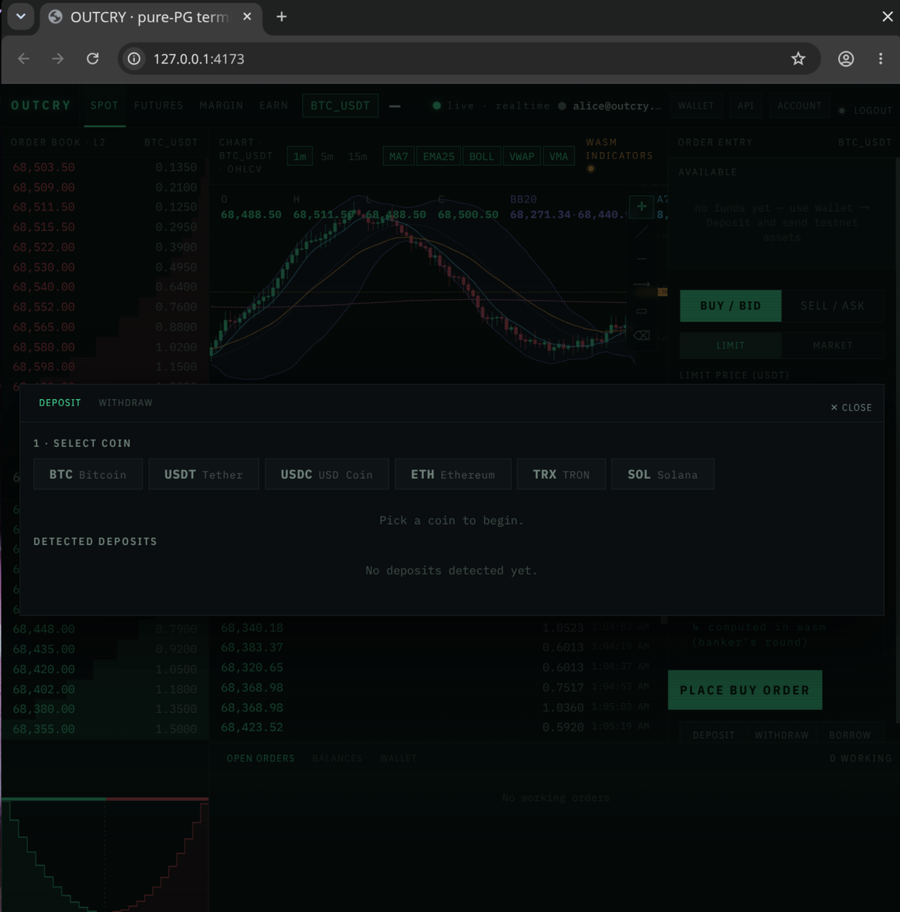
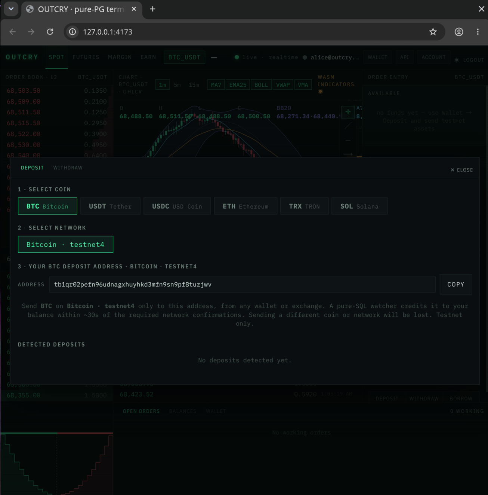
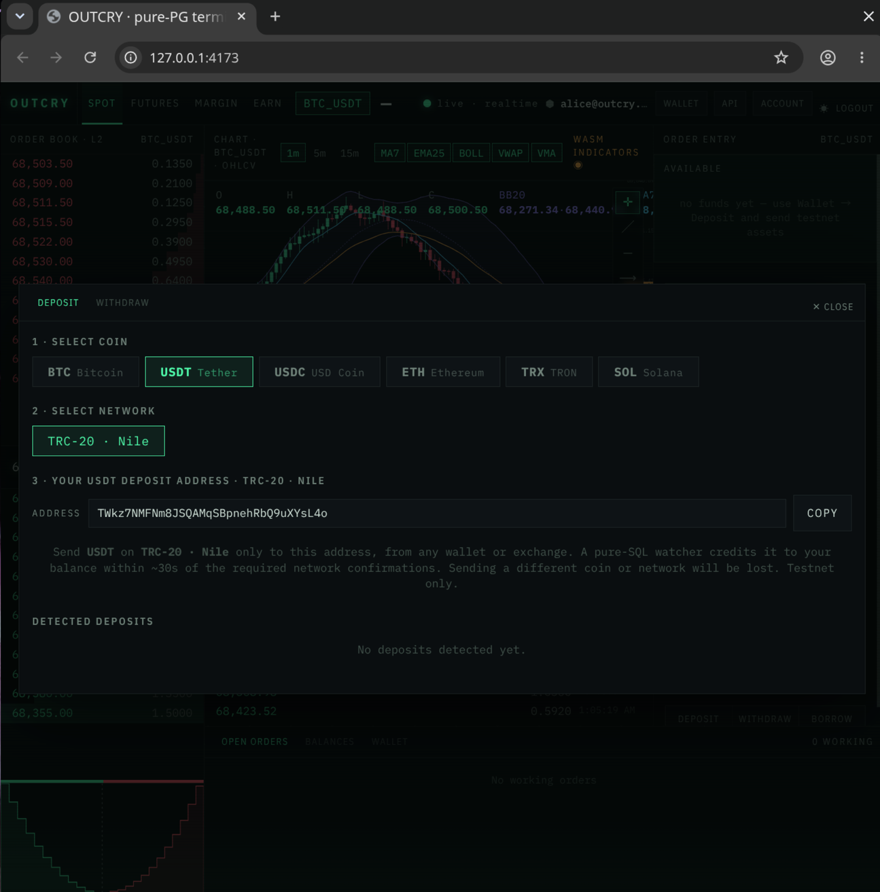
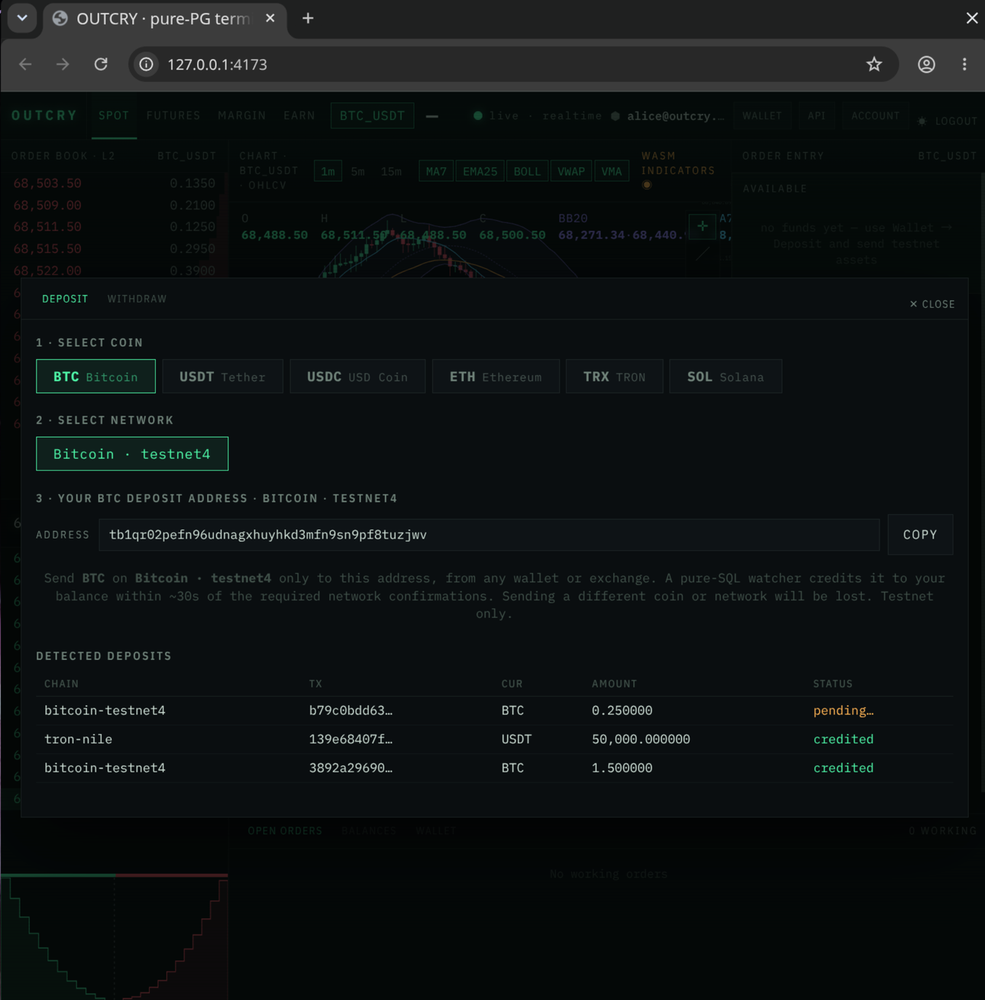
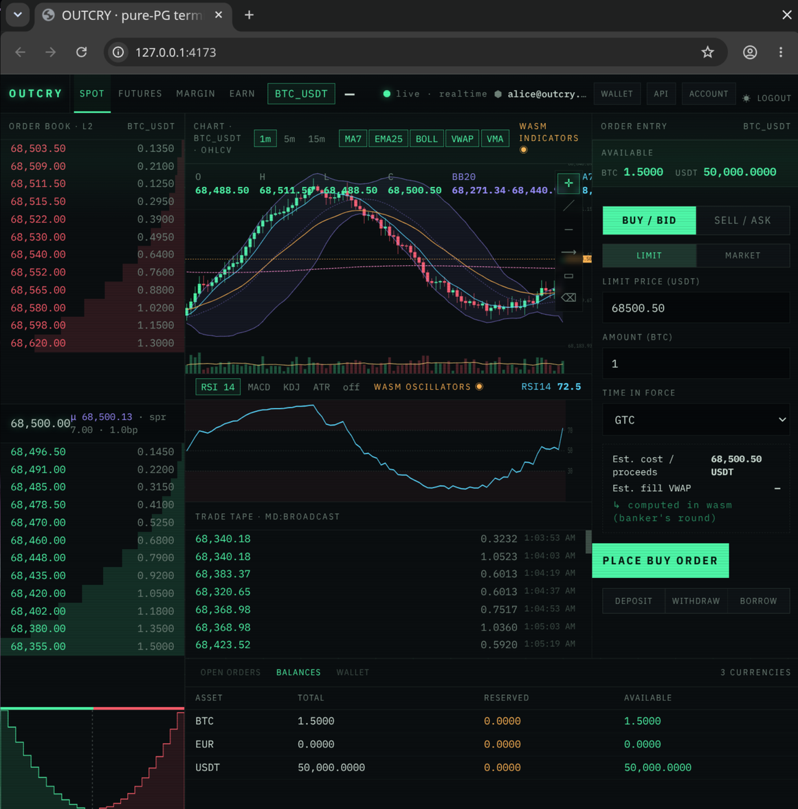

**English** · [中文](./02-deposit-guide.md)

# Chapter 2: On-Chain Deposits (From Derived Address to Credited Balance)

[← Previous: Onboarding & Security](./01-onboarding-and-security.en.md) · [Wiki Master Index](./README.en.md) · [Next: Spot Trading Masterclass →](./03-spot-trading-masterclass.en.md)

---

A newly created account starts with zero balance. In OUTCRY, **no customer cash can be minted without on-chain backing** — every spendable unit is backed by a verified `chain_deposit` record and continuously audited by `custody_reconcile()`.

This chapter walks you through deriving your unique per-user deposit address, choosing the exact blockchain network, sending testnet coins, and understanding how confirmation gating protects your balance.

---

## 2.1 Supported Coins, Networks & Confirmation Rules

Before initiating any external transfer, verify that **the network selected in your external wallet matches the network selected in OUTCRY 100%**:

| Step 1: Select Coin | Step 2: Select Network | Address Format | Token Contract / Asset | Required Confirmations | Credited Exchange Currency |
|---|---|---|---|---|---|
| **BTC** (`Bitcoin`) | **`Bitcoin · testnet4`** | `tb1q…` (Native SegWit Bech32 P2WPKH, 42 chars) | Bitcoin Testnet4 native BTC (8 dec) | **2 blocks** | **`BTC`** |
| **USDT** (`Tether`) | **`TRC-20 · Nile`** | `T…` (Base58Check TRON address, 34 chars) | TRON Nile TRC-20 USDT (`TXYZopYRdj2D9XRtbG411XZZ3kM5VkAeBf`, 6 dec) | **19 blocks** | **`USDT`** |
| **USDC** (`USD Coin`) | **`SPL · devnet`** | Base58 Solana pubkey (32–44 chars) | Solana Testnet/Devnet SPL USDC (`4zMMC9srt5Ri5X14GAgXhaHii3GnPAEERYPJgZJDncDU`, 6 dec) | **32 / Finalized** | **`USDC`** |
| **ETH** (`Ethereum`) | **`Sepolia`** | `0x…` (42-char EVM address) | Ethereum Sepolia native ETH (18 dec) | **12 blocks** | **`EUR`** (demo mapping) |
| **TRX** (`TRON`) | **`Nile`** | `T…` (Base58Check TRON address) | TRON Nile native TRX (6 dec) | **19 blocks** | **`EUR`** (demo mapping) |
| **SOL** (`Solana`) | **`devnet`** | Base58 Solana pubkey | Solana Testnet native SOL (9 dec) | **32 confirmations** | **`EUR`** (demo mapping) |

> [!IMPORTANT]
> **Currency Mapping Note**: Depositing **BTC**, **USDT**, or **USDC** credits **`BTC`**, **`USDT`**, and **`USDC`** 1:1. Native testnet gas tokens (**ETH / TRX / SOL**) map to **`EUR`** in the demo configuration. To trade `BTC_USDT` spot or `BTC-PERP` futures, deposit **BTC** (`Bitcoin · testnet4`) and **USDT** (`TRC-20 · Nile`).

---

## 2.2 How Pure-PostgreSQL Address Derivation & Detection Works

```mermaid
sequenceDiagram
  participant U as Browser (OUTCRY Terminal)
  participant PG as PostgreSQL (RPC + Vault + pg_cron)
  participant BC as Blockchain (Bitcoin testnet4 / Tron Nile / Sepolia / Solana)

  U->>PG: 1. Select coin & network → RPC my_deposit_address(chain)
  PG->>PG: 2. Deterministically derive per-user HD address from Vault seed<br/>Persist in user_chain_wallet & watched_address (idempotent)
  PG-->>U: 3. Return dedicated deposit address (e.g. tb1qr02p...)
  U->>BC: 4. Broadcast transfer from external wallet / faucet
  loop Every 20–30s via pg_cron
    PG->>BC: 5. poll_bitcoin / poll_evm / poll_tron / poll_solana
    PG->>PG: 6. credit_chain_deposit(chain, txid, vout, addr, cur, amt, confs)
    alt Confirmations < chain threshold (e.g. BTC 1/2)
      PG-->>U: Record row; UI shows amber pending… (balance unchanged)
    else Confirmations ≥ chain threshold (e.g. BTC 2/2)
      PG->>PG: Auto-open currency account + MASTER→User credit + set credited_at
      PG-->>U: UI shows green credited; AVAILABLE updates in real time!
    end
  end
```

- **Permanent Per-User Address**: Calling `my_deposit_address` is idempotent — your deposit address for a given chain never changes across sessions.
- **Zero Double-Crediting**: `chain_deposit` enforces a `UNIQUE (chain, txid, log_index)` constraint. Even if polled thousands of times, an on-chain output can only transition to `credited` **once**.

---

## 2.3 Step-by-Step Walkthrough: Depositing BTC & USDT

### Step 1: Open `Wallet → Deposit`
Click **`WALLET`** in the top header (or **`DEPOSIT`** at the bottom of the Order Entry panel):



---

### Step 2: Generate Your Dedicated BTC (`Bitcoin · testnet4`) Address
1. Under **`1 · SELECT COIN`**, click **`BTC Bitcoin`**.
2. **`Bitcoin · testnet4`** is selected automatically, and PostgreSQL derives your native SegWit `tb1q…` address in real time:



3. Click **`COPY`** to copy your address (`tb1qr02pefn96udnagxhuyhkd3mfn9sn9pf8tuzjwv` for Alice). Notice the **`tb1q`** prefix — confirming it is a Bitcoin Testnet4 native SegWit address.

---

### Step 3: Generate Your Dedicated USDT (`TRC-20 · Nile`) Address
1. Click **`USDT Tether`** under **`1 · SELECT COIN`**.
2. **`TRC-20 · Nile`** is selected automatically, displaying your derived TRON `T…` address (`TWkz7NMFNm8JSQAMqSBpnehRbQ9uXYsL4o`):



> [!CAUTION]
> **Memo / Tag Rule**: When only `ADDRESS` is shown, you have a dedicated derived address and **no Memo is needed**. If a shared-treasury chain displays a **`MEMO / TAG`** row (e.g., `oc4`), you **must** include that exact memo string in your on-chain transfer or the deposit cannot be attributed to your account!

---

### Step 4: Send Testnet Funds & Track `pending…` vs `credited`
Acquire free testnet coins from a Bitcoin Testnet4 faucet / Sparrow Wallet or the TRON Nile faucet (`nileex.io`) and send them to your copied address. Within ~30 seconds, inspect **`DETECTED DEPOSITS`**:



Compare the two statuses in the screenshot above:
- 🟠 **`pending…` (`0.250000 BTC`)**: Detected on-chain at 1/2 confirmations. To protect against block reorganizations, **`pending…` deposits are NOT added to your spendable balance yet**. Wait for the 2nd block confirmation and it will credit automatically.
- 🟢 **`credited` (`50,000.000000 USDT` & `1.500000 BTC`)**: Required confirmations reached; funds have been atomically credited from `MASTER` into your account! Hover over any truncated `TX` hash to inspect the full 64-character `txid`.

---

### Step 5: Verify Credited Balances in the Blotter
Close the modal (`✕ CLOSE`) and open the **`BALANCES`** tab in the bottom blotter:



- **`AVAILABLE` bar**: Shows **`BTC 1.5000   USDT 50,000.0000`**.
- **`BALANCES` table**: Confirms `Total = 1.5000 BTC` (excluding the unconfirmed `0.25 BTC` still in `pending…`) and `50,000.0000 USDT`, with `0.0000` reserved.

---

## 2.4 Pre-Deposit 7-Point Anti-Loss Checklist

- [ ] **1. Exact Coin Match**: Sending mapped `BTC` or `USDT`, not an unmapped custom token.
- [ ] **2. Exact Network Match**: `TRC-20 · Nile` vs `ERC-20` — never cross-send across incompatible chains.
- [ ] **3. Testnet Mode Verified**: External wallet is on **Testnet4 / Nile / Sepolia / Devnet**, never Mainnet.
- [ ] **4. First 6 & Last 6 Character Check**: Visually confirm the pasted address matches the OUTCRY modal.
- [ ] **5. Memo / Tag Check**: Include `MEMO / TAG` verbatim whenever displayed by the UI.
- [ ] **6. Small Test Transfer First**: For large amounts, verify a tiny test transfer reaches `credited` first.
- [ ] **7. Sufficient External Gas**: Keep a small amount of Nile TRX or Sepolia ETH in your external wallet to pay token transfer gas.

---

**Previous: [← Chapter 1: Onboarding & Security](./01-onboarding-and-security.en.md)** · **Next: [Chapter 3: Spot Trading Masterclass →](./03-spot-trading-masterclass.en.md)**
