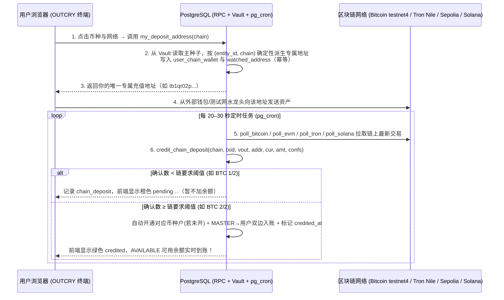
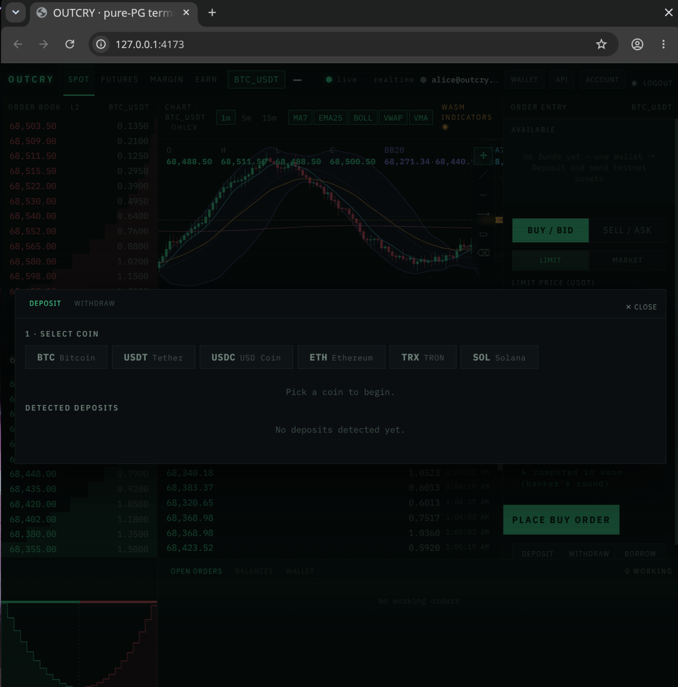
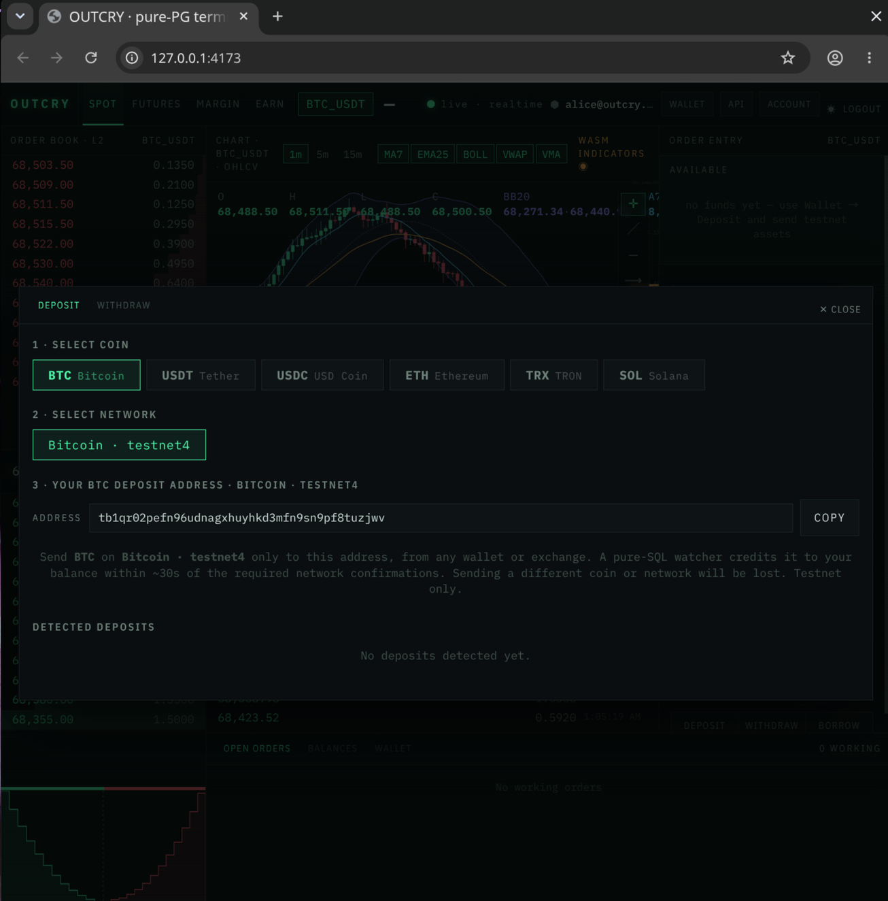
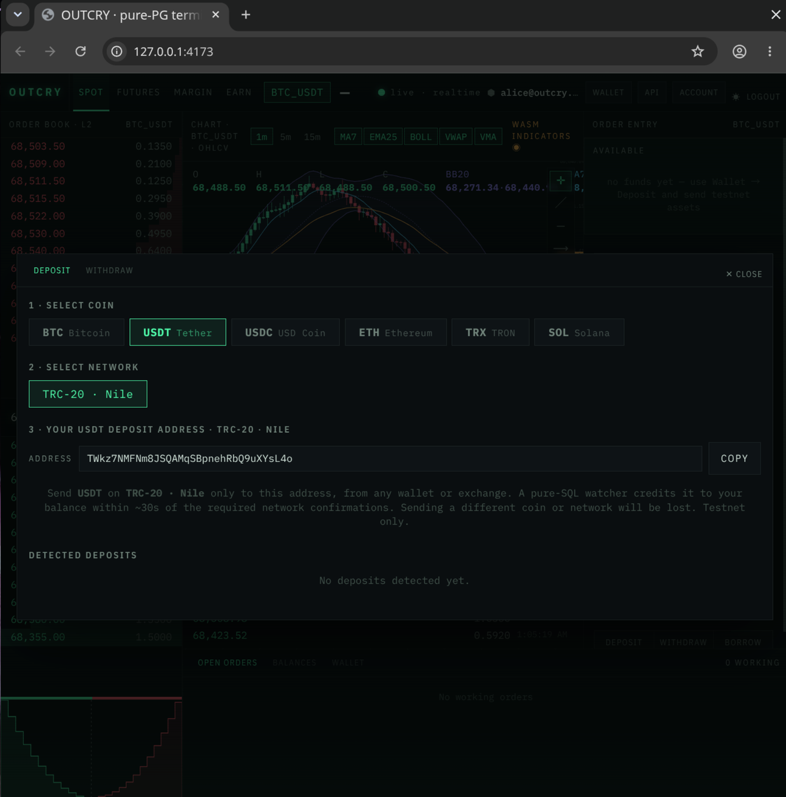
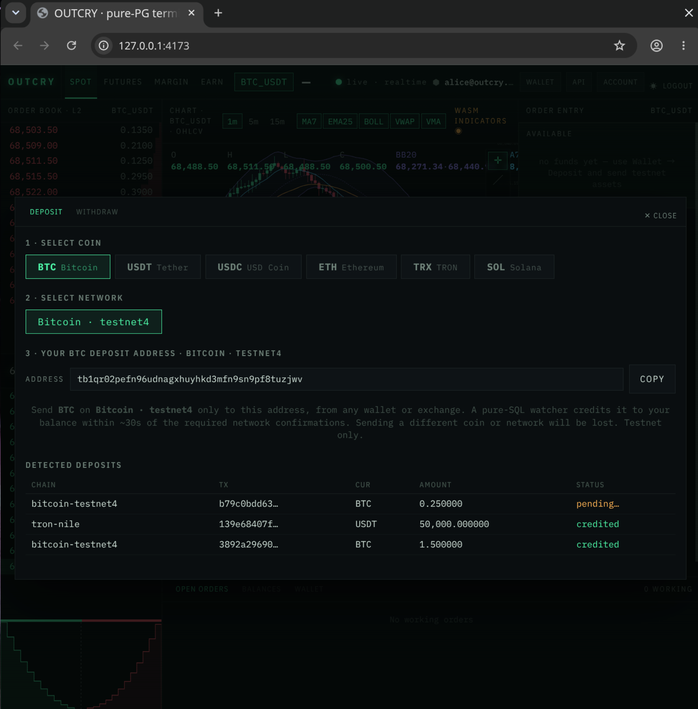
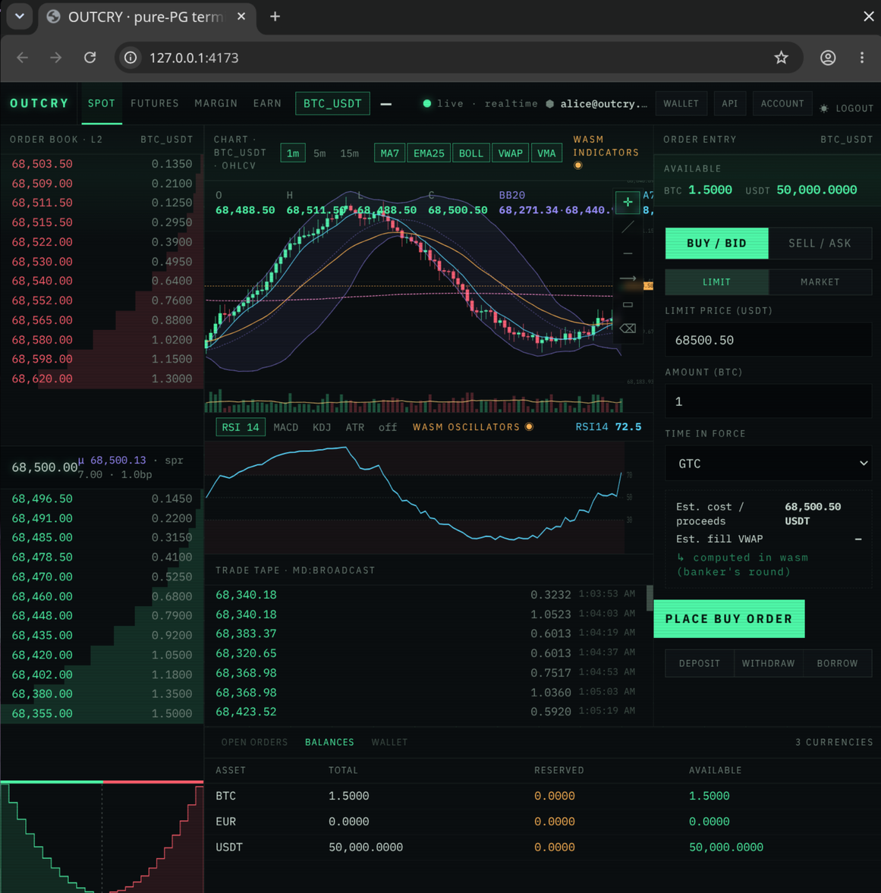

[English](./02-deposit-guide.en.md) · **中文**

# 第 2 章：链上充值全流程精讲（Deposit）

[← 上一章：账户注册与安全基线](./01-onboarding-and-security.md) · [Wiki 总目录](./README.md) · [下一章：现货交易全流程精讲 →](./03-spot-trading-masterclass.md)

---

新注册的交易所账户初始余额为 `0`。在 OUTCRY 中，**任何客户资金都不能凭空铸造**——每一分可用余额都必须拥有真实的链上充值交易（`chain_deposit`）背书，并通过托管对账不变量（`custody_reconcile()`）的持续核验。

本章将完整拆解如何获取你的专属充值地址、支持哪些币种与区块链网络、外部转账后系统如何自动监测确认并入账，以及如何避免链上充提中最常见的「充错链丢币」事故。

---

## 2.1 支持的充值币种、网络与入账规则一览

在发起任何链上转账前，**第一铁律是确保「发送方选择的区块链网络」与「OUTCRY 充值面板选定的网络」100% 一致**。当前支持的全部充值通道如下：

| 步骤 1：选择币种 (`Coin`) | 步骤 2：选择网络 (`Network`) | 地址格式特征 | 测试网代币合约 / 资产说明 | 要求的区块确认数 | 到账后计入的交易所币种 |
|---|---|---|---|---|---|
| **BTC** (`Bitcoin`) | **`Bitcoin · testnet4`** | `tb1q…`（原生隔离见证 Bech32 P2WPKH，42 字符） | Bitcoin Testnet4 原生测试币（8 位精度） | **2 个区块确认** | **`BTC`** |
| **USDT** (`Tether`) | **`TRC-20 · Nile`** | `T…`（Base58Check 波场地址，34 字符） | TRON Nile 测试网 TRC-20 USDT 合约：`TXYZopYRdj2D9XRtbG411XZZ3kM5VkAeBf`（6 位精度） | **19 个区块确认** | **`USDT`** |
| **USDC** (`USD Coin`) | **`SPL · devnet`** | Base58 Solana 公钥地址（32–44 字符） | Solana 测试网 SPL USDC Mint：`4zMMC9srt5Ri5X14GAgXhaHii3GnPAEERYPJgZJDncDU`（6 位精度） | **32 个确认 / Finalized** | **`USDC`** |
| **ETH** (`Ethereum`) | **`Sepolia`** | `0x…`（42 字符十六进制 EVM 地址） | Ethereum Sepolia 原生测试 ETH（18 位精度） | **12 个区块确认** | **`EUR`**（演示环境映射） |
| **TRX** (`TRON`) | **`Nile`** | `T…`（Base58Check 波场地址，34 字符） | TRON Nile 原生测试 TRX（6 位精度） | **19 个区块确认** | **`EUR`**（演示环境映射） |
| **SOL** (`Solana`) | **`devnet`** | Base58 Solana 公钥地址（32–44 字符） | Solana 测试网原生 SOL（9 位精度） | **32 个确认** | **`EUR`**（演示环境映射） |

> [!IMPORTANT]
> **注意原生 Gas 币与稳定币的账本映射区别**：
> - 充值 **BTC**、**USDT**、**USDC** 会 **1:1 计入对应的 `BTC`、`USDT`、`USDC` 现货账户**（其中 `BTC_USDT` 是当前主交易对，建议优先充值 **BTC** 与 **USDT**）。
> - 充值原生测试币 **ETH / TRX / SOL** 在当前配置中按演示规则映射入账至 `EUR` 账户。

---

## 2.2 底层原理：无网关的纯数据库 HD 地址派生与监听

很多用户好奇：没有后台微服务，OUTCRY 怎么知道哪笔链上转账是打给我的？

- **一人一链一固定地址（幂等持久）**：无论你打开充值弹窗多少次，同一账户在同一条链上调用 `my_deposit_address` 返回的地址**永远固定不变**，你可以放心地将它保存到自己外部钱包的常用地址簿中。
- **防重复入账保证**：底层表 `chain_deposit` 在 `(chain, txid, log_index)` 上建有唯一约束。即便区块浏览器或 RPC 节点被轮询成百上千次，同一笔链上输出也**绝不可能重复入账第二次**。

---

## 2.3 手把手实操：获取 BTC 与 USDT 充值地址并完成入金

### 第 1 步：打开充值面板（两种入口任选）
登录交易终端后，你可以通过以下任一入口唤起充值窗口：
- **入口 A（顶部全局栏）**：点击右上角 **`WALLET`** 按钮（默认即停留在绿色的 `DEPOSIT` 页签）；
- **入口 B（下单区快捷栏）**：点击右侧 `ORDER ENTRY` 面板底部的 **`DEPOSIT`** 按钮。

打开后的初始充值面板如下图所示：

---

### 第 2 步：获取 BTC（`Bitcoin · testnet4`）专属原生隔离见证地址
1. 在 **`1 · SELECT COIN`** 区域，点击 **`BTC Bitcoin`** 按钮。
2. 由于 BTC 当前仅开放唯一官方测试网通道，系统会自动为你选中 **`2 · SELECT NETWORK`** 下的 **`Bitcoin · testnet4`**，并在瞬间完成库内 secp256k1 公钥压缩、`HASH160` 与 BIP-173 Bech32 编码，展示 **`3 · YOUR BTC DEPOSIT ADDRESS · BITCOIN · TESTNET4`**：

3. 点击地址框右侧的 **`COPY`** 按钮复制完整地址（界面右下角会弹出 `Copied` 提示）。
   - 在本演示中，系统为 `alice@outcry.dev` 派生的专属地址为：`tb1qr02pefn96udnagxhuyhkd3mfn9sn9pf8tuzjwv`。
   - **自检小技巧**：所有 Bitcoin Testnet4 原生隔离见证地址均以 **`tb1q`** 开头（全小写，长度 42 位）。如果你手上拿的是 `bc1q…` 或 `1…`、`3…` 开头的主网钱包，说明你的外部钱包还没切到 Testnet4 网络！

---

### 第 3 步：获取 USDT（`TRC-20 · Nile`）专属波场充值地址
既然我们要交易 `BTC_USDT` 现货或开立 `BTC-PERP` 永续合约，通常还需要充值稳定币 `USDT` 作为报价与保证金资产：
1. 在 **`1 · SELECT COIN`** 区域点击 **`USDT Tether`**。
2. 系统自动选中 **`TRC-20 · Nile`** 网络，并展示你的专属波场测试网地址（以大写字母 **`T`** 开头，共 34 位）：

3. 点击 **`COPY`** 复制该 `T…` 地址（图中为 `TWkz7NMFNm8JSQAMqSBpnehRbQ9uXYsL4o`）。

> [!CAUTION]
> **关于 Memo / Tag（备注标签）的特别提醒**：
> - 当你在第 3 步看到仅显示 **`ADDRESS`** 输入框时，说明该链当前运行在**独立派生地址模式（Derived Per-User Address）**，直接向该地址转账即可，无需填写 Memo。
> - 如果某条共享金库链在界面第 3 步额外显示了 **`MEMO / TAG`** 行（格式如 `oc4`）及黄色警告 `⚠ You must include this memo when sending`，则你在外部钱包转账时**必须原样填入该 Memo**！漏填或填错 Memo 将导致系统无法识别这笔钱属于哪个用户。

---

### 第 4 步：从外部测试网钱包或水龙头发送资产

在测试网环境下，你可以通过公共水龙头（Faucet）免费领取测试币，或从自己的测试网钱包直接发起转账：
- **Bitcoin Testnet4**：使用支持 Testnet4 的钱包（如 Sparrow Wallet 开启 `--network testnet4`）或访问 `mempool.space/testnet4` 生态水龙头，向你的 `tb1q…` 地址发送测试 BTC。
- **TRON Nile（TRC-20 USDT）**：安装 TronLink 插件并将网络切换至 **Nile Testnet**，在 Nile 官方水龙头（`nileex.io/join/getJoinPage`）免费领取测试 TRX（作能量/带宽手续费）与测试 TRC-20 USDT（合约地址 `TXYZopYRdj2D9XRtbG411XZZ3kM5VkAeBf`），然后向你的 `T…` 充值地址发起转账。
- **Ethereum Sepolia / Solana Devnet**：分别使用 MetaMask（切至 Sepolia）或 Phantom（开启 Developer Mode 切至 Testnet/Devnet）向面板分配的地址发送测试币。

---

### 第 5 步：追踪充值进度——读懂 `pending…` 与 `credited` 的本质区别

外部钱包广播交易后，大约在 **20–30 秒**内（一个 `pg_cron` 轮询周期），你就能在充值面板底部的 **`DETECTED DEPOSITS`** 表格中看到系统捕获到的链上记录！

请仔细观察下方这张极具代表性的实操截图——它同时展示了**「已入账（`credited`）」**与**「确认中（`pending…`）」**两种状态：

让我们逐行拆解这张表里的每一列信息：

1. **`CHAIN`（来源网络）**：记录资产来自哪条区块链（如 `bitcoin-testnet4`、`tron-nile`）。
2. **`TX`（链上交易哈希 TxID）**：截断显示前 10 位哈希；**将鼠标悬停在哈希上即可查看完整 64 位 TxID**，方便你复制到区块链浏览器（如 `mempool.space/testnet4/tx/<txid>`）核验区块高度。
3. **`CUR` 与 `AMOUNT`**：识别出的入账币种与精确到小数点后 6 位的金额。
4. **`STATUS`（入账状态——最关键的一列！）**：
   - 🟠 **`pending…`（琥珀橙色，区块确认中）**：如图中第一行 `0.250000 BTC`，交易已被链上节点打包进第 1 个区块（1/2 确认），但尚未达到 `bitcoin-testnet4` 要求的 **2 个区块确认阈值**。为了防止区块链重组（Reorg）双花攻击，**处于 `pending…` 状态的资金绝不会提前计入你的可用余额**，你无需任何人工催促，静候下一个区块爆出即可自动转正。
   - 🟢 **`credited`（磷光绿色，已安全入账）**：如图中第二行 `50,000.000000 USDT` 与第三行 `1.500000 BTC`，区块确认数已达标，数据库已自动执行从 `MASTER` 到你个人资金账户的双边记账转账！

---

### 第 6 步：核验到账后的账户资产总览（`Balances`）

点击充值弹窗右上角的 **`✕ CLOSE`** 关闭弹窗，然后点击底部工作台的 **`BALANCES`** 页签，进行入金后的最终核验：

核对以下两处数字完全吻合，即代表充值流程 100% 圆满完成：
1. **右上角 `AVAILABLE` 实时资产条**：由最初的空白提示变为醒目的 **`BTC 1.5000   USDT 50,000.0000`**。
2. **底部 `BALANCES` 资产明细表**：
   - **`TOTAL`（总余额）**：你在该币种下的全部已确认账面资产（注意：刚才那笔还在 `pending…` 的 `0.25 BTC` 没有算进来，所以 `BTC` 总额严格等于已确认的 `1.5000`！）。
   - **`RESERVED`（冻结余额）**：当前挂单或待审提币锁定的资金，此时尚未下单，全为 `0.0000`。
   - **`AVAILABLE`（可用余额）**：`TOTAL - RESERVED`，即你此刻可以立即用来挂单交易、开合约、做质押或提币的自由资金。

---

## 2.4 充值防丢币「七大黄金核对清单」

在点击外部钱包「发送（Send）」按钮的前一秒，请务必逐项默念以下 7 条检查项：

- [ ] **1. 币种一致**：面板选的是 `USDT`，外部钱包发出的确实是 `USDT`，而不是其他同名假币或未映射合约。
- [ ] **2. 网络一致**：面板选的是 `TRC-20 · Nile`，外部钱包绝不能选成 ERC-20、BEP-20 或 Arbitrum。跨链错充在去中心化账本上无法自动找回！
- [ ] **3. 测试网 vs 主网一致**：确认外部钱包处于对应的 **Testnet4 / Nile / Sepolia / Devnet**，切勿将真金白银的主网资产打入测试网地址。
- [ ] **4. 首尾字符复核**：粘贴地址后，肉眼核对地址的**前 6 位**与**后 6 位**字符与 OUTCRY 面板完全一致（防范剪贴板木马篡改地址）。
- [ ] **5. Memo / Tag 检查**：若界面展示了 `MEMO / TAG` 字段，确认已在发送方备注栏准确填写 `oc<数字>` 且前后无多余空格。
- [ ] **6. 大额先做小额试水**：首次向新派生的地址大额入金前，建议先发送一笔极小金额走通「广播 → `pending…` → `credited`」全链路，确认无误后再发大额。
- [ ] **7. 留足发送端矿工费**：在外部钱包发送 TRC-20 USDT 或 ERC-20 代币时，确保外部钱包里有少量原生币（Nile TRX 或 Sepolia ETH）支付链上 Gas。

---

**上一篇：[← 第 1 章：账户注册、登录鉴权与安全基线](./01-onboarding-and-security.md)** · **下一篇：[第 3 章：现货交易全流程精讲（Spot Trading） →](./03-spot-trading-masterclass.md)**
