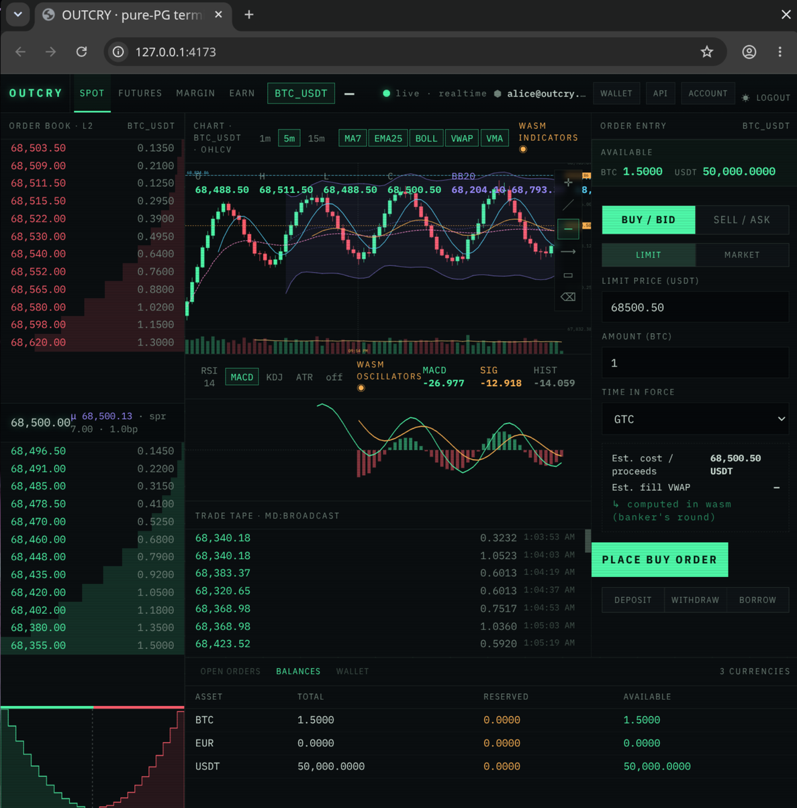
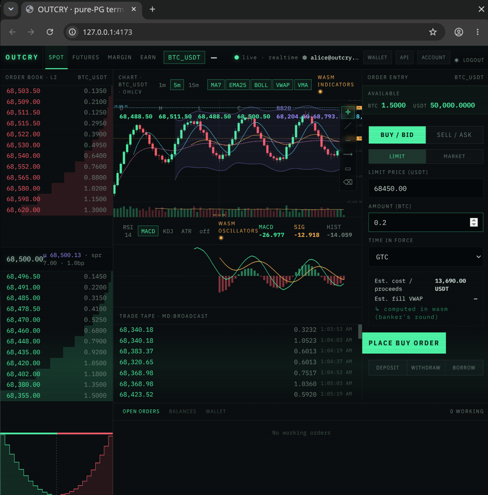
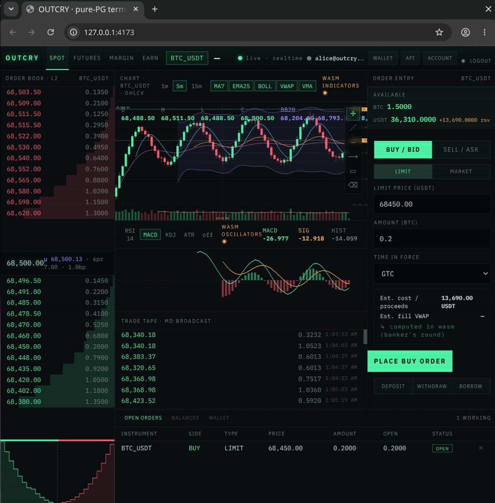
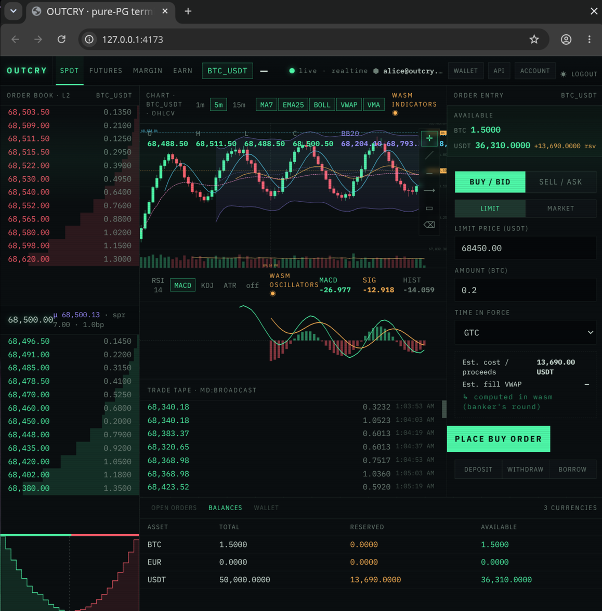
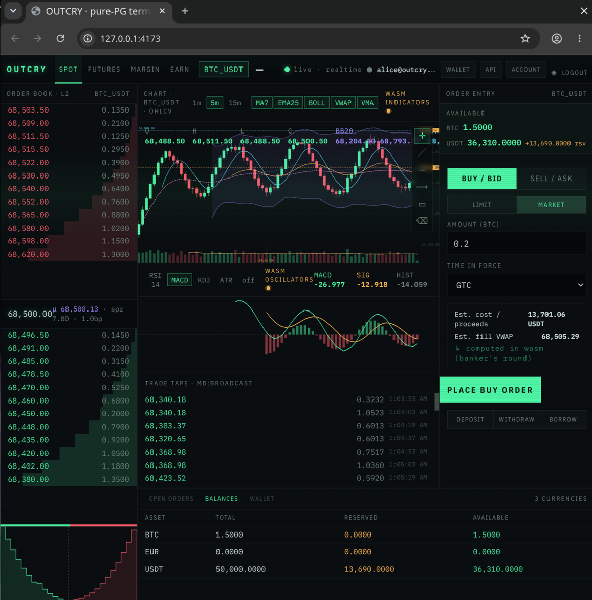
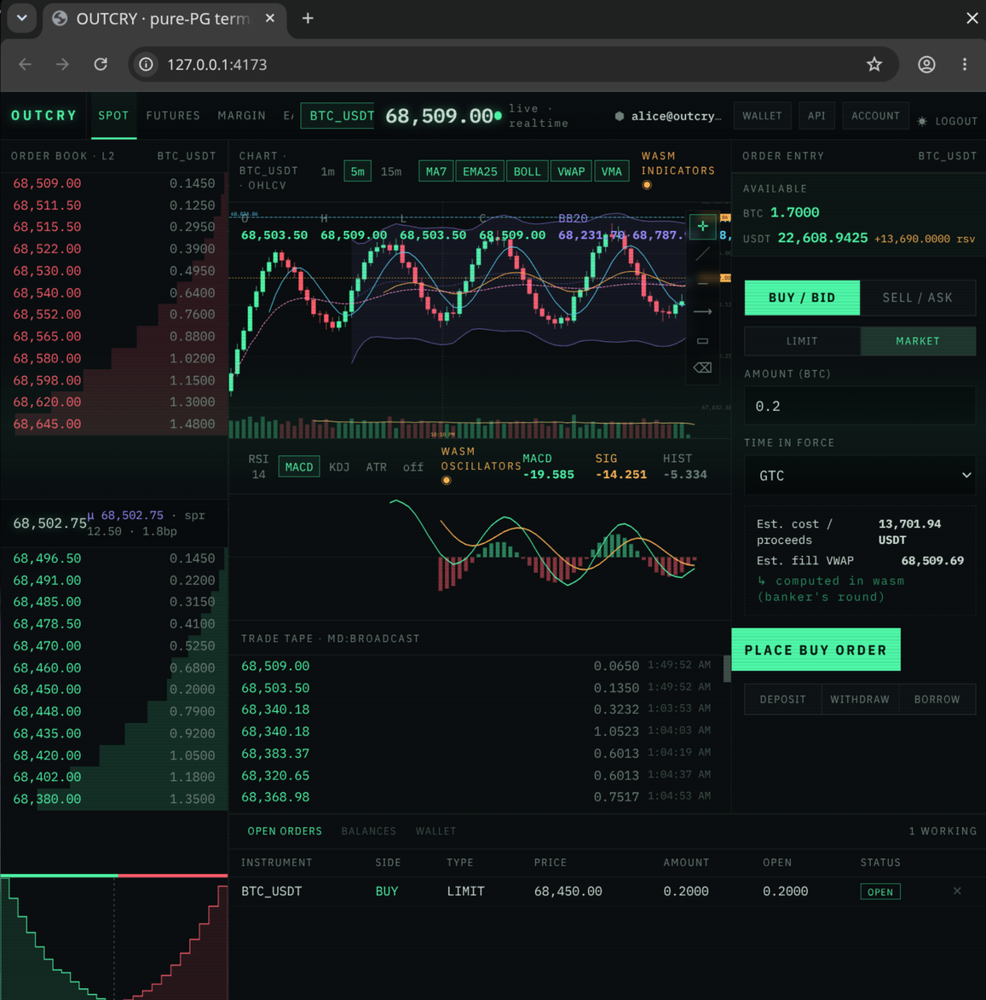
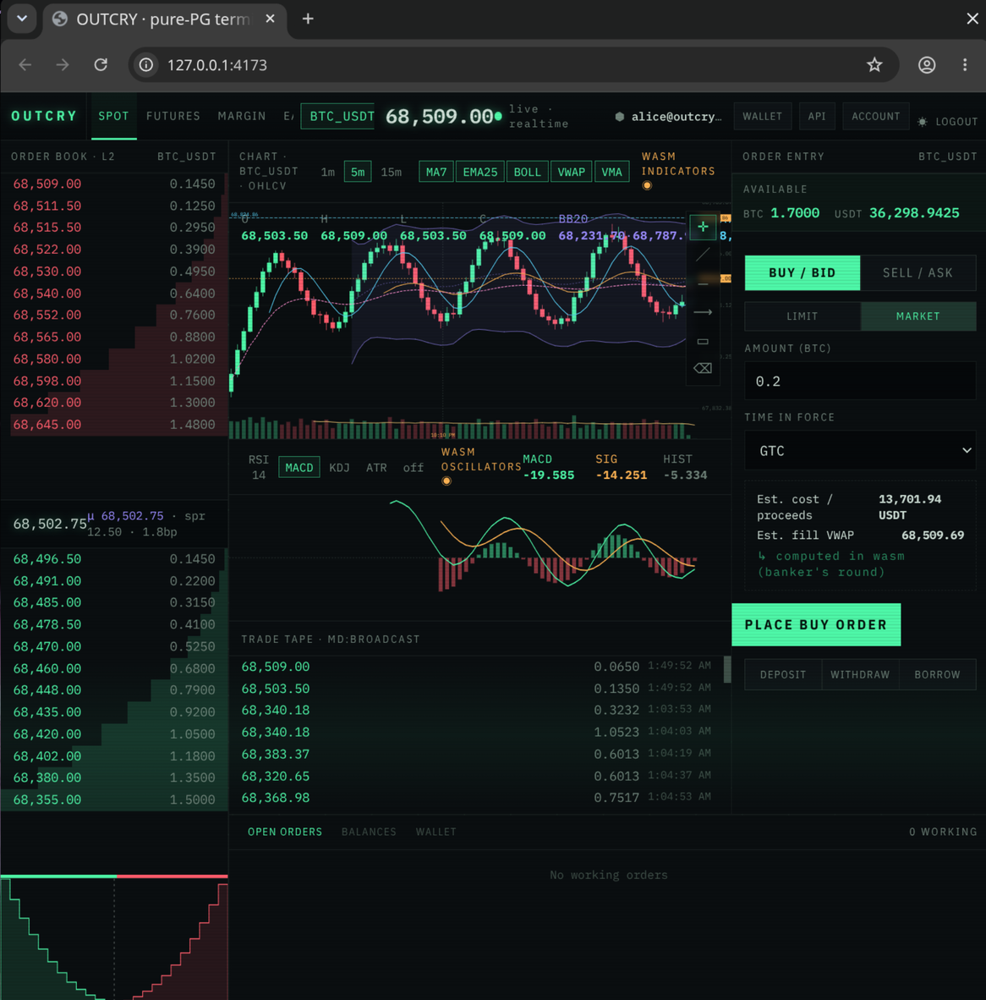

**English** · [中文](./03-spot-trading-masterclass.md)

# Chapter 3: Spot Trading Masterclass

[← Previous: On-Chain Deposits](./02-deposit-guide.en.md) · [Wiki Master Index](./README.en.md) · [Next: On-Chain Withdrawals →](./04-withdrawal-guide.en.md)

---

With **`1.5000 BTC`** and **`50,000.0000 USDT`** credited, you are ready to trade on the live `BTC_USDT` order book. This chapter covers L2 market microstructure, WebAssembly technical indicators and chart drawing tools, order types and Time-in-Force (`GTC` / `IOC` / `FOK`), and three hands-on executions: **resting a Limit Buy (balance freeze), sweeping multiple ask levels with a Market Buy (VWAP verification), and cancelling an open order (instant unfreeze)**.

---

## 3.1 Reading the L2 Order Book & Market Microstructure

1. **Asks (Top Coral Ladder)**: Resting sell limit orders sorted lowest-ask-at-bottom (**Best Ask = `68,503.50`**, size `0.1350 BTC`). Background bars show cumulative sell depth.
2. **Bids (Bottom Phosphor-Green Ladder)**: Resting buy limit orders sorted highest-bid-at-top (**Best Bid = `68,496.50`**, size `0.1450 BTC`).
3. **Mid Bar Microstructure Metrics**:
   - **Mid Price**: $\frac{68496.50 + 68503.50}{2} = 68,500.00$.
   - **Microprice ($\mu$, purple)**: Size-weighted fair price computed in WASM:
     $$\mu = \frac{V_{\text{bid}} \cdot P_{\text{ask}} + V_{\text{ask}} \cdot P_{\text{bid}}}{V_{\text{bid}} + V_{\text{ask}}}$$
   - **Spread (`spr 7.00 · 1.0bp`)**: Tight `1.0` basis-point (`0.01%`) top-of-book spread.
4. **Imbalance Strip & Step-Depth Chart**: Visualizes bid-vs-ask book pressure and cumulative depth across up to 30 levels per side.
5. **One-Click Price Fill**: **Click any bid or ask row in the L2 ladder to copy that exact price into `LIMIT PRICE` and recalculate your WASM cost preview!**

---

## 3.2 Technical Analysis: WASM Indicators & Chart Drawing Tools

Every indicator in OUTCRY runs locally inside `orderbook.wasm` at 60fps:

- **Resolutions**: Switch between **`1m`**, **`5m`**, and **`15m`** (backed by the pure-SQL `ohlcv` RPC + live `md:BTC_USDT` trade broadcast).
- **Main-Pane Overlays (multi-toggle)**: `MA7` (cyan), `EMA25` (amber), `BOLL` (20,2 violet envelope), `VWAP` (pink dashed), and `VMA` (volume SMA).
- **Oscillator Sub-Pane**: `RSI 14` (with 30/70 zones), `MACD` (12,26,9 histogram + signal), `KDJ` (9), `ATR` (14 volatility), or `off`.
- **6 Drawing Tools (persisted per symbol in `localStorage`)**: `✛` Crosshair, `╱` Trendline, `─` Horizontal Support/Resistance line, `⟶` Ray, `▭` Rectangle zone, and `⌫` Clear all.

---

## 3.3 Order Types & Time-in-Force (`GTC` / `IOC` / `FOK`)

### `LIMIT` vs `MARKET`
- **`LIMIT`**: Executes only at your limit price or better (`Buy ≤ Limit`, `Sell ≥ Limit`). Rests on the book as a **Maker** if non-marketable, or fills immediately as a **Taker** if crossing the spread.
- **`MARKET`**: Sweeps resting liquidity immediately (`IOC` enforced). For **`SELL MARKET`**, `amount` is base `BTC`; for **`BUY MARKET`**, WASM `marketBuyVwap(amount)` computes the required **USDT quote budget** (banker-rounded) and automatically releases any unspent rounding dust. *(Note: `STOP` and `STOP_LIMIT` orders are also supported via the PostgREST RPC API — see [Chapter 6](./06-api-and-bot-guide.en.md)).*

### Time-in-Force (`GTC` / `IOC` / `FOK`) Matrix

| TIF | Full Name | Execution Behavior | Ideal Use Case |
|---|---|---|---|
| **`GTC`** | Good-Til-Cancelled | Fills any immediately marketable portion and rests the remainder on the book until filled or manually cancelled (`✕`). | Passive bid layering, take-profit targets, market making. |
| **`IOC`** | Immediate-Or-Cancel | Fills as much as possible immediately at your limit price or better and **cancels any unfilled remainder on the spot** — never rests on the book. | **Institutional slippage-protected sweep!** (e.g., `LIMIT BUY @ 68,550 + IOC` sweeps the book immediately while capping worst-case price at `68,550`). |
| **`FOK`** | Fill-Or-Kill | Either **100% of the entire order quantity fills immediately** within your limit price, or the **entire order is cancelled atomically** with zero partial fills. | All-or-nothing arbitrage legs. |

---

## 3.4 Walkthrough A: Placing a Resting Limit Buy & Verifying Reserved Funds

Let's place a passive `GTC` Limit Buy for **`0.2 BTC`** at **`68,450.00 USDT`**:

1. Select **`BUY / BID`**, **`LIMIT`**, enter `68450.00` in **`LIMIT PRICE`**, `0.2` in **`AMOUNT`**, and keep **`GTC`**. WASM previews **`Est. cost / proceeds: 13,690.00 USDT`**:

2. Click **`PLACE BUY ORDER`**. Three UI zones update instantaneously:
   - The L2 bid ladder inserts **`68,450.00 | 0.2000`** between `68,460.00` and `68,448.00`;
   - `OPEN ORDERS (1 WORKING)` lists the live order with a cancel **`✕`** button;
   - `AVAILABLE` updates to **`USDT 36,310.0000 +13,690.0000 rsv`**.

3. Click **`BALANCES`** in the blotter to inspect the fundamental reservation identity:

$$\underbrace{50,000.0000}_{\text{Total}} = \underbrace{13,690.0000}_{\text{Reserved}} + \underbrace{36,310.0000}_{\text{Available}}$$

---

## 3.5 Walkthrough B: Multi-Level Market Buy Sweep & Exact VWAP Settlement

Now Alice wants **`0.2 BTC` immediately** at market:

1. Click **`MARKET`** in Order Entry (`0.2` BTC). Look closely at the WASM preview: **`Est. fill VWAP: 68,505.29`**, **`Est. cost / proceeds: 13,701.06 USDT`**!
   - Why `68,505.29` instead of Best Ask `68,503.50`? Because Best Ask only has `0.1350 BTC`! WASM walks two ask levels (`0.1350 @ 68,503.50` + `0.0650 @ 68,509.00`):
     $$\text{VWAP} = \frac{0.1350 \times 68,503.50 + 0.0650 \times 68,509.00}{0.2000} = 68,505.2875 \approx \mathbf{68,505.29}$$

> [!TIP]
> **Pro Tip — Price Band Guardrails & Marketable `LIMIT + IOC`**: When `instrument_risk.price_band_pct` (`±10%`) is active, submitting a raw `MARKET` order (`price=0`) may be blocked by `risk_price_band`. Institutional traders execute immediate sweeps using **`LIMIT` + a protective cap (e.g., `68,550.00`) + `IOC`**, which sweeps `68,503.50` and `68,509.00` identically while guaranteeing slippage protection!

2. Click **`PLACE BUY ORDER`**. In a single ACID transaction:
   - Best Ask `68,503.50` is completely consumed, and `68,509.00` shrinks from `0.2100` to `0.1450`;
   - `TRADE TAPE` prints `68,509.00 (0.0650)` and `68,503.50 (0.1350)`;
   - Alice's `BTC` jumps from `1.5000` to **`1.7000`**, and `USDT` settles at **`22,608.9425`** (`36,310.0000 - 13,701.0575` — returning the `0.0025` budget rounding dust automatically!).

---

## 3.6 Walkthrough C: One-Click Order Cancellation (`✕`) & Instant Unfreeze

In **`OPEN ORDERS`**, click **`✕`** on the resting `68,450.00` order:

The `68,450.00` bid vanishes from the L2 book, `OPEN ORDERS` drops to `0 WORKING`, and `13,690.0000 USDT` returns immediately to `Available` (`36,298.9425 USDT`).

---

## 3.7 Engine Safeguards: Risk Controls, STP & Banker's Rounding

- **Pre-Trade Risk Limits (`instrument_risk`)**: Enforces per-order `max_order_amount` (`100`), `max_order_notional` (`100,000 USDT`), and `price_band_pct` (`±10%` fat-finger protection around `reference_price`).
- **Self-Trade Prevention (STP)**: Orders from the same account never match against each other.
- **Price-Time Priority (FIFO)** & **Banker's Rounding (Round Half to Even)**: Ensures fair queue execution and unbiased financial rounding across every fill and fee calculation.

---

**Previous: [← Chapter 2: On-Chain Deposits](./02-deposit-guide.en.md)** · **Next: [Chapter 4: On-Chain Withdrawals →](./04-withdrawal-guide.en.md)**
