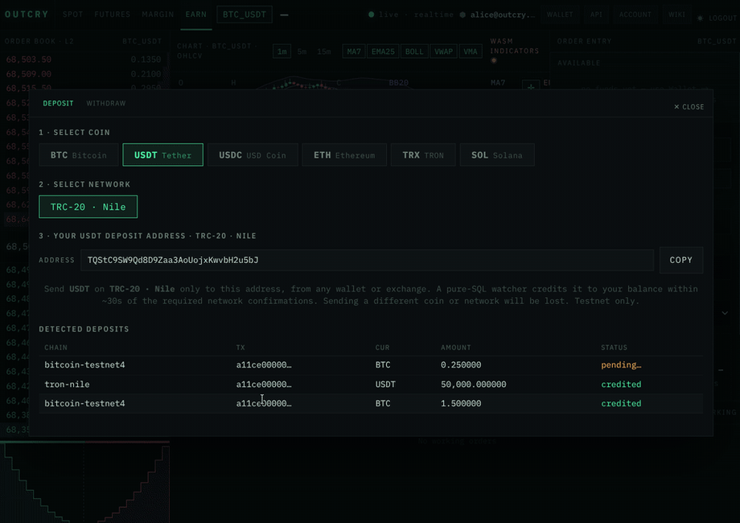
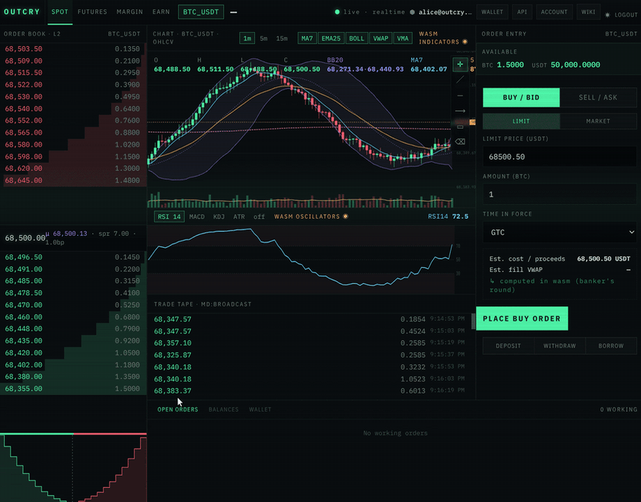
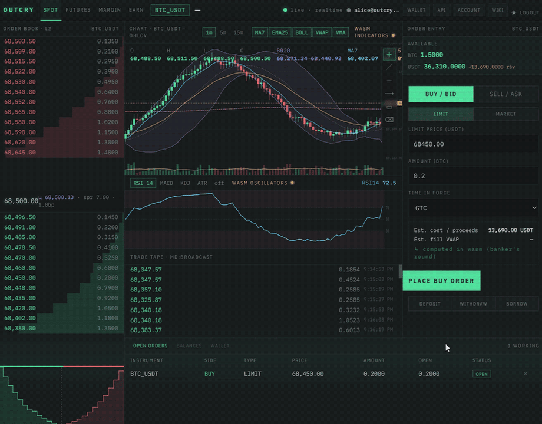
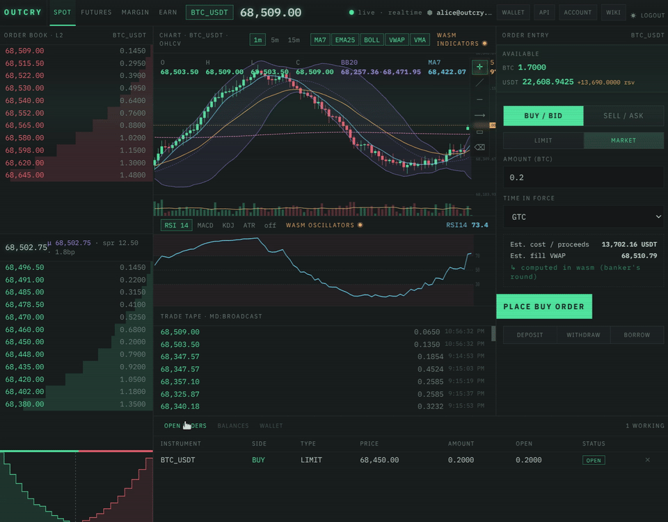

[English](./03-spot-trading-masterclass.en.md) · **中文**

# 第 3 章：现货交易全流程精讲（Spot Trading）

[← 上一章：链上充值全流程精讲](./02-deposit-guide.md) · [Wiki 总目录](./README.md) · [下一章：链上提币全流程精讲 →](./04-withdrawal-guide.md)

---

现在你的账户中已经拥有了已确认到账的 **`1.5000 BTC`** 与 **`50,000.0000 USDT`**。本章将带你深入理解 OUTCRY 交易终端的盘口微观结构、全套 WebAssembly 技术指标与画线工具、订单类型与生效时间策略（`GTC` / `IOC` / `FOK`），并通过三次真实下单实操，完整演示**「限价挂单冻结 → 市价跨档吃单交割 → 一键撤单解冻」**的每一个细节。

---

## 3.1 读懂盘口（Order Book · L2）与市场微观指标

在下单之前，专业交易员做的第一件事是读懂左侧 **`ORDER BOOK · L2`** 面板传递的实时流动性信息：

1. **卖盘（Asks，上半区珊瑚红）**：当前市场上所有等待卖出的限价挂单，按价格从高到低排列，**最底部紧贴中轴的那一档即为「卖一价（Best Ask）」**（例如 `68,503.50`，挂单量 `0.1350 BTC`）。每行右侧的半透明红色进度条代表从卖一累加到该档的**累计卖盘深度**。
2. **买盘（Bids，下半区荧光绿）**：当前市场上所有等待买入的限价挂单，按价格从高到低排列，**最顶部紧贴中轴的那一档即为「买一价（Best Bid）」**（例如 `68,496.50`，挂单量 `0.1450 BTC`）。
3. **盘口中轴核心三指标**：
   - **中间价（Mid Price）**：$\text{Mid} = \frac{\text{Best Bid} + \text{Best Ask}}{2} = \frac{68496.50 + 68503.50}{2} = 68,500.00$。
   - **微观公允价（Microprice $\mu$，紫色标注）**：由客户端 WASM 引擎按买一/卖一挂单量反比加权计算出的瞬时公允价：
     $$\mu = \frac{V_{\text{bid}} \cdot P_{\text{ask}} + V_{\text{ask}} \cdot P_{\text{bid}}}{V_{\text{bid}} + V_{\text{ask}}}$$
     当买一挂单远厚于卖一时，$\mu$ 会偏向卖一价，预示短期买盘支撑更强。
   - **点差与基点（`spr 7.00 · 1.0bp`）**：买卖一档绝对价差 `7.00 USDT`，折合相对点差仅 `1.0 bp`（万分之一，即 `0.01%`），代表盘口流动性极佳。
4. **盘口失衡条（Imbalance Bar）与阶梯深度图（Depth Chart）**：买盘下方有一条细长的绿红双色比例条，直观反映全盘口买卖挂单总量对比；最底部的阶梯多边形面积图则展示了左右两侧各 30 档的累计承接厚度。
5. **快捷填价技巧**：**直接用鼠标左键点击买卖盘任意一档价格行，该档价格会自动填入右侧下单面板的 `LIMIT PRICE` 输入框，并同步刷新预估成交金额！**

---

## 3.2 专业看盘：K 线周期、WASM 技术指标与画线工具

OUTCRY 的全部技术指标均在浏览器本地通过 **WebAssembly (`orderbook.wasm`)** 零延迟计算，不消耗任何后端算力。下面我们将周期切到 **`5m`**、副图切到 **`MACD`**，并在阻力位画上一条水平参考线：

### 图表控制栏全功能速查

| 区域 | 按钮标识 | 含义与实战用法 |
|---|---|---|
| **K 线周期** | `1m` · `5m` · `15m` | 点击切换 1 分钟、5 分钟、15 分钟 K 线分辨率（后端调用纯 SQL `ohlcv` 缓存聚合函数拉取最多 500 根历史 K 线，并由实时 `trade` 广播无缝续接最新一根 K 线）。 |
| **主图叠加指标** （可多选叠加） | `MA7`（天蓝） `EMA25`（琥珀橙） `BOLL`（紫罗兰带） `VWAP`（粉红虚线） `VMA`（浅金量均线） | 点击按钮开启/关闭对应指标；左上角图例实时显示当前最新一根 K 线的 `O`（开）、`H`（高）、`L`（低）、`C`（收）以及各均线与布林上下轨（`BB20`）精确数值。 |
| **副图摆动指标** （单选切换） | `RSI 14` · `MACD` · `KDJ` · `ATR` · `off` | - **`RSI 14`**：相对强弱指标（带 `30` 超卖 / `70` 超买阴影带） - **`MACD`**：`(12, 26, 9)` 快慢线与红绿动能柱（`HIST`） - **`KDJ`**：`(9)` 随机指标 `K` / `D` / `J` 三线 - **`ATR`**：`14` 周期平均真实波幅，衡量市场波动率以辅助设止损 - **`off`**：关闭副图，将垂直空间全部让给主 K 线图 |
| **右侧悬浮画线栏** | `✛` · `╱` · `─` · `⟶` · `▭` · `⌫` | - **`✛`（十字准星）**：默认游标模式，悬停显示精确价格与时间标签 - **`╱`（趋势线）**：按住鼠标左键拖拽连接两个波峰或波谷 - **`─`（水平线）**：单击图表任意高度，一键画出带价格标签的支撑/阻力线（如图中蓝色虚线） - **`⟶`（射线）**：向右侧无限延伸的通道趋势射线 - **`▭`（矩形框）**：框选震荡箱体或盈亏比区间 - **`⌫`（清空）**：一键清除当前交易对全部画线（画线按品种自动保存在本地 `localStorage` 中，刷新不丢失！） |

---

## 3.3 报单参数全解：订单类型与生效时间（`GTC` / `IOC` / `FOK`）

在点击下单按钮前，彻底弄清右侧 **`ORDER ENTRY`** 面板的每一个选项，能帮你避免 99% 的滑点损失与意外撤单：

### 1. 买卖方向（`BUY / BID` vs `SELL / ASK`）
- **`BUY / BID`（买入基础币）**：在 `BTC_USDT` 中，代表**花 `USDT` 买入 `BTC`**。下单时系统检查并锁定你的 **`USDT`** 可用余额。
- **`SELL / ASK`（卖出基础币）**：在 `BTC_USDT` 中，代表**卖出持有的 `BTC` 换回 `USDT`**。下单时系统检查并锁定你的 **`BTC`** 可用余额。

### 2. 订单类型（`LIMIT` 限价单 vs `MARKET` 市价单）

| 对比维度 | `LIMIT`（限价单） | `MARKET`（市价单） |
|---|---|---|
| **成交价格规则** | **买单成交价 ≤ 你的限价**；**卖单成交价 ≥ 你的限价**。绝不会以比你指定更差的价格成交。 | 不指定价格上限/下限，按对手盘从最优档往深处逐档吃单，直到数量填满或对手盘耗尽。 |
| **做市/吃单属性** | 若限价未穿过对手盘最优价，则挂入订单簿成为 **Maker（提供流动性）**；若穿过对手盘最优价（如买单限价 ≥ 卖一价），则立即按对手盘更优价格成交（**Taker**）！ | 永远是 **Taker（消耗流动性）**，并强制使用 `IOC` 策略，绝不会留在盘口挂单。 |
| **底层金额模型** | 按基础币数量（`BTC`）与限价（`USDT`）精确锁定预算。 | - **`SELL MARKET`**：直接发送要卖出的基础币 `BTC` 数量。 - **`BUY MARKET`**：前端先用 WASM `marketBuyVwap(amount)` 遍历卖盘算出预估成交均价，再经银行家舍入折算为 **USDT 报价预算（Quote Budget）** 发送给引擎，未花完的零头尾差通过自动 `IOC` 即刻退回可用余额。 |

> [!TIP]
> **API 专属高阶条件单（`STOP` / `STOP_LIMIT`）**：除了网页界面直接提供的限价单与市价单外，PostgreSQL 撮合内核原生还支持止损市价单（`STOP`）与止损限价单（`STOP_LIMIT`），可通过 PostgREST RPC 直接调用（详见 [第 6 章](./06-api-and-bot-guide.md)）。

### 3. 生效时间策略（`TIME IN FORCE`：`GTC` / `IOC` / `FOK`）
这是区分业余玩家与专业交易员的核心选项：

| 策略选项 | 英文全称 | 撮合行为详解 | 最适用场景 |
|---|---|---|---|
| **`GTC`** | Good-Til-Cancelled （取消前有效） | 能立即成交的部分先成交，**剩余未成交部分挂入订单簿持续排队**，直到全部成交或你手动点击 `✕` 撤销。 | 逢低挂买单接针、逢高挂卖单止盈、网格做市。 |
| **`IOC`** | Immediate-Or-Cancel （立即成交否则取消） | 订单到达引擎瞬间，**能成交多少就立即成交多少，剩余未成交部分当场自动撤销并解冻资金**，绝不留单在盘口。 | **机构最爱的「带滑点上限的市价单」**！例如卖一在 `68,503.50`，你下 `LIMIT BUY @ 68,520 + IOC`，既能像市价单一样瞬间扫货，又保证绝不买贵超过 `68,520`！ |
| **`FOK`** | Fill-Or-Kill （全部成交否则整单取消） | 引擎先检查对手盘在你的限价范围内是否够填满**整笔 100% 数量**：够则一笔全成，**差哪怕 `0.0001 BTC` 则整单全部取消、一股不买**！ | 大宗套利对冲单，要求双腿数量严格对等，拒绝零碎部分成交。 |

---

## 3.4 手把手实操一：挂出限价买单并验证资金冻结（`LIMIT · GTC`）

假设当前 `BTC_USDT` 买一在 `68,496.50`，Alice 希望在更低的 **`68,450.00 USDT`** 位置挂一笔 **`0.2 BTC`** 的逢低接货买单：

### 第 1 步：填写报单参数并核对 WASM 预估成本
1. 在右侧 `ORDER ENTRY` 确认选中绿色的 **`BUY / BID`** 与 **`LIMIT`**。
2. 在 **`LIMIT PRICE (USDT)`** 输入 **`68450.00`**。
3. 在 **`AMOUNT (BTC)`** 输入 **`0.2`**。
4. **`TIME IN FORCE`** 保持默认的 **`GTC`**。
5. 观察下方虚线预览框：WASM 引擎已用银行家舍入实时算出 **`Est. cost / proceeds: 13,690.00 USDT`**（$0.2 \times 68,450.00 = 13,690.00$）。

### 第 2–3 步：点击 `PLACE BUY ORDER` 提交挂单，观察三处实时联动与 `BALANCES` 恒等式
点击绿色的 **`PLACE BUY ORDER`** 按钮后，无需刷新页面，屏幕上**盘口买单档位、挂单列表、右上角冻结栏与底部 `BALANCES` 资产明细**在数毫秒内同步更新（完整操作见下方实景动图）：

请逐一对照上方动图核验核心变化：
1. **左侧 `ORDER BOOK · L2` 买盘第 8 档**：在 `68,460.00` 与 `68,448.00` 之间，真实长出了属于你的绿色买单行 **`68,450.00 | 0.2000`**！这证明你的订单已进入全市场共享的实时盘口排队。
2. **底部 `OPEN ORDERS (1 WORKING)`**：出现了工作中的挂单记录 `BTC_USDT | BUY | LIMIT | 68,450.00 | 0.2000 | 0.2000 | OPEN`，最右侧带有撤单按钮 **`✕`**。
3. **右上角 `AVAILABLE` 与底部 `BALANCES` 恒等式**：USDT 显示为 **`36,310.0000 +13,690.0000 rsv`**，切换到 `BALANCES` 页签清晰印证资金三分法：

$$\underbrace{50,000.0000}_{\text{TOTAL（总资产）}} = \underbrace{13,690.0000}_{\text{RESERVED（挂单冻结）}} + \underbrace{36,310.0000}_{\text{AVAILABLE（剩余可用）}}$$

> [!NOTE]
> **为什么要冻结挂单资金？**
> 冻结（Reservation）确保了盘口上的每一笔挂单都是 **100% 足额兑付（Fully Funded）** 的——在挂单成交或撤销之前，你无法把这 `13,690 USDT` 重复用于下另一单或提走，从而从数据库底层杜绝了穿仓与空头支票。

---

## 3.5 手把手实操二：市价买单跨档吃单与即时 ACID 交割（`MARKET`）

接下来，Alice 希望不再等待排队，直接按当前市场最优卖盘**立即买入 `0.2 BTC`**。

### 第 1–2 步：切换到 `MARKET` 预估跨档 VWAP，点击 `PLACE BUY ORDER` 瞬时扫货交割
在右侧 `ORDER ENTRY` 将订单类型点击切换为 **`MARKET`**（数量保持 **`0.2`** BTC），核对 WASM 预估均价后点击 **`PLACE BUY ORDER`**（完整操作与即时成交动画如下）：

**请特别留意预览框里出现的新数字：`Est. fill VWAP: 68,505.29`、`Est. cost / proceeds: 13,701.06 USDT`！为什么不是卖一价 `68,503.50`？**

看一眼左侧卖盘你就瞬间明白了：
- **卖一档（`68,503.50`）只有 `0.1350 BTC`**，不够填满你要买的 `0.2000 BTC`！
- 剩下的 **`0.0650 BTC`**（$0.2000 - 0.1350$）必须向上吃进**卖二档（`68,509.00`）**！
- 客户端 WASM 引擎在本地直接模拟了这次两档扫货，为你提前算出了分毫不差的成交量加权平均价（VWAP）：
  $$\text{VWAP} = \frac{0.1350 \times 68,503.50 + 0.0650 \times 68,509.00}{0.2000} = \frac{9,247.9725 + 4,453.0850}{0.2000} = 68,505.2875 \approx \mathbf{68,505.29}$$

> [!WARNING]
> **进阶实战贴士：价格带风控（Price Band）与「激进限价 `IOC` 单」**
> 在开启了严格防胖手指价格带风控（`instrument_risk.price_band_pct = 10%`）的交易对上，由于前端 `MARKET` 单向 RPC 传递 `price_param = 0`，若后端风控对 `0` 价格执行偏离度校验，可能会弹出红色提示 `risk price band: 0 beyond 10 pct band of reference ...`（以及高单价品种上 `BUY MARKET` 将报价预算传给 `amount_param` 时可能触碰默认 `max_order_amount`）。
> - **交易员最佳实践**：当遇到价格带拦截市价单时，只需切回 **`LIMIT`**，填入略高于卖二/卖三的保护上限价（如 **`68,550.00`**），并将 **`TIME IN FORCE` 选为 `IOC`**！这在金融工程中称为 **Marketable Limit IOC Order（可成交限价 IOC 单）**——它与市价单一样在毫秒内按 `68,503.50` 和 `68,509.00` 最优价跨档扫货、绝不留挂单，同时还额外给你加了一道「绝不在极端插针时以高于 `68,550` 成交」的防滑点护盾！

让我们逐项欣赏上方动图中 PostgreSQL 单事务撮合与结算带来的**四处精确变化**：
1. **顶部最新成交价 Ticker**：跃升至刚才扫到的最高成交档位 **`68,509.00`**（荧光绿高亮）。
2. **左侧 `ORDER BOOK · L2` 卖盘**：原本的卖一 `68,503.50 (0.1350)` 已被彻底吃光消失！原本的卖二 `68,509.00` 挂单量从 `0.2100` 精确扣减 `0.0650`，变为新的卖一 **`68,509.00 | 0.1450`**！
3. **中央 `TRADE TAPE` 实时成交带**：最顶部瞬间弹出两笔最新成交明细：
   - `68,509.00 | 0.0650`
   - `68,503.50 | 0.1350`
4. **右上角 `AVAILABLE` 实时余额**：
   - **`BTC`** 从 `1.5000` 精准增加 `0.2000`，变为 **`1.7000`**！
   - **`USDT`** 可用余额从 `36,310.0000` 精准扣除两档实付金额 `13,701.0575`（注意：比预算 `13,701.06` 省下的 `0.0025 USDT` 尾差已自动退回！），变为 **`22,608.9425`**！

---

## 3.6 手把手实操三：一键撤单与冻结资金秒级释放

如果市场价格没有回调到 `68,450.00`，Alice 决定撤回刚才挂在盘口上的那笔限价买单，释放锁定的 `13,690.0000 USDT`：

1. 确保底部工作台停留在 **`OPEN ORDERS`** 页签。
2. 找到目标挂单行最右侧的 **`✕`** 按钮，直接左键点击 **`✕`**：

撤单完成后的三处核验：
- 底部显示 `0 WORKING` / `No working orders`；
- 左侧买盘中 `68,450.00` 的 `0.2000` 档位立即移除；
- 右上角 **`USDT`** 的橙色 `+13,690.0000 rsv` 消失，全额加回可用余额（$22,608.9425 + 13,690.0000 = \mathbf{36,298.9425\text{ USDT}}$）！

---

## 3.7 交易风控、防自成交与手续费规则速查

为了保护交易者免受误操作侵害，OUTCRY 引擎在每一笔订单进入撮合前都会自动执行以下保护机制：

1. **三道事前风控护栏（Pre-Trade Risk Controls）**：
   - **单笔最大数量（`max_order_amount`）**：默认 `100 BTC`，超出报错 `risk_max_order_amount`。
   - **单笔最大名义金额（`max_order_notional`）**：默认 `100,000 USDT`（即 `价格 × 数量 ≤ 100,000`），超出报错 `risk_max_order_notional`。大额订单可拆分为多笔提交。
   - **防胖手指价格保护带（`price_band_pct`）**：默认 `±10%`（相对参考价 `reference_price`），若不小心多敲或少敲一个 `0`（例如把 `68,500` 敲成 `685,000` 或 `6,850`），引擎会直接拒绝下单并提示 `risk_price_band`，防止瞬间巨额亏损！
2. **自成交防护（Self-Trade Prevention）**：同一个交易账户下的买单与卖单绝不会互相撮合成交，避免左手倒右手白交手续费或制造虚假成交量。
3. **价格优先 · 时间优先（Price-Time Priority / FIFO）**：更优价格永远排在前面；同一价格档位上，先提交的订单先成交。
4. **银行家舍入（Banker's Rounding / 四舍六入五成双）**：所有金额与手续费计算统一采用无统计偏差的银行家舍入，杜绝传统四舍五入长期累积导致的账目尾差。
5. **手续费计收方式（`MAKER_FEE` / `TAKER_FEE`）**：演示环境默认现货费率为 **`0%`**；当运营方在后台配置了百分比费率（以及可选最低/最高收费上下限）时，手续费以 `CHARGE` 转账形式从**成交所得币种**中自动扣除并划归平台 `MASTER` 账户。

---

**上一篇：[← 第 2 章：链上充值全流程精讲](./02-deposit-guide.md)** · **下一篇：[第 4 章：链上提币全流程精讲（Withdrawal） →](./04-withdrawal-guide.md)**
