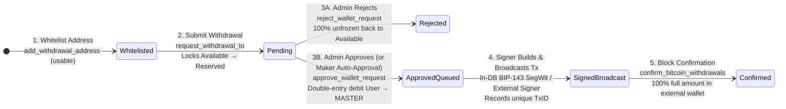
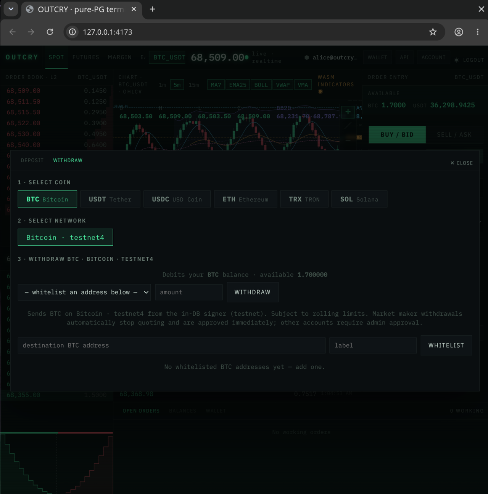
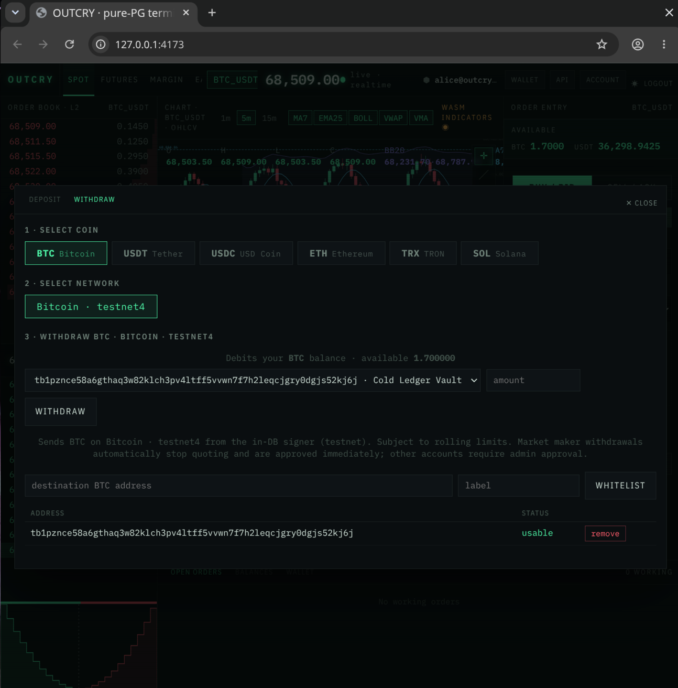
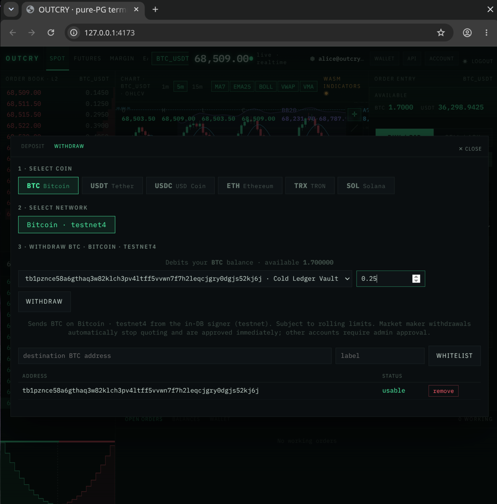
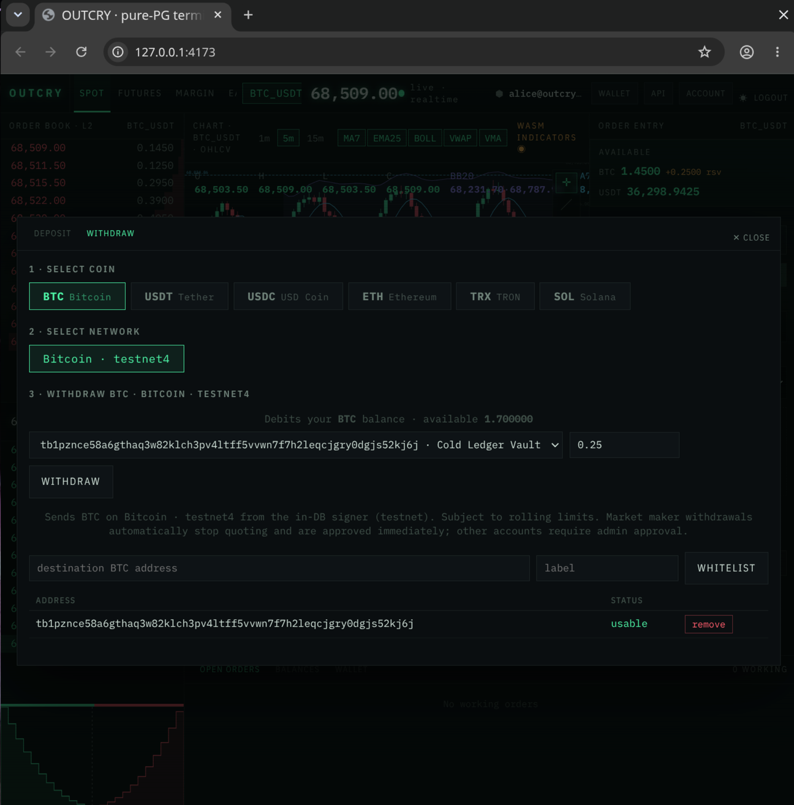
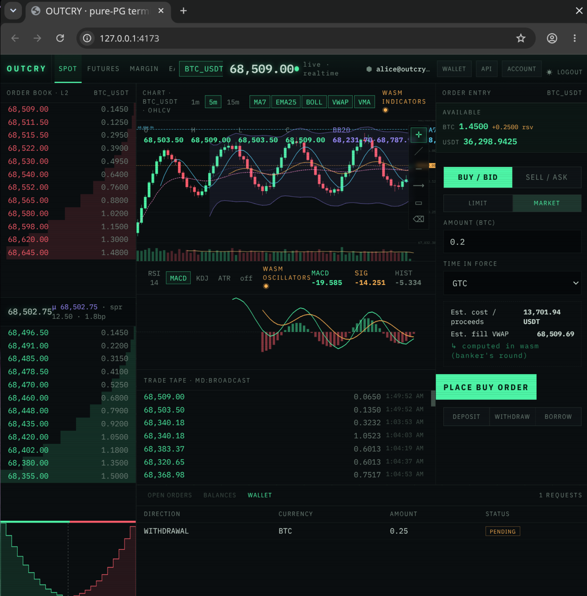
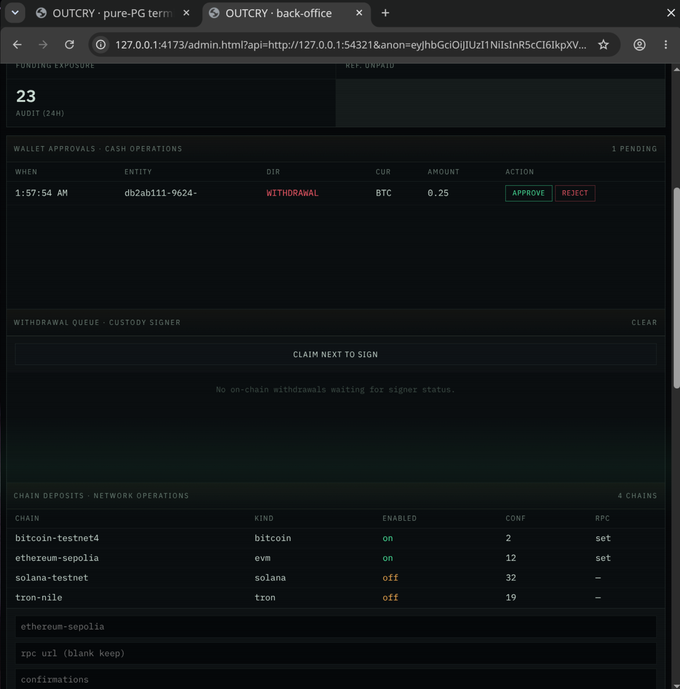
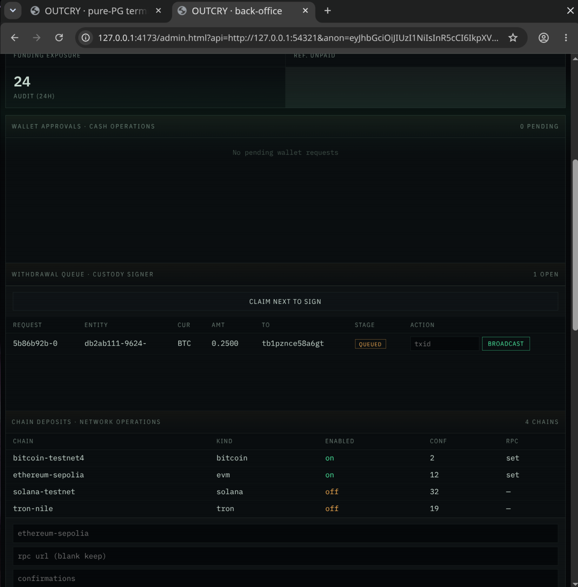
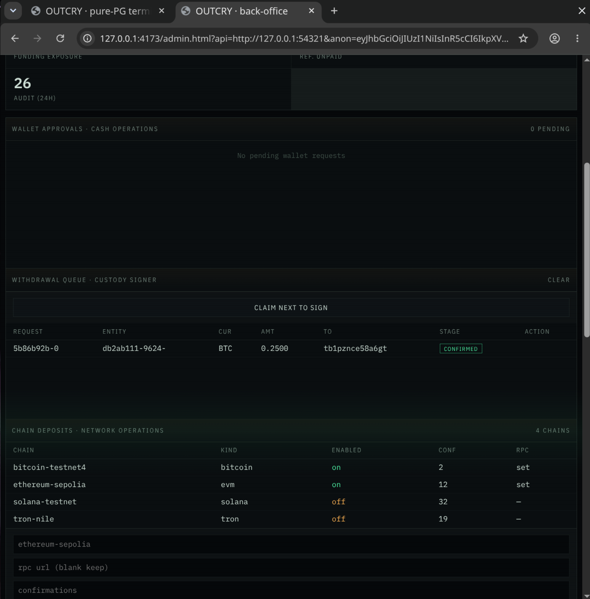
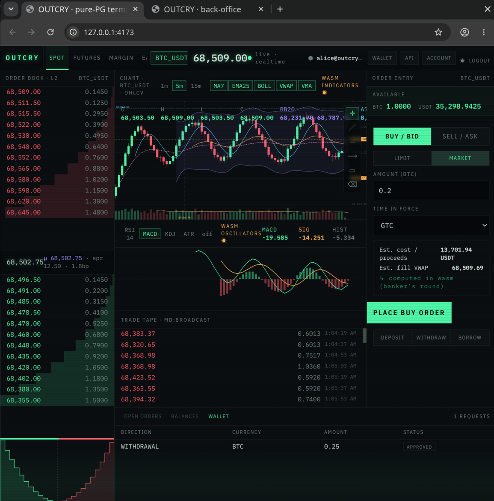

**English** · [中文](./04-withdrawal-guide.md)

# Chapter 4: On-Chain Withdrawals (Whitelist, Rolling Limits & Zero-Fee Payout)

[← Previous: Spot Trading Masterclass](./03-spot-trading-masterclass.en.md) · [Wiki Master Index](./README.en.md) · [Next: Advanced Products →](./05-advanced-products.en.md)

---

The ultimate test of any exchange is a clean, verifiable, full-amount on-chain withdrawal to self-custody. Holding **`1.7000 BTC`** after Chapter 3, Alice will now whitelist an external cold-storage address and withdraw **`0.25 BTC`** on `Bitcoin · testnet4` — tracing both the trader terminal and the operator signer pipeline through on-chain confirmation.

---

## 4.1 The 6-Stage Withdrawal State Machine

---

## 4.2 Supported Withdrawal Assets, Address Formats & 24h Rolling Limits

| UI Coin | UI Network | Accepted Destination Formats | Debited Currency | 24h Rolling Cap (`withdrawal_limit`) | Network Fee Policy |
|---|---|---|---|---|---|
| **BTC** | `Bitcoin · testnet4` | All testnet types: `tb1q…` (P2WPKH), `tb1p…` (Taproot), `m/n…` (P2PKH), `2…` (P2SH). **Mainnet `bc1/1/3` refused!** | **`BTC`** | **5 BTC** / 24h | **Paid by venue** (recipient gets 100% full amount) |
| **USDT** | `TRC-20 · Nile` | TRON Nile `T…` (34 chars) | **`USDT`** | **50,000 USDT** / 24h | **Paid by venue** |
| **USDC** | `SPL · devnet` `ERC-20 · Sepolia` | Solana Base58 / EVM `0x…` | **`USDC`** | Venue-configured | **Paid by venue** |
| **ETH / TRX / SOL** | `Sepolia` / `Nile` / `devnet` | Native testnet addresses | **`EUR`** | **50,000 EUR** / 24h | **Paid by venue** |

> [!IMPORTANT]
> **How Rolling 24-Hour Limits Work**: PostgreSQL sums all non-`REJECTED` (`PENDING` + `APPROVED`) withdrawals for that currency over the trailing 24 hours. Rejected requests do **not** consume your quota.

---

## 4.3 Step-by-Step Walkthrough: Withdrawing `0.25 BTC` to Cold Storage

### Step 1: Open `Wallet → Withdraw` & Select `BTC → Bitcoin · testnet4`
Click **`WITHDRAW`** in the Order Entry footer (or `WALLET → WITHDRAW`), then click **`BTC Bitcoin`**:

Notice that arbitrary ad-hoc addresses cannot be typed directly into a send box — **every withdrawal destination must first be registered on your personal whitelist**.

---

### Step 2: Whitelist Your Destination Address (`Whitelist`)
1. Paste your testnet destination address (`tb1pznce58a6gthaq3w82klch3pv4ltff5vvwn7f7h2leqcjgry0dgjs52kj6j`) into **`destination BTC address`**.
2. Enter a human-readable label (`Cold Ledger Vault`) and click **`WHITELIST`**.

The address appears in the table as green **`usable`** and is automatically selected in the payout dropdown.

---

### Step 3: Enter Amount (`0.25`) & Submit Withdrawal
1. Enter **`0.25`** in **`amount`**.

2. Click **`WITHDRAW`**. `request_withdrawal_to` serializes your entity (`FOR UPDATE`), verifies idempotency and rolling limits, creates the `PENDING` request, and **immediately reserves `0.2500 BTC`**:

---

### Step 4: Track `PENDING` Status & Balance Hold in the Blotter
Close the modal and open the **`WALLET`** tab in the bottom blotter:

- **Standard Accounts vs. Market Maker Self-Withdrawal (`00190`)**: Regular customer withdrawals wait in `PENDING` for admin approval. If the account is an assigned house **Market Maker**, submitting a withdrawal atomically disables quoting, cancels all resting quotes to free reserved inventory, approves the ledger debit immediately, and queues the payment for automatic signing!

---

## 4.4 Behind the Scenes: Approval, In-DB BIP-143 SegWit Signing & Confirmation

1. **Operator Approval (`admin.html → Treasury`)**: The operator verifies `recon ALL PASS` and clicks **`APPROVE`** on Alice's `0.25 BTC` request (clicking `REJECT` would unfreeze `0.25 BTC` straight back to `Available`):

2. **Queued → Signed & Broadcast → Confirmed in Pure PostgreSQL**:
   - Upon approval, the request enters **`WITHDRAWAL QUEUE · CUSTODY SIGNER`** as **`QUEUED`**:

   - Within seconds, three `pg_cron` jobs execute the on-chain payout:
     - **`sign_bitcoin_withdrawals()`**: Scans `btc_hot_wallet` (all HD user deposit UTXOs + treasury index `0` — **zero sweeping required!**), locks chosen outpoints in `btc_spent_outpoint` so no UTXO can ever be double-spent, pays **`25,000,000 sats` (`0.25000000 BTC`)** to Alice's `tb1p…` address (**absorbs the `330 sats` miner fee from treasury change so Alice receives 100% of `0.25 BTC`!**), and builds a 234-byte BIP-143 native SegWit transaction (`txid: 3c91e9fbc4735543889547a5190209bf9668d9e5a4373e054458fb14588b574e`).
     - **`broadcast_bitcoin_withdrawals()`**: Idempotently broadcasts the recorded raw hex transaction (never re-signing).
     - **`confirm_bitcoin_withdrawals()`**: Marks the request **`CONFIRMED`** once mined:

3. **Real-Time User Closure (`APPROVED`)**: Switching back to Alice's trading terminal, Supabase Realtime has already updated her `WALLET` blotter to **`APPROVED`** and cleared the `+0.2500 rsv` hold:

---

## 4.5 Pre-Withdrawal 6-Point Safety Checklist

- [ ] **1. Valid Testnet Address**: Starts with `tb1q`, `tb1p`, `m`, `n`, or `2` for BTC Testnet4 (mainnet `bc1/1/3` addresses are rejected).
- [ ] **2. Matching Token Network**: Recipient supports `TRC-20` when withdrawing USDT on Nile.
- [ ] **3. Standard Wallet / EOA Recipient**: Avoid withdrawing directly to smart contracts that require custom calldata.
- [ ] **4. Free Available Balance**: Cancel unneeded open orders (`✕`) if funds are locked in `Reserved`.
- [ ] **5. Within 24h Rolling Cap**: Total 24h withdrawals stay within `5 BTC` / `50,000 USDT`.
- [ ] **6. Irreversibility Acknowledged**: Once broadcast on-chain, blockchain transactions cannot be reversed.

---

**Previous: [← Chapter 3: Spot Trading Masterclass](./03-spot-trading-masterclass.en.md)** · **Next: [Chapter 5: Advanced Products →](./05-advanced-products.en.md)**
