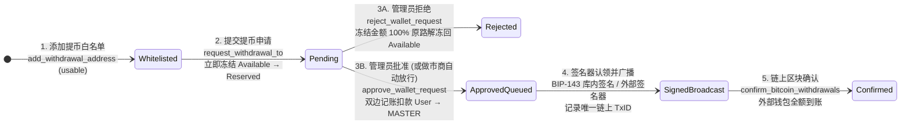
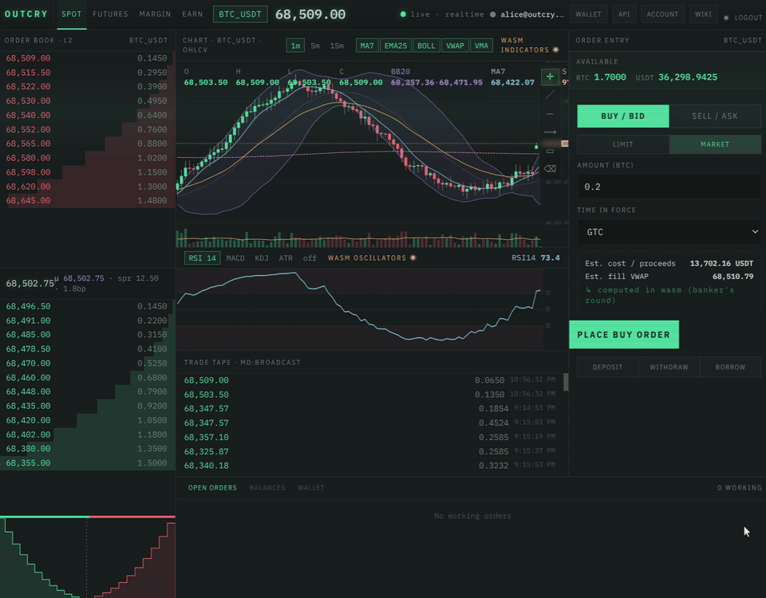
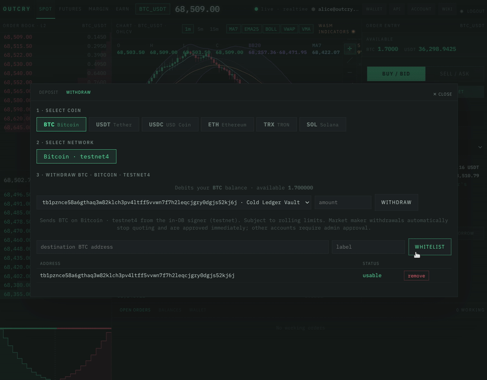
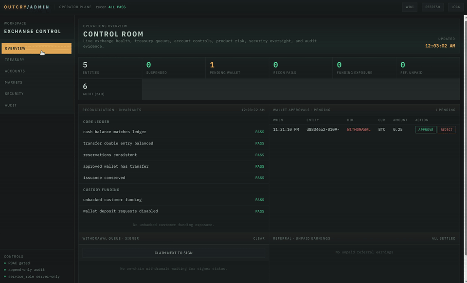
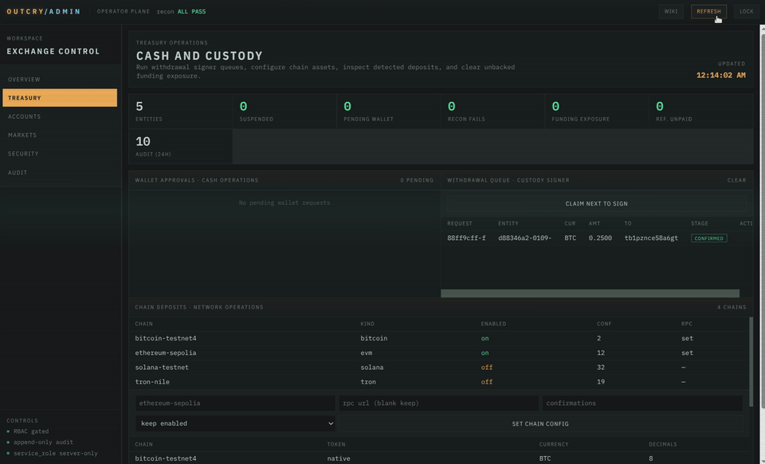
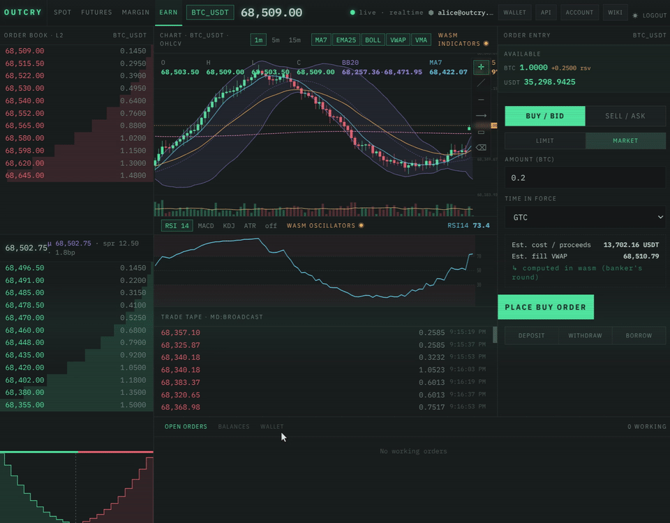

[English](./04-withdrawal-guide.en.md) · **中文**

# 第 4 章：链上提币全流程精讲（Withdrawal）

[← 上一章：现货交易全流程精讲](./03-spot-trading-masterclass.md) · [Wiki 总目录](./README.md) · [下一章：进阶金融产品手册 →](./05-advanced-products.md)

---

**「能不能丝滑、足额、可验证地把币提到自己的链上钱包」**，是检验一家加密货币交易所技术实力与资金透明度的终极试金石。

在上一章完成现货买入后，Alice 账户中持有 **`1.7000 BTC`** 与 **`36,298.9425 USDT`**。本章将完整演示如何将 **`0.25 BTC`** 从交易所安全提现至外部冷钱包地址，并同步展示用户端与管理后台在提币生命周期每一个节点上的真实状态流转。

---

## 4.1 提币全生命周期六阶段状态机

与充值「先有链上交易、后加账面余额」相反，提币遵循严谨的 **「先白名单风控 → 立即冻结可用余额 → 审批扣账 → 签名广播 → 链上确认」** 六阶段闭环：

---

## 4.2 支持的提币币种、网络、扣款账户与 24h 滚动限额

在发起提币前，请先核对目标币种对应的链网络、扣减的场内资金户以及 **24 小时滚动提现限额**：

| 前端选择币种 (`Coin`) | 支持的提现网络 (`Network`) | 支持的目标地址格式 | 扣减的场内余额 (`Debits`) | 默认 24h 滚动限额 (`withdrawal_limit`) | 网络矿工费（Gas）承担方 |
|---|---|---|---|---|---|
| **BTC** (`Bitcoin`) | `Bitcoin · testnet4` | 所有测试网格式：`tb1q…` (P2WPKH)、`tb1p…` (Taproot P2TR)、`m/n…` (P2PKH)、`2…` (P2SH)；**严拒 `bc1/1/3` 主网地址** | **`BTC`** | **5 BTC** / 24h | **平台全额承担**（收款方 100% 全额到账） |
| **USDT** (`Tether`) | `TRC-20 · Nile` | 波场测试网 `T…` 地址（34 位） | **`USDT`** | **50,000 USDT** / 24h | **平台全额承担** |
| **USDC** (`USD Coin`) | `SPL · devnet` `ERC-20 · Sepolia` | Solana Base58 地址 Ethereum `0x…` 地址 | **`USDC`** | 按后台配置 | **平台全额承担** |
| **ETH / TRX / SOL** | `Sepolia` / `Nile` / `devnet` | 对应测试网原生地址 | **`EUR`**（演示映射） | **50,000 EUR** / 24h | **平台全额承担** |

> [!IMPORTANT]
> **24 小时滚动限额是如何计算的？**
> 系统按过去 **连续滚动的 24 小时窗口**（`created_at > now() - interval '24 hours'`），累加你在该币种下所有状态不为 `REJECTED`（即包含 `PENDING` 待审与 `APPROVED` 已批）的提币总额。若 `已用额度 + 本次提币金额 > 限额`，系统将拒绝请求并提示 `withdrawal limit exceeded`。被管理员 `REJECTED` 拒绝的申请**不占用**你的提币额度！

---

## 4.3 手把手实操：四步完成链上提币（`0.25 BTC`）

### 第 1–2 步：打开 `Wallet → Withdraw` 并添加提现白名单地址（`Whitelist`）
你可以通过右上角 **`WALLET`** 按钮切换到 **`WITHDRAW`** 页签，或直接点击右侧下单面板底部的 **`WITHDRAW`** 快捷按钮。点击 **`BTC Bitcoin`**（自动选中 **`Bitcoin · testnet4`**），提示当前扣款币种与可用余额：`Debits your BTC balance · available 1.700000`。

**在 OUTCRY 中，任何未经白名单登记的陌生地址都无法直接发起提币**——这层强制白名单设计能在账号会话意外泄露时为你争取宝贵的止损缓冲。下面我们将外部冷钱包的 Taproot 测试网地址 `tb1pznce58a6gthaq3w82klch3pv4ltff5vvwn7f7h2leqcjgry0dgjs52kj6j` 添加进白名单：

1. 在下方 **`destination BTC address`** 输入框粘贴目标收款地址。
2. 在右侧 **`label`** 输入框填入便于识别的备注名（例如 `Cold Ledger Vault`）。
3. 点击 **`WHITELIST`** 按钮：

添加成功后：
- 下方白名单列表新增该地址，状态显示为绿色 **`usable`**（立即可用；若运营方开启了新地址冷却期策略且尚未到期，则会显示琥珀橙色 `cooling…`）；若日后不再使用该钱包，可随时点击右侧红色的 **`remove`** 将其软删除。
- 上方提币下拉框已自动选中 **`tb1pznce58a6gthaq3w82klch3pv4ltff5vvwn7f7h2leqcjgry0dgjs52kj6j · Cold Ledger Vault`**！

---

### 第 3–4 步：填写 `0.25 BTC` 点击 `WITHDRAW` 提交，并在底部 `WALLET` 页签核验资金冻结
1. 在下拉框右侧的 **`amount`** 输入框填入提币数量：**`0.25`**。
2. 仔细核对网络（`Bitcoin · testnet4`）、地址首尾字符与金额无误后，点击 **`WITHDRAW`** 按钮！
3. 点击弹窗右上角 **`✕ CLOSE`** 回到主界面，点击底部工作台的 **`WALLET`** 页签追踪状态（完整操作如下方动图所示）：

> [!TIP]
> **防手抖连点保护（幂等键 `idempotency_key`）**：底层 RPC `request_withdrawal_to` 原生支持幂等键校验并先对用户实体加行级排他锁（`SELECT 1 FROM app_entity ... FOR UPDATE`），防止网络卡顿重试时重复创建两笔提币单或重复冻结双倍余额。

请核对此时界面上的两处关键状态：
1. **右上角 `AVAILABLE`**：`BTC` 可用余额从 `1.7000` 立即降为 **`1.4500`**，右侧紧跟橙色 **`+0.2500 rsv`** 冻结标识！此时你用剩余的 `1.4500 BTC` 继续下单、做杠杆或做质押完全不受影响，但那 `0.2500 BTC` 已被安全隔离保护。
2. **底部 `WALLET (1 REQUESTS)`**：显示 `WITHDRAWAL | BTC | 0.25 | PENDING`（琥珀色待审批标签）。

> **普通账户 vs 做市商账户的审批分流规则（最新 `00190` 特性）**：
> - **普通交易账户**：提交后进入 `PENDING` 状态，需后台管理员（`wallet.approve` 权限）审核放行，防范被盗号后的异常大额出金。
> - **官方绑定做市商账户（Market Maker Self-Withdrawal）**：若提交提币的是后台绑定的做市商专用账户，系统会在**同一个原子事务**内自动停用其做市开关、撤销所有双边报价单以释放盘口冻结库存、免除人工审批直接完成账本扣减并送入自动签名广播队列！

---

## 4.4 幕后揭秘：管理员放行、库内 BIP-143 签名广播与用户端闭环

提币申请提交后，后台与链上究竟经历了怎样严丝合缝的接力？让我们跟随这笔 `0.25 BTC` 申请走进 `OUTCRY/ADMIN` 后台一探究竟：

### 1. 管理员审核放行并推入签名队列（`Overview → Treasury → Approve`）
运营人员登录后台 `admin.html`，在对账徽章显示绿色 **`recon ALL PASS`** 的前提下，进入 **`TREASURY`** 模块看到待审批提币记录，点击绿色的 **`APPROVE`** 按钮（若发现可疑被盗风险则点击 `REJECT`，点击 `REJECT` 会将 `0.2500 BTC` 原封不动解冻退回 Alice 的可用余额）。批准瞬间，账本完成双边记账扣款（`WITHDRAWAL: Alice → MASTER`），该申请立即进入下方的 **`WITHDRAWAL QUEUE · CUSTODY SIGNER`** 队列（`QUEUED`）：

### 2. 库内原生隔离见证签名、幂等广播与区块确认（`CONFIRMED`）
随后，PostgreSQL 内部的定时任务（`pg_cron`）自动接管后续全流程，**无需人工导出私钥**：
1. **`sign_bitcoin_withdrawals()`（每 30 秒运行，纯 SQL 构造并签名原生隔离见证交易）**：
   - **免归集热钱包（Zero-Sweep Hot Wallet）**：直接扫描平台掌控私钥的所有 HD 地址（全部用户的 `user_chain_wallet` 充值地址 + 0 号金库地址）上已确认且未花费的 UTXO（由 `btc_spent_outpoint` 表严格防双花锁死），无需事先花矿工费做资金归集！
   - **BIP-143 确定性签名**：拉取链上实时费率（`/fee-estimates`），从大到小挑选 UTXO，生成两笔输出——第 1 笔精确支付给你的收款地址 **`0.25000000 BTC`（`25,000,000 sats`，矿工费 `330 sats` 由平台金库找零全额承担，你一聪都不少收！）**，第 2 笔将剩余找零打回 0 号平台金库地址，再用 RFC-6979 低 S 值 DER 签名生成 234 字节原始隔离见证交易（本笔真实生成 `txid: 139142c20da18f4cad315f7c9f98cdf8ab4e84b04e6b3e67569b4bf79a662717`）。
2. **`broadcast_bitcoin_withdrawals()`（每 20 秒运行，幂等广播）**：将已记录的原始十六进制交易推送至区块链节点（签名与广播严格分离，哪怕网络超时重试 10 次也绝不会签出第二笔交易重复付款！）。
3. **`confirm_bitcoin_withdrawals()`（每 60 秒运行，确认上链）**：检测到链上交易已打包进区块后，将状态更新为绿色的 **`CONFIRMED`**，并永久记入只追加审计台（`Audit`）：

### 3. 回到用户交易终端：验证最终闭环（`APPROVED`）
切回 Alice 的交易终端（无需刷新页面，Supabase Realtime 私有流会自动推送状态变更）：

- 底部 `WALLET` 页签中，这笔 `0.25 BTC` 提币状态已变为 **`APPROVED`**；
- 右上角 `AVAILABLE` 中，`+0.2500 rsv` 冻结标签已正式核销清零；
- 此时打开你的外部比特币测试网钱包（`tb1pznce…`），即可看到**分毫不差的 `0.25000000 BTC` 已经安全躺在你的自托管地址中**！

---

## 4.5 提币安全「六项终审清单」

由于区块链交易一旦广播上链便**不可撤回、不可冻结**，每次点击 `WITHDRAW` 前请务必核对：

- [ ] **1. 目标地址网络类型合法**：提取 BTC 测试币时，目标地址必须是测试网格式（`tb1q`、`tb1p`、`m`、`n`、`2` 开头）；输入 `bc1`、`1`、`3` 主网地址会被系统 `btc_testnet_script` 直接拦截报错 `btc_address_not_testnet`。
- [ ] **2. 确认收款方支持对应代币标准**：提 USDT 走 `TRC-20 · Nile` 时，确认收款钱包或目标交易所支持波场 TRC-20 网络。
- [ ] **3. 切勿直接提币至不支持内部转账或需要特殊 Calldata 的智能合约地址 / 众筹合约地址**，优先提至个人自托管外部账户（EOA / 标准钱包地址）。
- [ ] **4. 核对扣款币种（`Debits your <CUR> balance`）**：确认可用余额充足（若资金正挂在限价单里被 `Reserved` 锁定，请先去 `OPEN ORDERS` 点 `✕` 撤单释放可用余额）。
- [ ] **5. 检查 24 小时滚动限额**：若当天已提过多笔，确认累计金额未超过单日滚动上限（如 `5 BTC` / `50,000 USDT`）。
- [ ] **6. 保存好链上 TxID**：提币放行广播后，如需向收款平台提供入账凭证，可联系运营或在区块浏览器按收款地址查询对应的 64 位链上 `txid`。

---

**上一篇：[← 第 3 章：现货交易全流程精讲](./03-spot-trading-masterclass.md)** · **下一篇：[第 5 章：进阶金融产品手册（合约 · 杠杆 · 质押） →](./05-advanced-products.md)**
