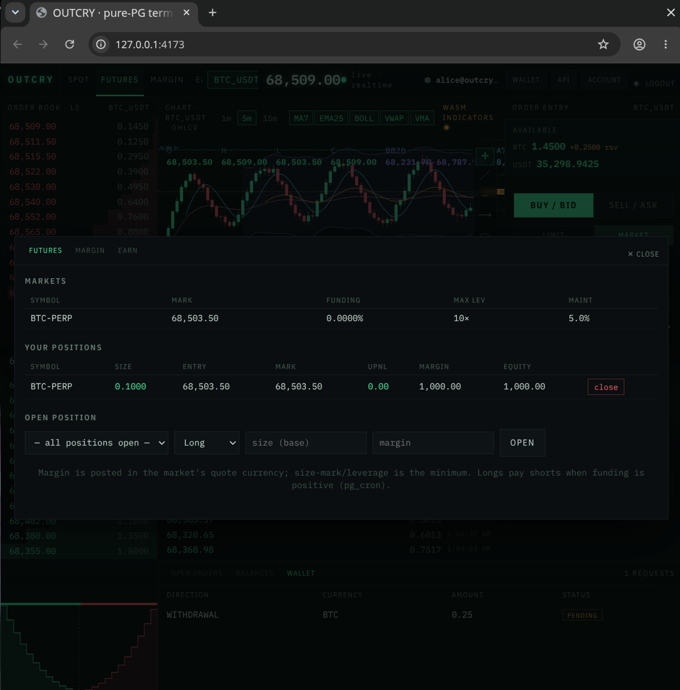
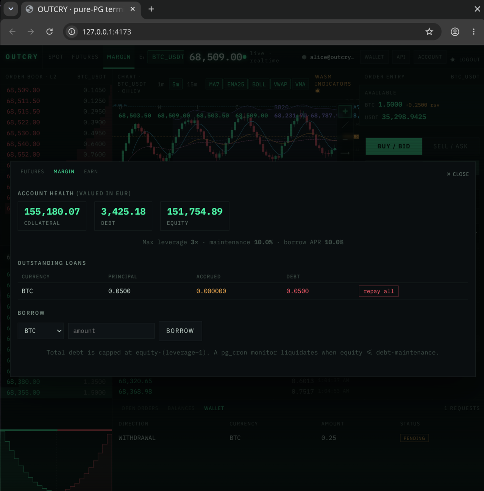
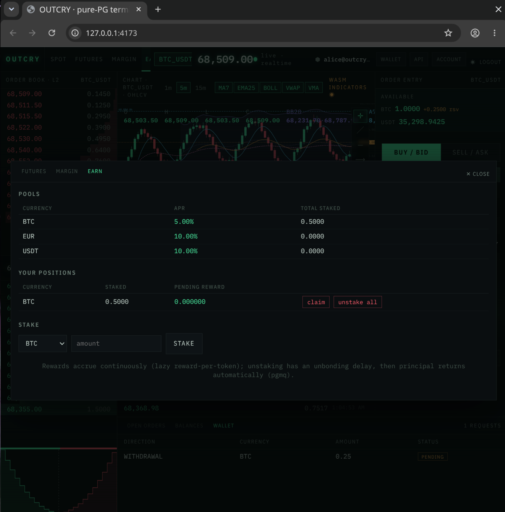

**English** · [中文](./05-advanced-products.md)

# Chapter 5: Advanced Financial Products (Perpetuals · Cross-Margin · Earn Staking)

[← Previous: On-Chain Withdrawals](./04-withdrawal-guide.en.md) · [Wiki Master Index](./README.en.md) · [Next: Developer API & Bot Trading →](./06-api-and-bot-guide.en.md)

---

Once you have mastered the core **Deposit → Spot Trading → Withdrawal** loop, OUTCRY unlocks three institutional-grade yield and leverage workspaces right from the top navigation bar — **`FUTURES`**, **`MARGIN`**, and **`EARN`** — all running natively on the **same unified double-entry ledger** with zero internal sub-account transfer friction!

> [!CAUTION]
> **Leverage & Liquidation Risk Disclosure**: Perpetual futures and cross-margin amplify both gains and losses. If adverse price movement pushes your equity down to the maintenance margin threshold, background `pg_cron` risk engines will automatically liquidate the position or collateral. Make sure you understand the exact formulas below before sizing leveraged positions.

---

## 5.1 Linear Perpetual Futures (`FUTURES` · `BTC-PERP`)

Click **`FUTURES`** in the top header bar to open the perpetual derivatives desk:

### Core Contract Specifications & Formulas

| Parameter | Default Setting | Formula & Risk Semantics |
|---|---|---|
| **Contract (`SYMBOL`)** | `BTC-PERP` | Linear perpetual contract tracking the `BTC_USDT` spot reference index, margined and settled in `USDT`. |
| **Mark Price (`MARK`)** | Refreshed live | Updated every 10 seconds by `update_perp_mark()` from the spot reference price; drives unrealized PnL and liquidation checks to prevent single-wick manipulation. |
| **Max Leverage (`MAX LEV`)** | **`10×`** | Minimum initial margin required at entry: $$\text{Margin}_{\min} = \frac{|\text{Size}| \times \text{Mark}}{\text{Max Leverage}} = \frac{|\text{Size}| \times \text{Mark}}{10}$$ |
| **Maintenance Margin (`MAINT`)** | **`5.0%`** | Liquidation triggers when live position equity drops to or below `5.0%` of notional value: $$\text{Equity} = \text{Margin} + \text{uPnL} \le |\text{Size}| \times \text{Mark} \times 5\%$$ |
| **Unrealized PnL (`UPNL`)** | Real-time | Let signed $\text{Size}$ be positive ($+$) for **Long** and negative ($-$) for **Short**: $$\text{uPnL} = \text{Size} \times (\text{Mark} - \text{Entry})$$ |
| **Funding Rate (`FUNDING`)** | Periodic settlement | Settled periodically by `apply_perp_funding()`: when `Funding > 0`, **Longs pay Shorts** (credited/debited directly on position margin); when `Funding < 0`, Shorts pay Longs. |

### Step-by-Step: Opening & Closing a Position
1. **Open Position (`OPEN POSITION`)**:
   - Select **`BTC-PERP`** and choose **`Long`** (bullish) or **`Short`** (bearish);
   - Enter **`size (base)`** (e.g. `0.1` BTC — notional $\approx 6,850.35\text{ USDT}$);
   - Enter **`margin`** in `USDT` ($\ge 685.04\text{ USDT}$; in the screenshot above we post **`1,000.00 USDT`** for a conservative **`6.85×`** effective leverage);
   - Click **`OPEN`** — `1,000.00 USDT` is atomically transferred from your available `USDT` balance into position margin.
2. **Net-Position Rule**: Each perpetual market holds one net position per account at a time (once open, the selector shows `— all positions open —`). To flip direction or resize, close the existing position first and open the new target size.
3. **One-Click Settlement (`close`)**: Click the red **`close`** button on your row in **`YOUR POSITIONS`** to settle realized PnL at the current mark price and return $\max(\text{Margin} + \text{PnL}, 0)$ immediately to your available `USDT` balance.

---

## 5.2 Spot Cross-Margin Borrowing (`MARGIN`)

Click **`MARGIN`** in the top header bar (or the **`BORROW`** shortcut in the Order Entry footer) to open the cross-margin lending desk:

### Risk Model & Continuous Interest Accrual

1. **Cross-Portfolio Valuation (`ACCOUNT HEALTH`)**:
   > *Note: While the legacy subtitle reads `(VALUED IN EUR)`, since migration `00100_usdt_quote` the underlying `_margin_price()` valuation engine marks all collateral and debt in **`USDT` terms**.*
   - **`COLLATERAL`**: Total market value of all spot balances across your cash accounts in `USDT` (`155,180.07` above).
   - **`DEBT`**: Total value of borrowed principal (`PRINCIPAL`) + accrued unpaid interest (`ACCRUED`) in `USDT` (`0.0500 BTC` = `3,425.18` above).
   - **`EQUITY`**: $\text{Equity} = \text{Collateral} - \text{Debt} = 155,180.07 - 3,425.18 = \mathbf{151,754.89}$.
2. **Maximum Borrow Leverage (`Max leverage 3×`)**:
   Total portfolio debt is capped by:
   $$\text{Total Debt} \le \text{Equity} \times (L_{\max} - 1) = 2 \times \text{Equity}$$
   Any borrow request exceeding this ceiling is rejected with `exceeds max leverage`.
3. **Per-Second Lazy Compounding (`borrow APR 10.0%`)**:
   Interest accrues continuously down to the exact elapsed second whenever health is queried, funds are borrowed/repaid, or liquidation checks run.
4. **Liquidation Threshold (`maintenance 10.0%`)**:
   `check_margin_liquidations()` scans active borrowers every 30 seconds; if $\text{Equity} \le \text{Debt} \times 10\%$, free collateral is automatically seized to repay debt.

### Step-by-Step: Shorting Spot & Repaying Debt
- **Spot Short Workflow**: Select `BTC` in `BORROW` → enter `0.05` → click **`BORROW`** (your spot available `BTC` immediately increases by `+0.0500`) → sell `0.05 BTC` for `USDT` on the spot book → buy back `0.05 BTC` lower → return to `MARGIN` and click **`repay all`** to clear principal + interest!
- **Interest-First Repayment**: Calling `repay` always clears **`ACCRUED` interest first**, then reduces **`PRINCIPAL`**.

---

## 5.3 Yield Staking (`EARN` · Staking)

Have idle `BTC`, `USDT`, or `EUR` sitting between trades? Click **`EARN`** in the top bar to put idle balances to work in per-second yield pools:

### Reward Mechanics & `pgmq` Unbonding
1. **Three Active Yield Pools (`POOLS`)**:
   - **`BTC`**: **`5.00% APR`**
   - **`USDT`**: **`10.00% APR`**
   - **`EUR`**: **`10.00% APR`**
2. **$O(1)$ MasterChef Reward Accumulator**:
   Using a global `acc_reward_per_token` accumulator, your green **`PENDING REWARD`** grows every single second with zero background cron overhead:
   $$\text{Pending Reward} = \text{Staked Amount} \times \Delta\text{acc\_reward\_per\_token}$$
3. **Everyday Operations**:
   - **`STAKE`**: Pick a currency, enter amount (e.g. `0.5` BTC), and click **`STAKE`** (adding to an existing stake automatically harvests and credits previously accrued rewards first so existing yield is never diluted).
   - **`claim`**: Click **`claim`** anytime to credit accrued yield **instantly** to your spot `Available` balance while keeping principal staked.
   - **`unstake all`**: Click **`unstake all`** to settle pending rewards immediately and place your principal into a **`pgmq`-backed unbonding queue (`604,800 s` = 7 days by default)**; once matured, `process_unbonding()` returns 100% of your principal automatically to `Available`.

---

**Previous: [← Chapter 4: On-Chain Withdrawals](./04-withdrawal-guide.en.md)** · **Next: [Chapter 6: Developer API & Bot Trading →](./06-api-and-bot-guide.en.md)**
