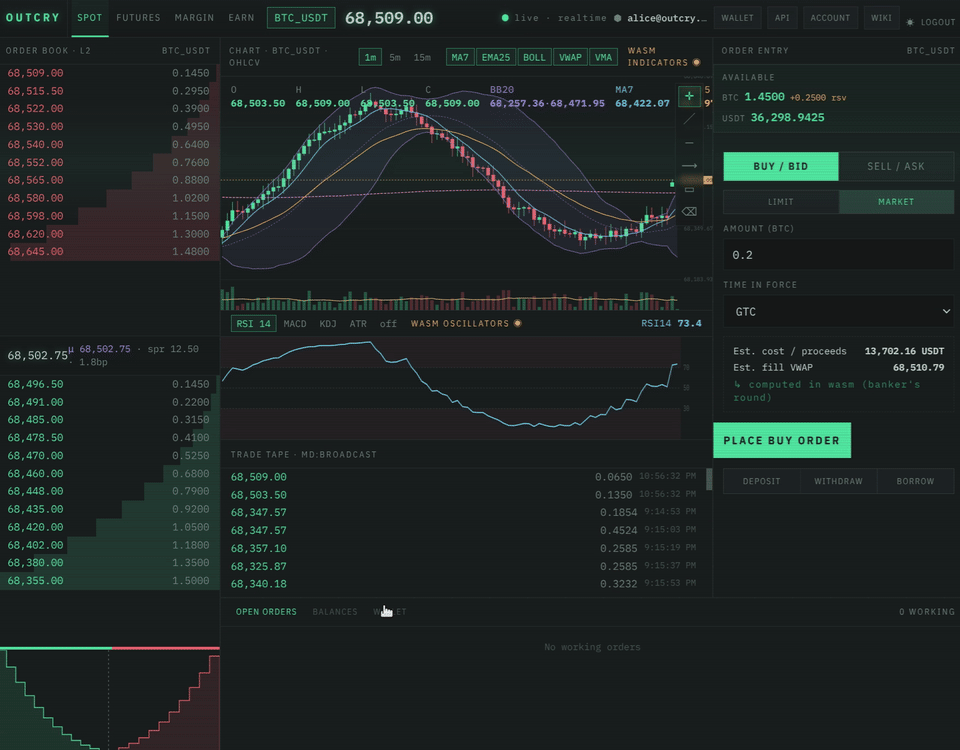
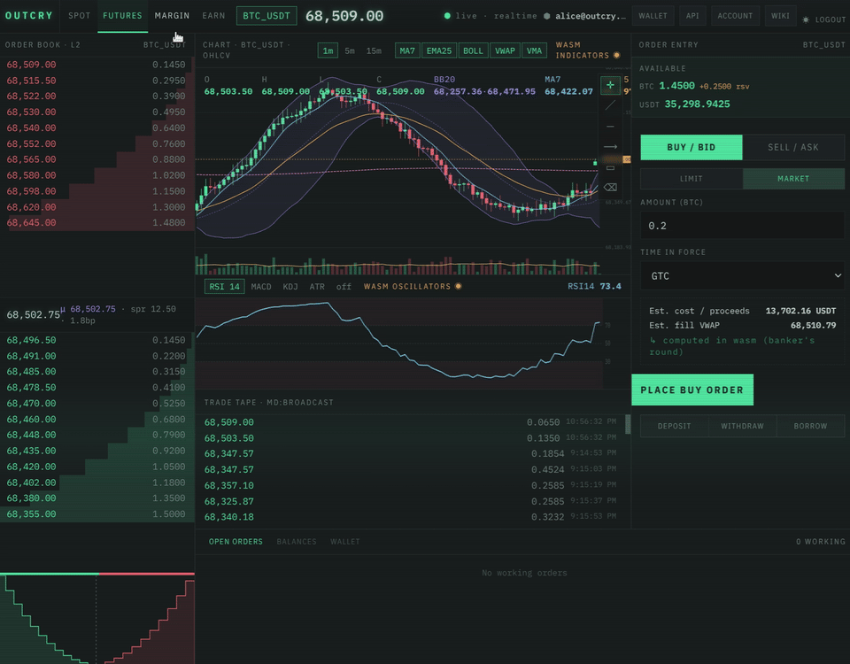
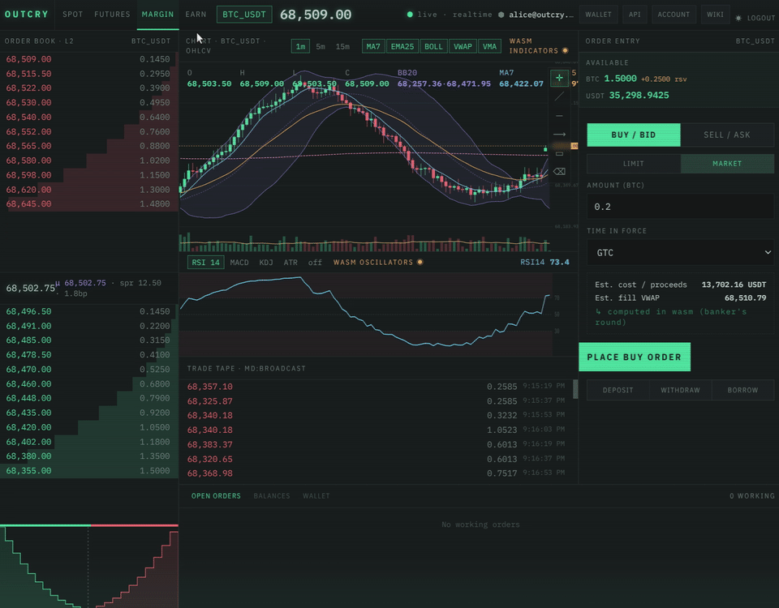

[English](./05-advanced-products.en.md) · **中文**

# 第 5 章：进阶金融产品手册（永续合约 · 全仓杠杆 · 质押赚币）

[← 上一章：链上提币全流程精讲](./04-withdrawal-guide.md) · [Wiki 总目录](./README.md) · [下一章：量化与 API 自动化交易完全指南 →](./06-api-and-bot-guide.md)

---

在跑通「充值 → 现货交易 → 提币」核心闭环后，OUTCRY 还通过顶部导航栏的 **`FUTURES`**、**`MARGIN`**、**`EARN`** 三个产品工作区，在**同一个双边记账账本之上**提供完整的线性永续合约、现货全仓抵押借贷与链下生息质押服务——无需任何跨子账户资金划转，现货可用余额一键即可参与！

> [!CAUTION]
> **高杠杆金融风险提示**：永续合约与现货杠杆带有放大收益与亏损的杠杆效应，触发维持保证金率红线时将由后台 `pg_cron` 风控守护任务自动执行强制平仓（Liquidation）。请在充分理解下文公式后再投入大额保证金。

---

## 5.1 线性永续合约（`FUTURES` · `BTC-PERP`）

点击顶部导航栏的 **`FUTURES`** 按钮，打开永续合约工作台：

### 合约核心参数与计算公式

| 参数字段 | 默认配置 | 公式与风控含义 |
|---|---|---|
| **合约标的 (`SYMBOL`)** | `BTC-PERP` | 锚定 `BTC_USDT` 现货指数的正向线性永续合约（`USDT` 本位结算）。 |
| **标记价格 (`MARK`)** | 实时刷新 | 由定时任务 `update_perp_mark()` 每 10 秒读取最新参考价/现货价更新，用于计算未实现盈亏与强平判定，防止单笔异常插针误强平。 |
| **最高杠杆 (`MAX LEV`)** | **`10×`** | 开仓所需最低初始保证金为：$$\text{Margin}_{\min} = \frac{|\text{Size}| \times \text{Mark}}{\text{Max Leverage}} = \frac{|\text{Size}| \times \text{Mark}}{10}$$ |
| **维持保证金率 (`MAINT`)** | **`5.0%`** | 当仓位实时净值（Equity）跌破名义价值的 `5.0%` 时触发强平：$$\text{Equity} = \text{Margin} + \text{uPnL} \le |\text{Size}| \times \text{Mark} \times 5\%$$ |
| **未实现盈亏 (`UPNL`)** | 实时变动 | 设仓位方向与数量为有符号数 $\text{Size}$（做多为正 $+$，做空为负 $-$）：$$\text{uPnL} = \text{Size} \times (\text{Mark} - \text{Entry})$$ |
| **资金费率 (`FUNDING`)** | 周期结算 | 由 `apply_perp_funding()` 定时结算：当 `Funding > 0` 时，**多头向空头支付资金费**（直接增减仓位保证金权益）；当 `Funding < 0` 时，空头向多头支付。 |

### 手把手实操：开仓与平仓
1. **开仓（`OPEN POSITION`）**：
   - 选择合约品种 `BTC-PERP`；
   - 选择方向 **`Long`（做多看涨）** 或 **`Short`（做空看跌）**；
   - 输入 **`size (base)`**（基础币数量，如上图输入 `0.1` BTC，名义价值约 `6,850.35 USDT`）；
   - 输入 **`margin`**（投入的 `USDT` 保证金，需 $\ge 685.04\text{ USDT}$；如上图投入 **`1,000.00 USDT`**，实际杠杆约为温和稳健的 **`6.85×`**）；
   - 点击 **`OPEN`**，系统立即从你的可用 `USDT` 中扣划 `1,000.00 USDT` 建立多头仓位。
2. **注意单市场净仓规则**：每个市场同一时间持有一个净仓位（如上图持仓后下拉框显示 `— all positions open —`）；如需反手或加减仓，请先平掉当前仓位再重新开仓。
3. **一键平仓（`close`）**：点击 **`YOUR POSITIONS`** 行右侧红色的 **`close`** 按钮，系统立即按最新标记价结算已实现盈亏，并将 $\max(\text{Margin} + \text{PnL}, 0)$ 全额打回你的 `USDT` 可用余额！

---

## 5.2 现货全仓杠杆借贷（`MARGIN`）

点击顶部导航栏 **`MARGIN`**（或弹窗顶部 `MARGIN` 页签、下单面板底部 `BORROW` 快捷按钮），进入全仓抵押借币面板：

### 核心风控模型与计息公式

1. **全仓估值指标（`ACCOUNT HEALTH`）**：
   > *注：界面副标题沿用了历史文案 `(VALUED IN EUR)`，但在 `00100_usdt_quote` 升级后，底层函数 `_margin_price()` 已统一按 **`USDT` 计价单位**对全账户所有持仓资产与负债进行实时估值！*
   - **`COLLATERAL`（总抵押资产估值）**：你现金账户中所有币种总额折合 `USDT` 之和（如上图 `155,180.07`）。
   - **`DEBT`（总负债估值）**：所有借入本金（`PRINCIPAL`）+ 累积未付利息（`ACCRUED`）折合 `USDT` 之和（如上图借入 `0.0500 BTC` 折合 `3,425.18`）。
   - **`EQUITY`（账户净权益）**：$\text{Equity} = \text{Collateral} - \text{Debt} = 155,180.07 - 3,425.18 = \mathbf{151,754.89}$。
2. **最高借贷杠杆上限（`Max leverage 3×`）**：
   借款后净权益不变，总负债上限严格受控于：
   $$\text{Total Debt} \le \text{Equity} \times (L_{\max} - 1) = 2 \times \text{Equity}$$
   超额借款会被直接拦截并提示 `exceeds max leverage`。
3. **按秒惰性复利计息（`borrow APR 10.0%`）**：
   每次查询健康度、借款、还款或执行风控扫描时，系统按实际经过秒数精确计提利息。
4. **强平红线（`maintenance 10.0%`）**：
   后台监控任务 `check_margin_liquidations()` 每 30 秒扫描一次全站借款户；一旦暴跌或利息累积导致 $\text{Equity} \le \text{Debt} \times 10\%$，系统将强制没收自由抵押品以清偿债务。

### 手把手实操：借币做空 / 杠杆做多与一键还币
- **做空现货流程**：在 `BORROW` 区选择 `BTC` → 输入 `0.05` → 点击 **`BORROW`**（你的现货可用 `BTC` 立即增加 `0.0500`）→ 回到现货界面将借来的 `0.05 BTC` 高价卖出换为 `USDT` → 待币价下跌后低价买回 `0.05 BTC` → 回到 `MARGIN` 面板点击 **`repay all`** 归还本息，赚取差价！
- **还款扣款顺序**：调用 `repay` 时，系统遵循国际金融准则**「先息后本（Interest First, Principal Second）」**优先核销 `ACCRUED` 应计利息，再扣减 `PRINCIPAL` 本金。

---

## 5.3 质押赚币（`EARN` · Staking）

如果你持有闲置的 `BTC`、`USDT` 或 `EUR` 暂时不准备挂单交易，点击顶部导航栏 **`EARN`** 即可放入链下高息池按秒赚取收益：

### 收益结算与解锁机制
1. **三档质押池年化收益率（`POOLS`）**：
   - **`BTC`**：年化 **`5.00% APR`**
   - **`USDT`**：年化 **`10.00% APR`**
   - **`EUR`**：年化 **`10.00% APR`**
2. **MasterChef 单位累积奖励算法（零定时任务开销、按秒精准计息）**：
   系统维护全局累加器 `acc_reward_per_token`，你每质押 1 秒钟，`YOUR POSITIONS` 中的绿色 **`PENDING REWARD`** 就会实时增长：
   $$\text{Pending Reward} = \text{Staked Amount} \times \Delta\text{acc\_reward\_per\_token}$$
3. **三种日常操作**：
   - **质押（`STAKE`）**：选择币种 → 输入数量（如 `0.5` BTC）→ 点击 **`STAKE`**（若已有仓位，追加质押前系统会自动先把此前累积的待领利息结算发放到你的可用余额中，绝不稀释老收益！）。
   - **提取收益（`claim`）**：随时点击仓位右侧的 **`claim`** 按钮，已产生的利息**秒级到账**现货可用余额，本金继续留池生息。
   - **赎回本金（`unstake all`）**：点击 **`unstake all`** 后，未领利息当场结清到账，**本金则进入基于 `pgmq` 持久化消息队列的解锁期（默认 `604,800 秒` = 7 天）**；到期后由每分钟运行的 `process_unbonding()` 自动将本金全额退回你的现货可用余额，全程满足双边记账平衡！

---

**上一篇：[← 第 4 章：链上提币全流程精讲](./04-withdrawal-guide.md)** · **下一篇：[第 6 章：量化与 API 自动化交易完全指南 →](./06-api-and-bot-guide.md)**
