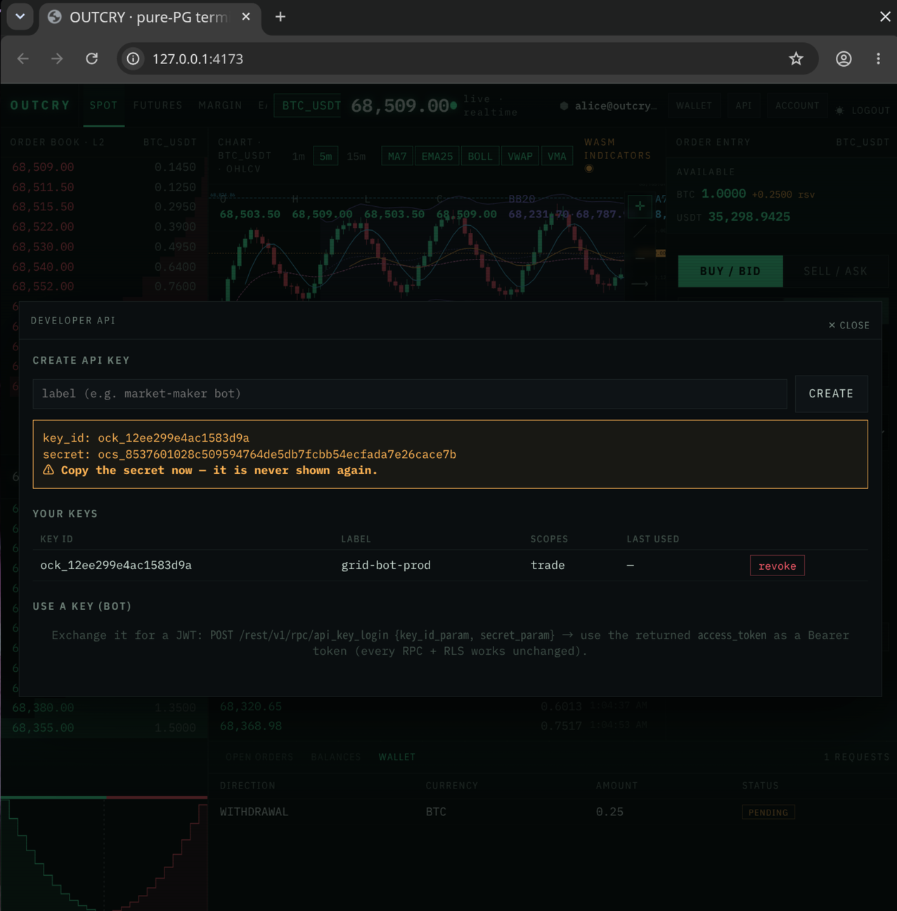

**English** · [中文](./06-api-and-bot-guide.md)

# Chapter 6: Developer API, Quant & Bot Trading Guide

[← Previous: Advanced Products](./05-advanced-products.en.md) · [Wiki Master Index](./README.en.md) · [Next: Back-Office & Proof of Solvency →](./07-backoffice-and-reconciliation.en.md)

---

Because OUTCRY's entire backend is **PostgREST (exposing whitelisted SQL functions as high-throughput JSON RPCs) + Supabase Realtime (low-latency WebSockets)**, quant traders and market makers never have to wrestle with proprietary binary protocols — **every single action available in the web terminal (deposit address derivation, L2 order book, limit/IOC order entry, cancellation, and idempotent withdrawals) is a clean HTTP `POST` or WebSocket subscription away**.

---

## 6.1 Step 1: Mint a Dedicated Bot API Key

Click **`API`** in the top header bar to open the `DEVELOPER API` modal:



1. Enter a descriptive label (e.g. `grid-bot-prod`) and click **`CREATE`**.
2. **Copy and store both credentials from the amber banner immediately**:
   - **`key_id`** (e.g. `ock_12ee299e4ac1583d9a`): Public identifier retained in `YOUR KEYS`;
   - **`secret`** (e.g. `ocs_8537601028c509594764de5db7fcbb54ecfada7e26cace7b`): **Shown in plaintext exactly once at creation!** PostgreSQL stores only its one-way cryptographic hash; once dismissed, it can never be retrieved again.
3. **Instant Revocation (`revoke`)**: If an environment variable ever leaks, click the red **`revoke`** button on that row to invalidate the key immediately without touching your funds or other keys.

---

## 6.2 Step 2: Exchange Your API Key for a Bot Bearer JWT

OUTCRY mints JWTs directly inside PostgreSQL: call the `api_key_login` RPC with `key_id_param` and `secret_param` (plus optional `ttl_seconds_param`, default `3600` seconds) to receive a standard `authenticated` Bearer JWT enforcing full Row-Level Security (`RLS`):

```bash
export API="http://127.0.0.1:54321"
export ANON="<YOUR_SUPABASE_PUBLISHABLE_OR_ANON_KEY>"
export KEY_ID="ock_12ee299e4ac1583d9a"
export SECRET="ocs_8537601028c509594764de5db7fcbb54ecfada7e26cace7b"

# Mint a 1-hour Bearer JWT
export BOT_JWT="$(curl -sS -X POST "$API/rest/v1/rpc/api_key_login" \
  -H "apikey: $ANON" \
  -H "Content-Type: application/json" \
  -d "{\"key_id_param\":\"$KEY_ID\",\"secret_param\":\"$SECRET\",\"ttl_seconds_param\":3600}" \
  | jq -r .access_token)"

echo "Bot JWT ready: ${BOT_JWT:0:24}..."
```

---

## 6.3 End-to-End REST / RPC Cookbook (Deposit → Trade → Withdraw)

Pass `-H "apikey: $ANON" -H "Authorization: Bearer $BOT_JWT"` on authenticated calls:

### 1. Public Market Data: L2 Book, Recent Trades & OHLCV Candles (No Auth Required)

```bash
# Live aggregated L2 order book for BTC_USDT
curl -sS "$API/rest/v1/order_book_l2?instrument=eq.BTC_USDT&order=price.asc" \
  -H "apikey: $ANON" | jq .

# Last 20 public trade prints
curl -sS "$API/rest/v1/trade_history?instrument=eq.BTC_USDT&order=created_at.desc&limit=20" \
  -H "apikey: $ANON" | jq .

# 5-minute (300s) OHLCV candles
curl -sS -X POST "$API/rest/v1/rpc/ohlcv" \
  -H "apikey: $ANON" -H "Content-Type: application/json" \
  -d '{"p_instrument":"BTC_USDT","p_resolution":300}' | jq '.[-5:]'
```

### 2. Derive Deposit Address & Query Balances

```bash
# Derive (or fetch existing) dedicated Bitcoin testnet4 deposit address
curl -sS -X POST "$API/rest/v1/rpc/my_deposit_address" \
  -H "apikey: $ANON" -H "Authorization: Bearer $BOT_JWT" -H "Content-Type: application/json" \
  -d '{"chain_param":"bitcoin-testnet4"}' | jq .

# Inspect detected on-chain deposits (RLS-isolated to your account)
curl -sS "$API/rest/v1/my_chain_deposits?order=created_at.desc&limit=10" \
  -H "apikey: $ANON" -H "Authorization: Bearer $BOT_JWT" | jq .

# Query Total, Reserved, and Available cash balances
curl -sS "$API/rest/v1/cash_balances?order=currency.asc" \
  -H "apikey: $ANON" -H "Authorization: Bearer $BOT_JWT" | jq .
```

### 3. Spot Order Entry (`GTC` Maker / Slippage-Capped `IOC` Taker) & Cancellation

```bash
# 1) Place a resting GTC Limit Buy: 0.15 BTC @ 68,400.00 USDT (returns order pub_id)
ORDER_ID="$(curl -sS -X POST "$API/rest/v1/rpc/place_order" \
  -H "apikey: $ANON" -H "Authorization: Bearer $BOT_JWT" -H "Content-Type: application/json" \
  -d '{
    "instrument_name_param": "BTC_USDT",
    "side_param": "BUY",
    "order_type_param": "LIMIT",
    "price_param": 68400.00,
    "amount_param": 0.15,
    "time_in_force_param": "GTC"
  }' | tr -d '"')"
echo "Placed order: $ORDER_ID"

# 2) List your active resting orders
curl -sS "$API/rest/v1/open_orders?order=created_at.desc" \
  -H "apikey: $ANON" -H "Authorization: Bearer $BOT_JWT" | jq .

# 3) Cancel the resting order and immediately release reserved USDT
curl -sS -X POST "$API/rest/v1/rpc/cancel_order" \
  -H "apikey: $ANON" -H "Authorization: Bearer $BOT_JWT" -H "Content-Type: application/json" \
  -d "{\"trade_order_id_param\": \"$ORDER_ID\"}"

# 4) Institutional slippage-protected sweep (LIMIT + IOC up to 68,550.00 USDT)
curl -sS -X POST "$API/rest/v1/rpc/place_order" \
  -H "apikey: $ANON" -H "Authorization: Bearer $BOT_JWT" -H "Content-Type: application/json" \
  -d '{
    "instrument_name_param": "BTC_USDT",
    "side_param": "BUY",
    "order_type_param": "LIMIT",
    "price_param": 68550.00,
    "amount_param": 0.05,
    "time_in_force_param": "IOC"
  }'
```

> [!TIP]
> **Batch Order Entry for Market Makers (`submit_orders`)**: Trusted server-side quoting engines authenticating with `service_role` can call `submit_orders(account, instrument, jsonb[])` to submit dozens of two-sided ladder quotes inside **a single PostgreSQL transaction**, amortizing network RTT and WAL `fsync` overhead by an order of magnitude (see [`PERFORMANCE.md`](../PERFORMANCE.md)).

### 4. Programmatic Whitelisting & Idempotent Withdrawals

```bash
# Whitelist an external Bitcoin Testnet4 cold-storage address
curl -sS -X POST "$API/rest/v1/rpc/add_withdrawal_address" \
  -H "apikey: $ANON" -H "Authorization: Bearer $BOT_JWT" -H "Content-Type: application/json" \
  -d '{
    "currency_param": "BTC",
    "address_param": "tb1pznce58a6gthaq3w82klch3pv4ltff5vvwn7f7h2leqcjgry0dgjs52kj6j",
    "label_param": "Treasury Cold Storage"
  }' | jq .

# Submit a withdrawal with a unique idempotency_key_param — safe to retry across network timeouts!
curl -sS -X POST "$API/rest/v1/rpc/request_withdrawal_to" \
  -H "apikey: $ANON" -H "Authorization: Bearer $BOT_JWT" -H "Content-Type: application/json" \
  -d '{
    "currency_param": "BTC",
    "amount_param": 0.10,
    "to_address_param": "tb1pznce58a6gthaq3w82klch3pv4ltff5vvwn7f7h2leqcjgry0dgjs52kj6j",
    "idempotency_key_param": "wd-20261125-batch01"
  }'
```

---

## 6.4 Step 3: Subscribe to Real-Time WebSocket Feeds (Node.js)

With `@supabase/supabase-js`, 25 lines of JavaScript stream both public L2/trade broadcasts and RLS-isolated private order & wallet updates (see [`examples/private-feed.mjs`](../../examples/private-feed.mjs) for a runnable script):

```javascript
import { createClient } from "@supabase/supabase-js";

const sb = createClient(process.env.API, process.env.ANON);

// 1. Exchange API Key for Bot JWT & authenticate Realtime socket
const { data: auth } = await sb.rpc("api_key_login", {
  key_id_param: process.env.KEY_ID,
  secret_param: process.env.SECRET,
});
await sb.realtime.setAuth(auth.access_token);

// 2. Public market-data broadcast channel md:BTC_USDT (coalesced L2 + trade prints)
sb.channel("md:BTC_USDT")
  .on("broadcast", { event: "l2" }, ({ payload }) => {
    console.log("Top Bid/Ask:", payload.bids?.[0], payload.asks?.[0]);
  })
  .on("broadcast", { event: "trade" }, ({ payload }) => {
    console.log("Trade Print:", payload.price, payload.amount, payload.ts);
  })
  .subscribe();

// 3. RLS-filtered private execution & wallet stream (only YOUR rows arrive!)
sb.channel("bot-private")
  .on("postgres_changes", { event: "*", schema: "public", table: "trade_order" }, (ev) => {
    console.log("My Order Update:", ev.new?.pub_id, ev.new?.status, "open:", ev.new?.open_amount);
  })
  .on("postgres_changes", { event: "*", schema: "public", table: "wallet_request" }, (ev) => {
    console.log("My Wallet Update:", ev.new?.direction, ev.new?.amount, ev.new?.status);
  })
  .subscribe();
```

---

**Previous: [← Chapter 5: Advanced Products](./05-advanced-products.en.md)** · **Next: [Chapter 7: Back-Office & Proof of Solvency →](./07-backoffice-and-reconciliation.en.md)**
