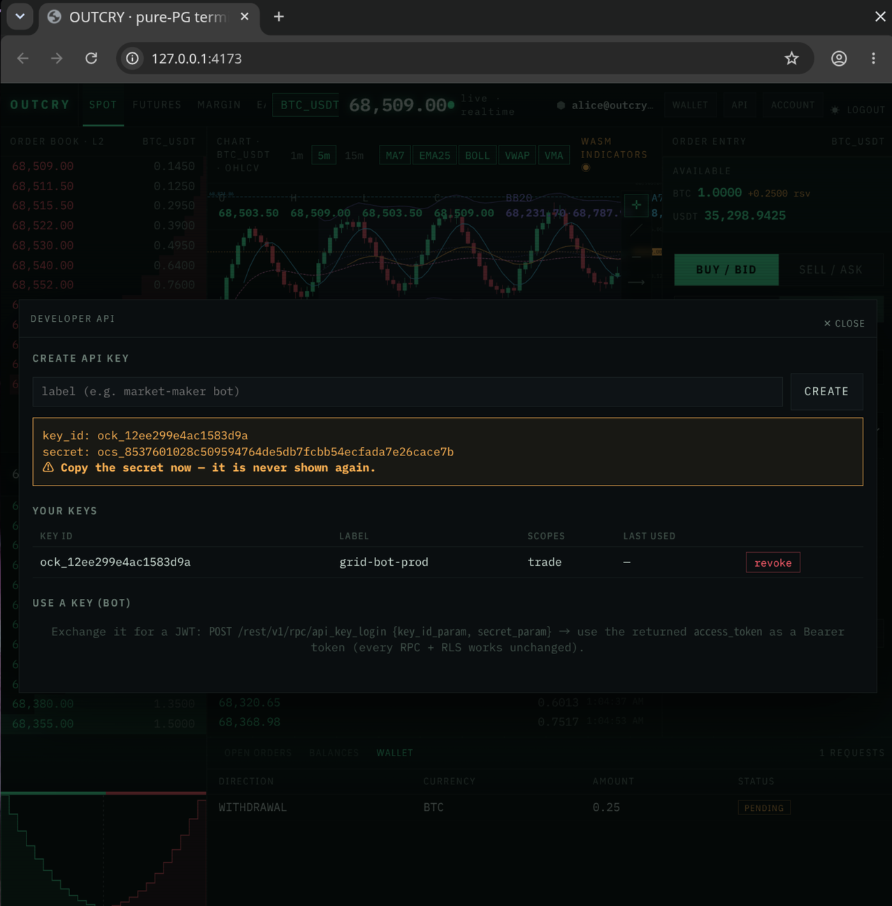

[English](./06-api-and-bot-guide.en.md) · **中文**

# 第 6 章：量化与 API 自动化交易完全指南（Developer API）

[← 上一章：进阶金融产品手册](./05-advanced-products.md) · [Wiki 总目录](./README.md) · [下一章：后台审批与七重账本自证 →](./07-backoffice-and-reconciliation.md)

---

由于 OUTCRY 的整个后端就是 **PostgREST（自动将白名单 SQL 函数暴露为高性能 JSON RPC）+ Supabase Realtime（低延迟 WebSocket）**，量化交易员与做市商无需学习复杂的私有二进制协议——**网页终端能做的每一件事（查地址、查余额、下单、批量报单、撤单、提币），只需几行标准 HTTP `POST` 与 WebSocket 订阅即可实现**！

---

## 6.1 第一步：在终端创建机器人专属 API Key

点击顶部导航栏的 **`API`** 按钮，打开 `DEVELOPER API` 密钥管理面板：



1. 在输入框填写便于区分用途的标签名（例如 `grid-bot-prod`），点击 **`CREATE`**。
2. **立即复制并离线保存琥珀色警告框中的两项凭证**：
   - **`key_id`**（如 `ock_12ee299e4ac1583d9a`）：公开密钥标识，会在下方 `YOUR KEYS` 列表中保留显示；
   - **`secret`**（如 `ocs_8537601028c509594764de5db7fcbb54ecfada7e26cace7b`）：**仅在创建这一刻明文显示唯一一次！** 数据库内部仅存储其单向加密哈希值，关闭弹窗后任何人都无法再次查看。
3. **一键吊销（`revoke`）**：一旦怀疑机器人服务器环境变量泄露，随时回到此面板点击对应行的红色 **`revoke`** 按钮，该密钥立即失效。

---

## 6.2 第二步：用 API Key 换取机器人访问令牌（JWT）

OUTCRY 采用巧妙的「库内签发 JWT」设计：机器人通过 `api_key_login` RPC 提交 `key_id` 与 `secret`（可选指定有效期秒数 `ttl_seconds_param`，默认 3600 秒），PostgreSQL 校验通过后直接在库内签发一枚与普通登录用户完全同构的 `authenticated` Bearer JWT。此后所有业务接口与 RLS 行级隔离策略原样生效！

```bash
export API="http://127.0.0.1:54321"
export ANON="<你的_SUPABASE_PUBLISHABLE_OR_ANON_KEY>"
export KEY_ID="ock_12ee299e4ac1583d9a"
export SECRET="ocs_8537601028c509594764de5db7fcbb54ecfada7e26cace7b"

# 换取 1 小时有效的 Bearer JWT
export BOT_JWT="$(curl -sS -X POST "$API/rest/v1/rpc/api_key_login" \
  -H "apikey: $ANON" \
  -H "Content-Type: application/json" \
  -d "{\"key_id_param\":\"$KEY_ID\",\"secret_param\":\"$SECRET\",\"ttl_seconds_param\":3600}" \
  | jq -r .access_token)"

echo "Bot JWT ready: ${BOT_JWT:0:24}..."
```

---

## 6.3 全流程 REST / RPC 接口实战速查（充值 → 交易 → 提币）

拿到 `$BOT_JWT` 后，在请求头带上 `-H "apikey: $ANON" -H "Authorization: Bearer $BOT_JWT"`，即可通过纯命令行或任意编程语言跑通全流程：

### 1. 查询公共盘口、最新成交与 K 线（免登录 `anon` 即可调用）

```bash
# 获取 BTC_USDT 实时 L2 买卖盘口
curl -sS "$API/rest/v1/order_book_l2?instrument=eq.BTC_USDT&order=price.asc" \
  -H "apikey: $ANON" | jq .

# 获取最近 20 笔市场逐笔成交
curl -sS "$API/rest/v1/trade_history?instrument=eq.BTC_USDT&order=created_at.desc&limit=20" \
  -H "apikey: $ANON" | jq .

# 获取 5 分钟（300 秒）分辨率的 OHLCV 历史蜡烛图
curl -sS -X POST "$API/rest/v1/rpc/ohlcv" \
  -H "apikey: $ANON" -H "Content-Type: application/json" \
  -d '{"p_instrument":"BTC_USDT","p_resolution":300}' | jq '.[-5:]'
```

### 2. 获取专属链上充值地址与查询入账状态

```bash
# 获取（首次调用自动派生）Bitcoin testnet4 专属充值地址
curl -sS -X POST "$API/rest/v1/rpc/my_deposit_address" \
  -H "apikey: $ANON" -H "Authorization: Bearer $BOT_JWT" -H "Content-Type: application/json" \
  -d '{"chain_param":"bitcoin-testnet4"}' | jq .

# 查询属于当前账户的链上充值检测记录（RLS 自动隔离他人数据）
curl -sS "$API/rest/v1/my_chain_deposits?order=created_at.desc&limit=10" \
  -H "apikey: $ANON" -H "Authorization: Bearer $BOT_JWT" | jq .

# 查询当前各币种总余额、冻结余额与可用余额
curl -sS "$API/rest/v1/cash_balances?order=currency.asc" \
  -H "apikey: $ANON" -H "Authorization: Bearer $BOT_JWT" | jq .
```

### 3. 现货下单（限价 / 激进 IOC / 止损单）与撤单

```bash
# ① 下达 GTC 限价买单：以 68,400.00 USDT 挂买 0.15 BTC（返回订单 pub_id）
ORDER_ID="$(curl -sS -X POST "$API/rest/v1/rpc/place_order" \
  -H "apikey: $ANON" -H "Authorization: Bearer $BOT_JWT" -H "Content-Type: application/json" \
  -d '{
    "instrument_name_param": "BTC_USDT",
    "side_param": "BUY",
    "order_type_param": "LIMIT",
    "price_param": 68400.00,
    "amount_param": 0.15,
    "time_in_force_param": "GTC"
  }' | tr -d '"')"
echo "Placed order: $ORDER_ID"

# ② 查询当前所有未成交挂单
curl -sS "$API/rest/v1/open_orders?order=created_at.desc" \
  -H "apikey: $ANON" -H "Authorization: Bearer $BOT_JWT" | jq .

# ③ 撤销刚才挂出的订单，立即释放冻结资金
curl -sS -X POST "$API/rest/v1/rpc/cancel_order" \
  -H "apikey: $ANON" -H "Authorization: Bearer $BOT_JWT" -H "Content-Type: application/json" \
  -d "{\"trade_order_id_param\": \"$ORDER_ID\"}"

# ④ 机构级带滑点上限的扫货买单（LIMIT + IOC，最高不超过 68,550 立即吃单，未成余量当场自动撤销）
curl -sS -X POST "$API/rest/v1/rpc/place_order" \
  -H "apikey: $ANON" -H "Authorization: Bearer $BOT_JWT" -H "Content-Type: application/json" \
  -d '{
    "instrument_name_param": "BTC_USDT",
    "side_param": "BUY",
    "order_type_param": "LIMIT",
    "price_param": 68550.00,
    "amount_param": 0.05,
    "time_in_force_param": "IOC"
  }'
```

> [!TIP]
> **高频做市批量报单接口（`submit_orders`）**：对于服务端可信做市系统（持有 `service_role` 密钥），可调用组提交接口 `submit_orders(account, instrument, jsonb[])`，在**单个数据库事务内一次提交数十笔双边梯度报价**，将网络往返与 WAL 刷盘开销摊薄一个数量级（详见 [`PERFORMANCE.zh-CN.md`](../PERFORMANCE.zh-CN.md)）。

### 4. 程序化绑定提币白名单与幂等提币申请

```bash
# 添加提现白名单地址
curl -sS -X POST "$API/rest/v1/rpc/add_withdrawal_address" \
  -H "apikey: $ANON" -H "Authorization: Bearer $BOT_JWT" -H "Content-Type: application/json" \
  -d '{
    "currency_param": "BTC",
    "address_param": "tb1pznce58a6gthaq3w82klch3pv4ltff5vvwn7f7h2leqcjgry0dgjs52kj6j",
    "label_param": "Treasury Cold Storage"
  }' | jq .

# 携带唯一幂等键（idempotency_key_param）发起链上提币，网络超时安全重试绝不双扣！
curl -sS -X POST "$API/rest/v1/rpc/request_withdrawal_to" \
  -H "apikey: $ANON" -H "Authorization: Bearer $BOT_JWT" -H "Content-Type: application/json" \
  -d '{
    "currency_param": "BTC",
    "amount_param": 0.10,
    "to_address_param": "tb1pznce58a6gthaq3w82klch3pv4ltff5vvwn7f7h2leqcjgry0dgjs52kj6j",
    "idempotency_key_param": "wd-20261125-batch01"
  }'
```

---

## 6.4 第三步：订阅实时 WebSocket 行情与私有成交回报（Node.js 示例）

使用官方 `@supabase/supabase-js` 客户端，仅需 20 行代码即可同时接收公共 L2 深度/逐笔成交广播与个人订单/充提状态流（完整可运行示例亦见仓库 [`examples/private-feed.mjs`](../../examples/private-feed.mjs)）：

```javascript
import { createClient } from "@supabase/supabase-js";

const sb = createClient(process.env.API, process.env.ANON);

// 1. 用 API Key 换取机器人 JWT 并注入 Realtime 鉴权
const { data: auth } = await sb.rpc("api_key_login", {
  key_id_param: process.env.KEY_ID,
  secret_param: process.env.SECRET,
});
await sb.realtime.setAuth(auth.access_token);

// 2. 订阅免鉴权公共行情频道 md:BTC_USDT（合并 L2 盘口 + 逐笔成交广播）
sb.channel("md:BTC_USDT")
  .on("broadcast", { event: "l2" }, ({ payload }) => {
    console.log("Top Bid/Ask:", payload.bids?.[0], payload.asks?.[0]);
  })
  .on("broadcast", { event: "trade" }, ({ payload }) => {
    console.log("Trade Print:", payload.price, payload.amount, payload.ts);
  })
  .subscribe();

// 3. 订阅 RLS 严格隔离的私有订单与提币状态流（仅收到属于你自己的变更！）
sb.channel("bot-private")
  .on("postgres_changes", { event: "*", schema: "public", table: "trade_order" }, (ev) => {
    console.log("My Order Update:", ev.new?.pub_id, ev.new?.status, "open:", ev.new?.open_amount);
  })
  .on("postgres_changes", { event: "*", schema: "public", table: "wallet_request" }, (ev) => {
    console.log("My Wallet Update:", ev.new?.direction, ev.new?.amount, ev.new?.status);
  })
  .subscribe();
```

---

**上一篇：[← 第 5 章：进阶金融产品手册](./05-advanced-products.md)** · **下一篇：[第 7 章：后台审批与七重账本自证 →](./07-backoffice-and-reconciliation.md)**
