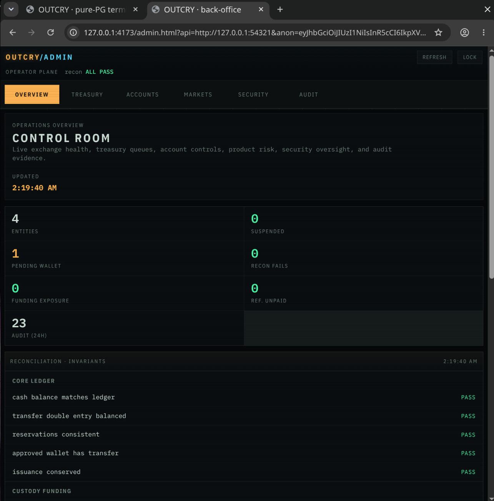
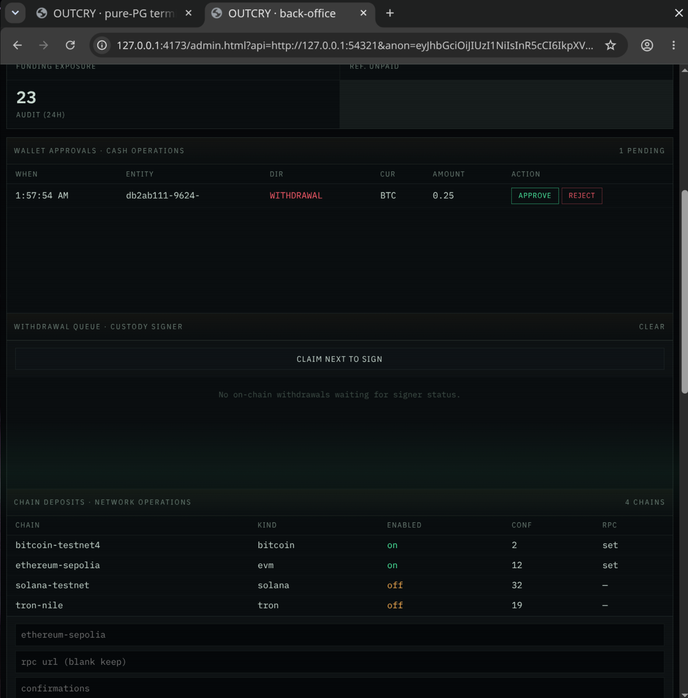
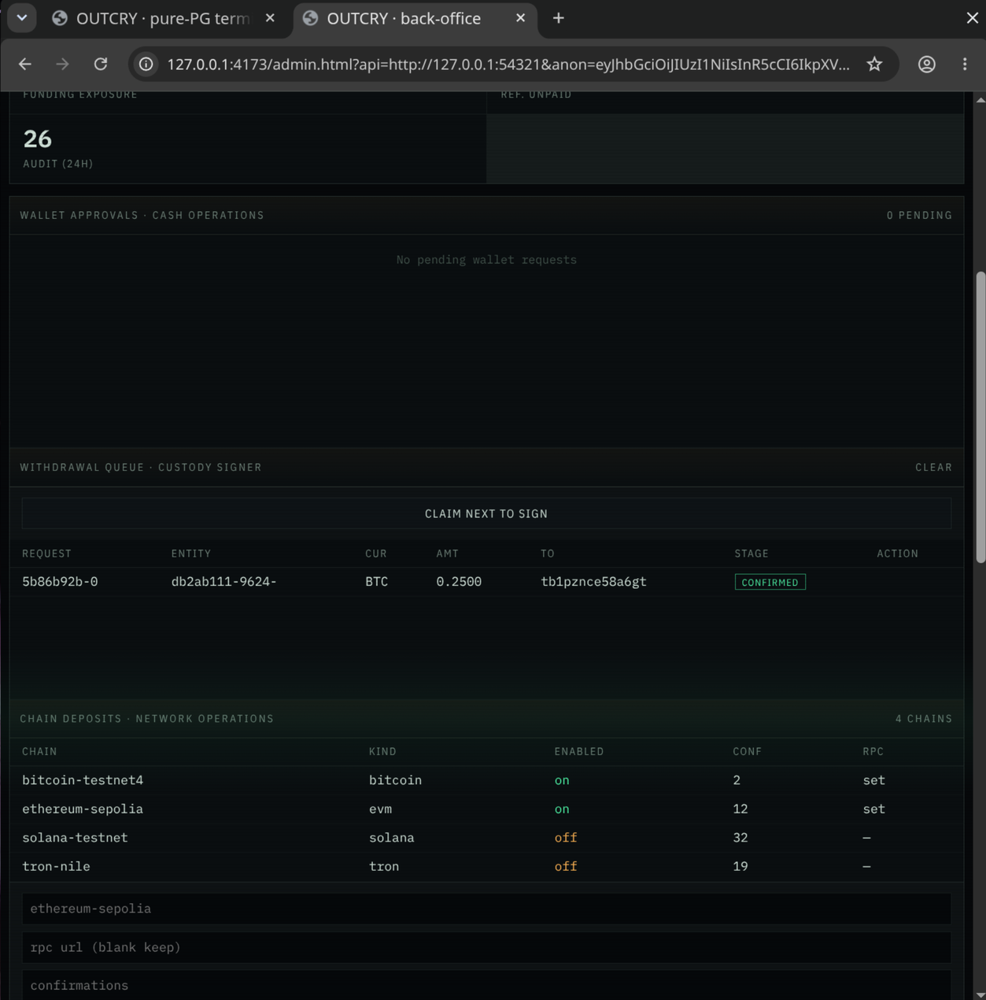
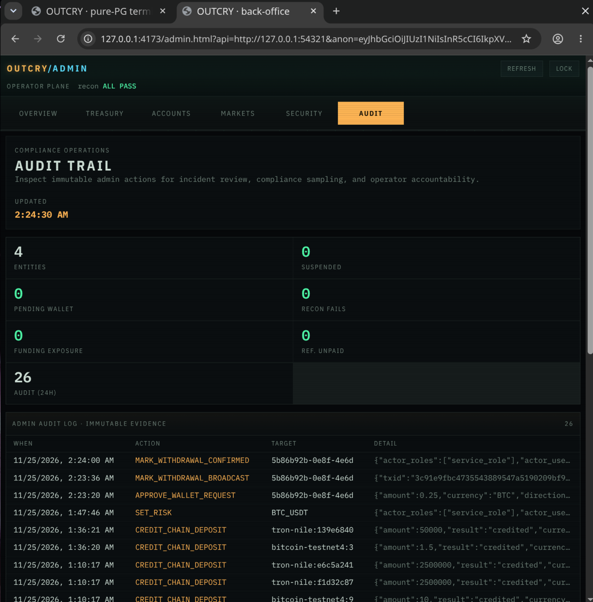

**English** · [中文](./07-backoffice-and-reconciliation.md)

# Chapter 7: Back-Office, Custody Approvals & 7-Invariant Proof of Solvency

[← Previous: Developer API & Bot Trading](./06-api-and-bot-guide.en.md) · [Wiki Master Index](./README.en.md) · [Next: Error Reference & Troubleshooting →](./08-troubleshooting-and-faq.en.md)

---

The biggest trust gap in traditional centralized exchanges is the "black-box ledger" — customers cannot verify whether deposits are genuinely backed on-chain or whether internal balances reconcile. In OUTCRY, the Back-Office console (`admin.html`) puts **live mathematical reconciliation invariants**, **on-chain custody signing queues**, and **append-only immutable audit logs** front and center.

Whether you are operating your own venue or exploring the live demo (where authenticated demo users can inspect `admin.html` firsthand), this chapter walks through every control surface of `OUTCRY/ADMIN`.

---

## 7.1 Signing In & Reading the Control Room (`Overview`)

Open `admin.html` (e.g. `http://127.0.0.1:4173/admin.html` locally or [`https://stars-labs.github.io/pg-outcry/admin.html`](https://stars-labs.github.io/pg-outcry/admin.html) on GitHub Pages) and click **`SIGN IN / CREATE →`** to enter the **`CONTROL ROOM`**:

### The 7 Golden Solvency & Custody Invariants (`recon ALL PASS`)

The green **`recon ALL PASS`** badge in the top bar (and the background `run_reconcile_monitor()` job running every 5 minutes) continuously verifies **5 Core Ledger invariants + 2 Custody Funding invariants**:

| Category | Check Name (`check_name`) | Mathematical Invariant (`PASS` Criterion) |
|---|---|---|
| **Core Ledger** | `cash balance matches ledger` | Every `currency_account.amount` snapshot **strictly equals** the net sum of append-only `transfer_ledger_entry` rows since genesis. |
| **Core Ledger** | `transfer double entry balanced` | Every `transfer_instance` has **strictly equal debit and credit leg totals** (zero discrepancy). |
| **Core Ledger** | `reservations consistent` | Every account's `amount_reserved` **strictly equals** open order holds + `PENDING` withdrawal holds — zero leaked or phantom locks. |
| **Core Ledger** | `approved wallet has transfer` | Every `APPROVED` `wallet_request` links 1-to-1 to a committed ledger transfer. |
| **Core Ledger** | `issuance conserved` | Customer balances + `MASTER` issuance accounts sum algebraically to zero across every currency. |
| **Custody Funding** | `unbacked customer funding` | Zero customer accounts hold credits without backing `chain_deposit` records (`FUNDING EXPOSURE = 0`). |
| **Custody Funding** | `wallet deposit requests disabled` | Manual unbacked fiat/cash deposit doors remain sealed; all customer inflows require on-chain proof. |

---

## 7.2 Treasury & Custody Operations (`Treasury`)

Click **`TREASURY`** in the navigation bar to manage withdrawals and chain listeners:

1. **`WALLET APPROVALS · CASH OPERATIONS` (Pending Withdrawal Queue)**:
   - Displays every customer withdrawal currently in `PENDING` state.
   - Click green **`APPROVE`**: Inside one atomic transaction, releases the user hold, posts the double-entry `WITHDRAWAL` debit from User → `MASTER`, and enqueues the payout for on-chain signing.
   - Click red **`REJECT`**: Cancels the request and immediately unfreezes 100% of the locked funds back to the customer's `Available` balance.

2. **`WITHDRAWAL QUEUE · CUSTODY SIGNER` (4-Stage On-Chain Payout Pipeline)**:
   - Every approved on-chain withdrawal advances monotonically through four states: **`QUEUED` → `CLAIMED` (atomically leased so concurrent signers never double-pay) → `BROADCAST` (raw tx broadcast with unique `txid`) → `CONFIRMED` (mined on-chain)**.
   - **Autonomous Bitcoin Testnet4 Loop**: When `bitcoin-testnet4` is enabled, in-DB `pg_cron` jobs perform UTXO selection, BIP-143 SegWit signing, broadcast, and confirmation automatically (advancing to green `CONFIRMED` below).
   - **External Signer Integration (EVM / Tron / Solana)**: External hot-wallet daemons (see [`examples/withdrawal-signer.mjs`](../../examples/withdrawal-signer.mjs)) or operators can also claim payouts via `CLAIM NEXT TO SIGN` and record `txid` / confirmation status.

3. **`CHAIN DEPOSITS · NETWORK OPERATIONS`**:
   - Toggle `bitcoin-testnet4`, `ethereum-sepolia`, `solana-testnet`, and `tron-nile` listeners (`on`/`off`), update RPC endpoints, and tune minimum confirmation thresholds (`CONF`) live.

---

## 7.3 Accounts, Markets, Anchored Market Maker & Security (`Accounts` · `Markets` · `Security`)

- **`ACCOUNTS` (Entity Freeze & Referral Payouts)**:
  - **`Suspend` / `Unsuspend`**: Freeze compromised or risky accounts in one click (blocking orders and withdrawals with `account_suspended` while preserving balances intact), and unsuspend once cleared.
  - **`Referral · payout desk`**: Inspect unpaid referral rebates and settle payouts to referrers.
- **`MARKETS` (Fees, Pre-Trade Risk, Binance-Anchored MM & Derivatives)**:
  - **`Fees`**: Configure `MAKER_FEE` and `TAKER_FEE` per currency.
  - **`Instrument Risk`**: Tune `max_order_amount`, `max_order_notional`, and fat-finger `price_band_pct` in real time.
  - **`Market Maker · Binance-anchored liquidity`**: Assign a **chain-funded** account as the house market maker, configure `half-spread bps`, `levels`, `level size`, and inventory skew limits (`target inventory` / `max deviation`) to quote two-sided depth every 5 seconds anchored to live Binance prices.
  - **`Derivatives & Staking`**: Configure staking APRs/unbonding periods, cross-margin leverage/APR, and perpetual mark prices, funding rates, and liquidation sweeps.
- **`SECURITY` (Global API Key Oversight)**: Audit active bot API keys venue-wide and revoke abusive keys immediately without freezing underlying customer wallets.

---

## 7.4 Append-Only Immutable Audit Trail (`Audit`)

Click **`AUDIT`** to inspect the compliance trail:

**Why every row here is tamper-evident cryptographic evidence:**
- `admin_audit_log` enforces a PostgreSQL trigger that **unconditionally rejects every `UPDATE` and `DELETE`** (`INSERT`-only append semantics).
- Every sensitive action — `CREDIT_CHAIN_DEPOSIT`, `SET_RISK`, `APPROVE_WALLET_REQUEST`, `MARK_WITHDRAWAL_BROADCAST` (capturing actor role + 64-hex `txid`), and `MARK_WITHDRAWAL_CONFIRMED` — permanently records timestamp, actor, target, and full JSON detail for internal and external auditors.

---

**Previous: [← Chapter 6: Developer API & Bot Trading](./06-api-and-bot-guide.en.md)** · **Next: [Chapter 8: Error Reference & Troubleshooting →](./08-troubleshooting-and-faq.en.md)**
