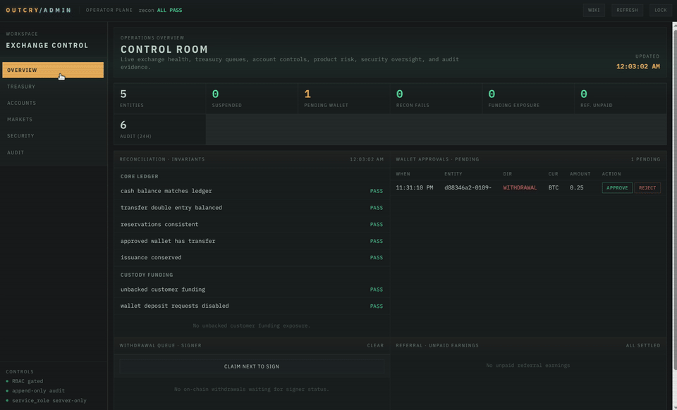
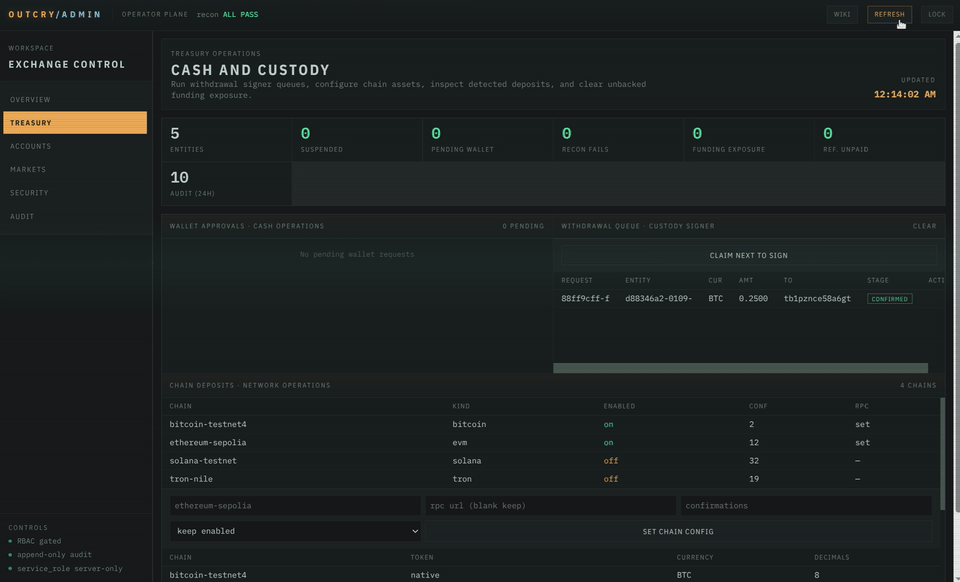

[English](./07-backoffice-and-reconciliation.en.md) · **中文**

# 第 7 章：管理后台、充提审批与七重账本自证（Back-Office & Proof of Solvency）

[← 上一章：量化与 API 自动化交易指南](./06-api-and-bot-guide.md) · [Wiki 总目录](./README.md) · [下一章：全量错误码速查词典与排障 →](./08-troubleshooting-and-faq.md)

---

传统中心化交易所最令用户担忧的是「黑箱账本」——用户不知道自己的充值是否真实在链、不知道平台是否存在未背书的虚假余额。而在 OUTCRY 中，管理后台（`admin.html`）直接将**实时数学对账不变量（Reconciliation Invariants）**、**链上充提签名队列**与**只追加不可篡改审计日志**公开呈现在运营与审计员面前。

无论你是自建运营方的管理员，还是在演示环境体验交易所闭环的用户（演示模式下任意注册登录用户默认均拥有后台体验权限），都可以通过本章全面掌握 `OUTCRY/ADMIN` 控制台。

---

## 7.1 登录管理后台与控制室总览（`Overview`）

在浏览器打开 `http://127.0.0.1:4173/admin.html`（若带有 `?api=...&anon=...` 参数会自动预填后端地址与 Publishable Key），输入管理员邮箱与密码点击 **`SIGN IN / CREATE →`**，即可进入 **`CONTROL ROOM`（总控室）**核验七重对账不变量（`recon ALL PASS`），并切换到 **`TREASURY`** 放行待审提币申请（完整联动操作见下方动图）：

### 读懂七项黄金对账不变量（顶部 `recon ALL PASS` 的底气）

后台左上角醒目的 **`recon ALL PASS`** 徽章（以及后台每 5 分钟自动巡检报警的 `run_reconcile_monitor()`），实时校验着以下 **5 项核心账本不变量 + 2 项链上托管背书不变量**：

| 类别 | 检查项名称 (`check_name`) | 数学不变量含义（必须为 `PASS`） |
|---|---|---|
| **Core Ledger** （核心双边账本） | `cash balance matches ledger` | 每个资金账户的当前快照余额 `currency_account.amount` **严格等于**只追加流水表 `transfer_ledger_entry` 自创世以来的借贷净额之和。 |
| **Core Ledger** | `transfer double entry balanced` | 每一笔转账（`transfer_instance`）的借方分录金额与贷方分录金额**逐笔严格相等、零差额**。 |
| **Core Ledger** | `reservations consistent` | 每个账户的冻结金额 `amount_reserved` **严格等于**当前未成交挂单锁定额 + `PENDING` 待审提币锁定额之和，无任何悬空泄漏。 |
| **Core Ledger** | `approved wallet has transfer` | 每一笔状态为 `APPROVED` 的钱包请求都有且仅有一笔对应的账本转账流水相绑定。 |
| **Core Ledger** | `issuance conserved` | 全站所有客户余额与平台 `MASTER` 发行总账严格代数守恒，没有任何一聪资产凭空产生或蒸发。 |
| **Custody Funding** （链上托管背书） | `unbacked customer funding` | 没有任何客户持有缺乏真实链上充值记录（`chain_deposit`）背书的空投假钱（`FUNDING EXPOSURE = 0`）。 |
| **Custody Funding** | `wallet deposit requests disabled` | 手工无背书充值口已被彻底封堵，所有入金必须经过链上凭证核验。 |

---

## 7.2 金库与充提运营台（`Treasury`）

点击顶部/侧边导航的 **`TREASURY`**，进入出入金与链配置核心操作台：

1. **`WALLET APPROVALS · CASH OPERATIONS`（待审提币审批队列）**：
   - 展示全站所有处于 `PENDING` 状态的客户提币申请。
   - 点击绿色 **`APPROVE`**（如上方 `18-admin-reconcile-and-approve.gif` 所示）：在同一个数据库事务内释放冻结额、执行从客户账户到 `MASTER` 的 `WITHDRAWAL` 双边扣账、并将记录推入下方链上签名队列。
   - 点击红色 **`REJECT`**：驳回提币请求，客户被冻结的资产立即 100% 解冻回可用余额。

2. **`WITHDRAWAL QUEUE · CUSTODY SIGNER`（链上托管签名与广播状态机）**：
   - 每一笔已批准的链上提币依次经历四个阶段：**`QUEUED`（排队待签）→ `CLAIMED`（已被签名器原子认领，防并发双发）→ `BROADCAST`（已广播上链并写入唯一 `txid`）→ `CONFIRMED`（链上已打包确认）**。
   - **Bitcoin Testnet4 全自动闭环**：开启 `bitcoin-testnet4` 后，库内 `pg_cron` 任务会自动完成选币、BIP-143 签名、广播与确认（见下方动图核验绿色 `CONFIRMED` 并切换至 `AUDIT` 审查完整审计链）。
   - **外部签名器对接（EVM 等）**：若使用独立部署的热钱包签名进程（参见 [`examples/withdrawal-signer.mjs`](../../examples/withdrawal-signer.mjs)），也可在此手动点击 `CLAIM NEXT TO SIGN` 或回填广播后的 `txid` 与确认状态。

3. **`CHAIN DEPOSITS · NETWORK OPERATIONS`（多链开关与 RPC 阈值管理）**：
   - 查看并动态调整 `bitcoin-testnet4`、`ethereum-sepolia`、`solana-testnet`、`tron-nile` 四条链的启用状态（`on`/`off`）、节点 RPC URL 与最低入账确认数（`CONF`）。

---

## 7.3 客户管控、市场风控与锚定币安做市商（`Accounts` · `Markets` · `Security`）

除金库模块外，后台另外三大运营模块职责如下：

- **`ACCOUNTS`（账户风控与返佣结算）**：
  - **紧急冻结/解冻账户（`Suspend` / `Unsuspend`）**：发现异常盗号或合规风险时一键冻结指定实体（被冻结账户调用下单或提币会立即收到 `account_suspended` 拦截，但账面资产安全保留）；排查解除后一键恢复。
  - **推荐返佣发放（`Referral · payout desk`）**：查看各推荐人的待发佣金（`unpaid`），一键结算发放至其资金账户。
- **`MARKETS`（费率、事前风控、官方做市商与衍生品参数）**：
  - **`Fees`**：按币种动态设置 `MAKER_FEE` / `TAKER_FEE` 费率。
  - **`Instrument Risk`**：实时调整交易对的 `max_order_amount`（单笔最大量）、`max_order_notional`（单笔最大名义额）与 `price_band_pct`（防胖手指价格偏离百分比）。
  - **`Market Maker · Binance-anchored liquidity`**：指定一个**真实链上充值入金**的专用账户作为官方做市账户，配置半点差（`half-spread bps`）、档位数（`levels`）、单档挂单量（`level size`）与库存偏移保护（`target inventory` / `max deviation`），开启后每 5 秒自动锚定币安实时盘口提供双边深度！
  - **`Derivatives & Staking`**：调整质押池 APR、解锁天数、全仓杠杆倍数/维持率/借贷利率，以及永续合约标记价、资金费率与手工触发清算巡检。
- **`SECURITY`（全站机器人 API Key 审计）**：全局审视所有活跃的自动化 API Key，遇到异常高频滥用可随时跨账户强制吊销（无需触碰客户钱包）。

---

## 7.4 不可篡改的管理审计日志（`Audit`）

点击导航栏的 **`AUDIT`**，进入合规审计追踪台（见上方 `19-admin-signer-confirm-and-audit.gif` 后半段展示的 `ADMIN AUDIT LOG · IMMUTABLE EVIDENCE`）：

**为什么说这里的每一行都是「铁证（Immutable Evidence）」？**
- 底层表 `admin_audit_log` 挂载了强制数据库触发器，**拒绝一切 `UPDATE` 与 `DELETE` 语句**（只允许 `INSERT` 追加）。
- 无论是链上充值入账（`CREDIT_CHAIN_DEPOSIT`）、修改风控参数（`SET_RISK`）、批准提币（`APPROVE_WALLET_REQUEST`），还是签名广播（`MARK_WITHDRAWAL_BROADCAST`，完整记录操作者角色与 64 位链上 `txid`）与链上确认（`MARK_WITHDRAWAL_CONFIRMED`），都会永久留下精确到秒的时间戳、目标对象与完整 JSON 上下文，随时可供内外部安全团队回溯审计。

---

**上一篇：[← 第 6 章：量化与 API 自动化交易指南](./06-api-and-bot-guide.md)** · **下一篇：[第 8 章：全量错误码速查词典与排障 →](./08-troubleshooting-and-faq.md)**
