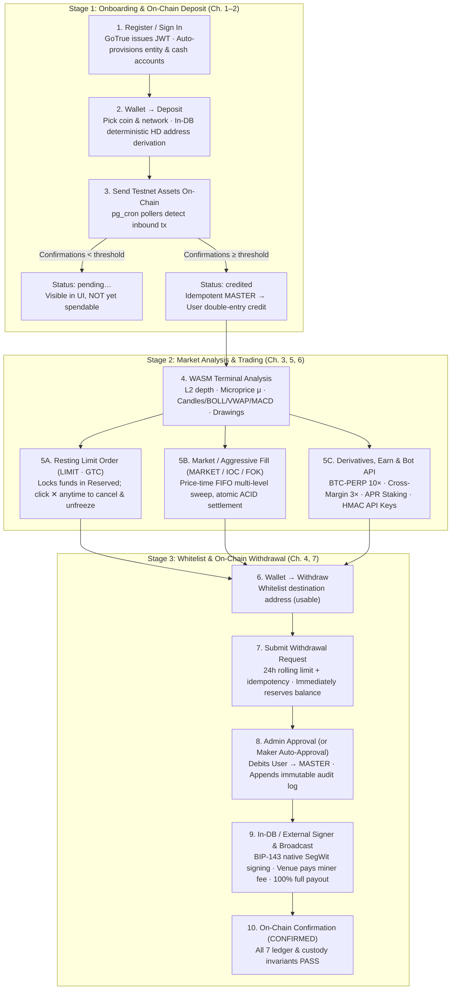

**English** · [中文](./README.md)

# OUTCRY (pg-outcry) User Operation Wiki · Master Index

[← Back to English README](../../README.md) · [← 返回中文主页](../../README.zh-CN.md) · [← All Docs](../README.md) · [🌐 Live Interactive Web Wiki (GitHub Pages)](https://stars-labs.github.io/pg-outcry/wiki.html?lang=en) · [Source (`web/wiki.html`)](../../web/wiki.html)

> **Welcome to the complete end-to-end OUTCRY operator & trader manual.**
> Every illustration in this Wiki is a **live-action animated GIF** recorded from a single continuous desktop session of trader **`alice@outcry.dev`** on a running OUTCRY exchange instance — reconciled down to `0.0001` precision across **19 Computer Use action GIFs**. Follow it sequentially to master **Account Creation → Multi-Chain Deposits → Spot & Derivatives Trading → Address Whitelisting & Zero-Fee On-Chain Withdrawals**.

---

## 1. End-to-End Asset Lifecycle Overview (Deposit → Trade → Withdraw)

In any centralized cryptocurrency exchange (CEX), a user's capital journey spans three stages: **On-Chain Deposit → In-Venue Matching & Settlement → On-Chain Withdrawal**.

Unlike traditional exchanges that split gateways, matching engines, and ledgers across a dozen microservices, **OUTCRY executes order matching, double-entry ledger settlement, pre-trade risk checks, deterministic HD wallet derivation, and even Bitcoin SegWit transaction signing inside a single PostgreSQL database under ACID transactions**:

---

## 2. 5-Minute Quickstart Path

| Step | Action | Verification Checkpoint | Detailed Chapter |
|---|---|---|---|
| **Step 1 · Sign Up** | Open the terminal → click `NO ACCOUNT? REGISTER →` → enter email & password → click `CREATE ACCOUNT →` (or use GitHub OAuth2) | Green dot `live · realtime` and your email badge appear in the top header | [Ch. 1: Onboarding, Auth & Security](./01-onboarding-and-security.en.md) |
| **Step 2 · Deposit** | Click `WALLET` → on `DEPOSIT`, select **BTC (`Bitcoin · testnet4`)** or **USDT (`TRC-20 · Nile`)** → copy your derived address and send testnet coins | `DETECTED DEPOSITS` transitions from amber `pending…` to green `credited`; `AVAILABLE` updates | [Ch. 2: On-Chain Deposits](./02-deposit-guide.en.md) |
| **Step 3 · Trade Spot** | In `ORDER ENTRY`, choose `BUY / BID` or `SELL / ASK` → select `LIMIT` or `MARKET` (inspect WASM `Est. fill VWAP`) → click `PLACE ORDER` | Working orders appear in `OPEN ORDERS` (`+rsv` hold); fills print on `TRADE TAPE` and settle balances | [Ch. 3: Spot Trading Masterclass](./03-spot-trading-masterclass.en.md) |
| **Step 4 · Whitelist & Withdraw** | Open `WALLET → WITHDRAW` → select coin & network → add your destination address via `WHITELIST` → enter amount & click `WITHDRAW` | Bottom `WALLET` tab shows `PENDING` request; requested amount is immediately reserved (`+rsv`) | [Ch. 4: On-Chain Withdrawals](./04-withdrawal-guide.en.md) |
| **Step 5 · Approve & Confirm** | Operator clicks `APPROVE` in `admin.html` (`Treasury`) → `pg_cron` signs & broadcasts the on-chain tx → network confirms | Back-office queue turns green `CONFIRMED`; user `WALLET` tab updates live to `APPROVED`; external wallet receives 100% of requested funds | [Ch. 4](./04-withdrawal-guide.en.md) · [Ch. 7: Back-Office & Solvency](./07-backoffice-and-reconciliation.en.md) |

---

## 3. Chapter Directory

| Chapter | Title | Key Topics Covered | Live Action GIFs |
|---|---|---|---|
| **Ch. 1** | **[Onboarding, Authentication & Security Baseline](./01-onboarding-and-security.en.md)** | Auth Gate anatomy, instant email signup, GitHub OAuth2 & delegated 2FA, custom `?api=&anon=` backend params, 8-zone terminal tour, Day/Night theme, referral codes | 3 |
| **Ch. 2** | **[On-Chain Deposits (Deposit Guide)](./02-deposit-guide.en.md)** | 6-coin × 4-testnet matrix, in-DB HD address derivation, Memo/Tag rules, testnet faucets, `pending…` vs `credited` confirmation gating & idempotency, 7 anti-loss rules | 3 |
| **Ch. 3** | **[Spot Trading Masterclass](./03-spot-trading-masterclass.en.md)** | L2 Order Book & Microprice $\mu$, WASM indicators (MA/EMA/BOLL/VWAP/RSI/MACD/KDJ/ATR) & 6 drawing tools, `LIMIT` vs `MARKET`, `GTC`/`IOC`/`FOK`, balance reservation math, multi-level Market VWAP sweep, cancellation, risk bands & banker's rounding | 4 |
| **Ch. 4** | **[On-Chain Withdrawals (Withdrawal Guide)](./04-withdrawal-guide.en.md)** | 6-stage state machine, coin-to-currency debit mapping, address whitelisting, 24h rolling limits, idempotency keys, in-DB BIP-143 SegWit signing & UTXO lock, venue-paid miner fees, Market Maker atomic self-withdrawal | 5 (incl. Admin loop) |
| **Ch. 5** | **[Advanced Products (Futures · Margin · Staking)](./05-advanced-products.en.md)** | `BTC-PERP` linear perpetuals (10× max lev, funding rate, liquidation math), Spot Cross-Margin (3× max lev, lazy interest, health monitor), `Earn` Staking (MasterChef accumulator, `pgmq` 7-day unbonding) | 3 |
| **Ch. 6** | **[Algorithmic Trading & Developer API Guide](./06-api-and-bot-guide.en.md)** | Creating/revoking HMAC API Keys, `api_key_login` JWT exchange, `curl`/Node.js scripts for deposits, orders, cancellations & withdrawals, WebSocket Broadcast & RLS private streams | 1 |
| **Ch. 7** | **[Back-Office Console & 7-Invariant Solvency Proof](./07-backoffice-and-reconciliation.en.md)** | `admin.html` RBAC permissions, 5 Core Ledger + 2 Custody invariants, Treasury approval & signer queue operations, Fees/Risk/Binance-anchored Market Maker config, immutable `admin_audit_log` | 2 |
| **Ch. 8** | **[Complete Error Reference, FAQ & CEX Glossary](./08-troubleshooting-and-faq.en.md)** | A-to-Z toast/RPC error dictionary with 1-minute fixes, Top 12 real-world FAQs, essential CEX terminology glossary | Reference |

---

## 4. Complete Reconciled Ledger Trail of Demo Account (`alice@outcry.dev`)

Every animated GIF across all chapters follows one continuous account (`alice@outcry.dev`), allowing you to verify exact accounting conservation at every step:

| # | Action (Chapter & GIF) | BTC `Available` | BTC `Reserved` | USDT `Available` | USDT `Reserved` | On-Chain / Position Note |
|---|---|---|---|---|---|---|
| 0 | Fresh registration (GIF `01`) | `0.0000` | `0.0000` | `0.0000` | `0.0000` | Empty new account |
| 1 | On-chain deposits credited (GIFs `04`–`06`) | **`1.5000`** | `0.0000` | **`50,000.0000`** | `0.0000` | `+1.5 BTC` (2 confs) & `+50,000 USDT` (25 confs) credited; `0.25 BTC` at 1/2 confs stays `pending…` (**excluded from balance**) |
| 2 | Place resting Limit Buy `0.2 BTC @ 68,450` (GIF `08`) | `1.5000` | `0.0000` | **`36,310.0000`** | **`13,690.0000`** | Locks `0.2 × 68,450 = 13,690 USDT`; `Total` stays `50,000 USDT` |
| 3 | Market Buy `0.2 BTC` across 2 ask levels (GIF `09`) | **`1.7000`** | `0.0000` | **`22,608.9425`** | `13,690.0000` | Sweeps `0.135 @ 68,503.50` + `0.065 @ 68,509.00` = `13,701.0575 USDT` (VWAP `68,505.29`) |
| 4 | Cancel `68,450` Limit Buy via `✕` (GIF `10`) | `1.7000` | `0.0000` | **`36,298.9425`** | **`0.0000`** | Releases `13,690.0000 USDT` immediately back to `Available` |
| 5 | Submit `0.25 BTC` whitelisted withdrawal (GIFs `11`–`12`) | **`1.4500`** | **`0.2500`** | `36,298.9425` | `0.0000` | Creates `PENDING` request `88ff9cff…`, locking `0.2500 BTC` |
| 6 | Open `BTC-PERP` `+0.1 BTC` Long (GIF `14`) | `1.4500` | `0.2500` | **`35,298.9425`** | `0.0000` | Posts `1,000.00 USDT` margin at `68,503.50` entry (`~6.85×` lev) |
| 7 | Spot Cross-Margin borrow `0.05 BTC` (GIF `15`) | **`1.5000`** | `0.2500` | `35,298.9425` | `0.0000` | Debt `0.0500 BTC` (`3,425.18` val), Net Equity `151,754.89` |
| 8 | Stake `0.50 BTC` in `5% APR` pool (GIF `16`) | **`1.0000`** | `0.2500` | `35,298.9425` | `0.0000` | Locks principal into `stake_pool`, accruing lazy rewards per second |
| 9 | Admin approves + In-DB SegWit broadcast & confirm (GIFs `18`, `19`, `13`) | **`1.0000`** | **`0.0000`** | **`35,298.9425`** | **`0.0000`** | 234-byte SegWit tx `139142c2…` confirmed on-chain; hold cleared; **all 7 invariants PASS** |

---

## 5. Master Asset, Network, Confirmation & Limit Cheat-Sheet

> [!IMPORTANT]
> **Testnet Only**: Every blockchain address on this venue is a testnet address (`tb1q…` Bitcoin Testnet4, Ethereum Sepolia, TRON Nile, Solana Devnet/Testnet). **Never send mainnet funds to a testnet deposit address!**

| UI Coin | UI Network | DB Chain ID (`chain`) | On-Chain Standard | Required Confirmations | Credited / Debited Ledger Currency | 24h Rolling Withdrawal Cap |
|---|---|---|---|---|---|---|
| **BTC** | `Bitcoin · testnet4` | `bitcoin-testnet4` | Native BTC (P2WPKH `tb1q…`) | **2 blocks** | **`BTC`** (8 chain dec / 5 ledger dec) | **5 BTC** / 24h |
| **USDT** | `TRC-20 · Nile` | `tron-nile` | TRC-20 Token (6 dec) | **19 blocks** | **`USDT`** (6 ledger dec) | **50,000 USDT** / 24h |
| **USDC** | `SPL · devnet` (dep/wd) `ERC-20 · Sepolia` (wd) | `solana-testnet` `ethereum-sepolia` | SPL / ERC-20 Token (6 dec) | **32** (Solana) **12** (Sepolia) | **`USDC`** (6 ledger dec) | Configured per venue |
| **ETH** | `Sepolia` | `ethereum-sepolia` | Native Sepolia ETH (18 dec) | **12 blocks** | **`EUR`** (demo mapping) | **50,000 EUR** / 24h |
| **TRX** | `Nile` | `tron-nile` | Native Nile TRX (6 dec) | **19 blocks** | **`EUR`** (demo mapping) | **50,000 EUR** / 24h |
| **SOL** | `devnet` | `solana-testnet` | Native Testnet SOL (9 dec) | **32 confirmations** | **`EUR`** (demo mapping) | **50,000 EUR** / 24h |

---

**Next → [Chapter 1: Onboarding, Authentication & Security Baseline](./01-onboarding-and-security.en.md)**
