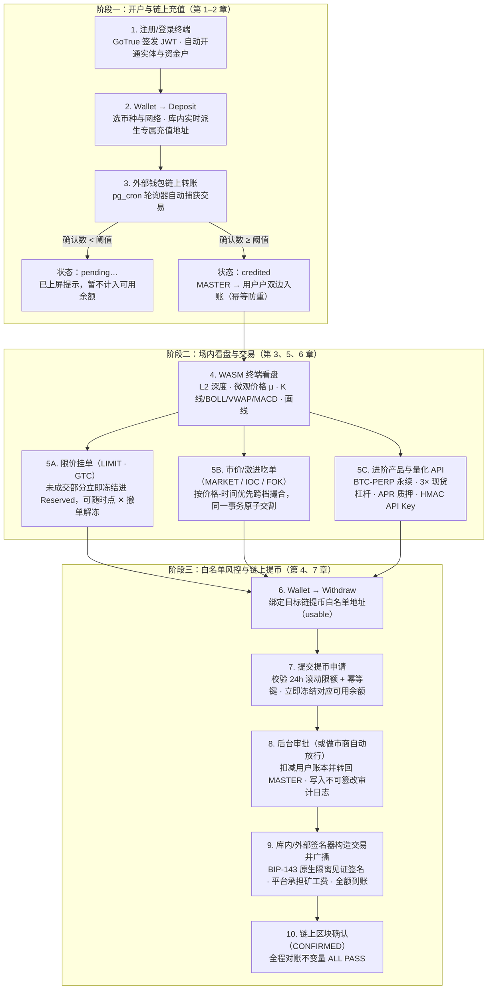

[English](./README.en.md) · **中文**

# OUTCRY (pg-outcry) 用户操作百科全书 · Wiki 总目录

[← 返回项目中文主页](../../README.zh-CN.md) · [← Back to English README](../../README.md) · [← 技术文档索引](../README.md) · [🌐 打开交互式网页版百科（GitHub Pages）](https://stars-labs.github.io/pg-outcry/wiki.html?lang=zh) · [本地源码 (`web/wiki.html`)](../../web/wiki.html)

> **欢迎来到 OUTCRY 全流程实操手册。**
> 本套 Wiki 以真实测试账户 **`alice@outcry.dev`** 在实时运行的 OUTCRY 交易所上的**完整生命周期**为主线，通过 **33 张桌面端真实实操截图**与底层账本逐笔核验，手把手带你走通从 **「零基础注册 → 多链充值入账 → 专业看盘与现货交易 → 衍生品与理财进阶 → 白名单提币与链上确认」** 的每一个按钮、每一条风控规则与每一分钱的来龙去脉。

---

## 一、全链路资金闭环全景图（从充值到交易再到提币）

在任何中心化加密货币交易所（CEX）中，用户的核心资产动线都由三大环节构成：**链上入金（Deposit）→ 场内撮合结算（Trading）→ 链上出金（Withdrawal）**。

与其他将网关、撮合、账本拆成十几个微服务的传统交易所不同，**OUTCRY 的撮合、双边记账结算、风控校验、HD 地址派生乃至比特币 SegWit 交易签名全部在同一个 PostgreSQL 数据库内以 ACID 事务完成**：

---

## 二、5 分钟极速上手路径（新手必读）

如果你是第一次打开 OUTCRY 交易终端，只需按以下 **5 步**即可在 5 分钟内跑通完整闭环：

| 步骤 | 你要做的操作 | 关键检查点 | 对应详尽章节 |
|---|---|---|---|
| **Step 1 · 注册登录** | 打开终端 → 点击 `NO ACCOUNT? REGISTER →` → 输入邮箱密码并点击 `CREATE ACCOUNT →`（或使用 GitHub OAuth2 登录） | 右上角显示绿点 `live · realtime` 与你的邮箱标识 | [第 1 章：账户注册、登录鉴权与安全基线](./01-onboarding-and-security.md) |
| **Step 2 · 链上充值** | 点击右上角 `WALLET` → 在 `DEPOSIT` 页签选择 **BTC (`Bitcoin · testnet4`)** 或 **USDT (`TRC-20 · Nile`)** → 复制专属地址并从水龙头/测试网钱包转入资产 | `DETECTED DEPOSITS` 状态由橙色 `pending…` 变为绿色 `credited`，右上角 `AVAILABLE` 出现可用余额 | [第 2 章：链上充值全流程精讲](./02-deposit-guide.md) |
| **Step 3 · 现货买卖** | 在右侧 `ORDER ENTRY` 选择 `BUY / BID` 或 `SELL / ASK` → 选 `LIMIT`（输入限价与数量）或 `MARKET`（查看 WASM 预估成交均价 VWAP）→ 点击下单按钮 | 挂单进入底部 `OPEN ORDERS`（冻结资金显示为橙色 `+rsv`）；成交单实时出现在 `TRADE TAPE` 并更新余额 | [第 3 章：现货交易全流程精讲](./03-spot-trading-masterclass.md) |
| **Step 4 · 绑定白名单并提币** | 点击 `WALLET` → 切换到 `WITHDRAW` → 选币种与网络 → 在下方输入收款地址与备注点击 `WHITELIST` → 选中地址、填入金额并点击 `WITHDRAW` | 底部 `WALLET` 页签出现 `PENDING` 提币记录，提币金额被立即冻结防误用 | [第 4 章：链上提币全流程精讲](./04-withdrawal-guide.md) |
| **Step 5 · 审批与链上到账** | 管理员在后台 `admin.html` 的 `Treasury` 模块点击 `APPROVE` → `pg_cron` 签名器自动构造并广播链上交易 → 等待链上确认 | 后台状态变为绿色 `CONFIRMED`，用户端 `WALLET` 页签实时同步为 `APPROVED`，外部钱包全额收到资金 | [第 4 章](./04-withdrawal-guide.md) · [第 7 章：后台审批与账本自证](./07-backoffice-and-reconciliation.md) |

---

## 三、全章节目录导航

| 章节 | 标题 | 核心涵盖内容 | 实操截图数 |
|---|---|---|---|
| **第 1 章** | **[账户注册、登录鉴权与安全基线](./01-onboarding-and-security.md)** | 登录门禁解析、邮箱极速注册、GitHub OAuth2 与委托式 2FA、自定义后端参数、终端八大功能区导览、日/夜主题切换、邀请返佣绑定 | 5 张 |
| **第 2 章** | **[链上充值全流程精讲（Deposit）](./02-deposit-guide.md)** | 6 币种 × 4 测试网全矩阵、库内 HD 确定性派生原理、Memo 归因规范、水龙头领币、从 `pending…` 到 `credited` 的区块确认与幂等入账机制、防丢币七大铁律 | 5 张 |
| **第 3 章** | **[现货交易全流程精讲（Spot Trading）](./03-spot-trading-masterclass.md)** | L2 深度图与微观价格 $\mu$、WASM 指标（MA/EMA/BOLL/VWAP/RSI/MACD/KDJ/ATR）与 6 种画线工具、`LIMIT` vs `MARKET`、`GTC`/`IOC`/`FOK` 生效策略、限价冻结与解冻、跨档市价 VWAP 吃单、价格带风控与银行家舍入 | 7 张 |
| **第 4 章** | **[链上提币全流程精讲（Withdrawal）](./04-withdrawal-guide.md)** | 提币六阶段状态机、币种与扣款账户映射、提现地址白名单管理、24 小时滚动限额、幂等防重扣、库内 BIP-143 原生隔离见证签名与 UTXO 防双花、平台全额包揽矿工费机制、做市商原子自提通道 | 9 张 |
| **第 5 章** | **[进阶金融产品手册（合约 · 杠杆 · 质押）](./05-advanced-products.md)** | `BTC-PERP` 线性永续合约（最高 10×、资金费率、强平公式）、现货全仓杠杆（最高 3×、惰性计息、健康度监控）、`Earn` 质押赚币（MasterChef 实时待领收益、`pgmq` 7 天解锁队列） | 3 张 |
| **第 6 章** | **[量化与 API 自动化交易完全指南](./06-api-and-bot-guide.md)** | 创建/吊销 HMAC API Key、`api_key_login` 换取限权 JWT、用 `curl`/Node.js/Python 调通查地址/下单/撤单/提币全套 PostgREST RPC、订阅公共毫秒级行情广播与 RLS 私有流 | 1 张 |
| **第 7 章** | **[管理后台、充提审批与七重账本自证](./07-backoffice-and-reconciliation.md)** | `admin.html` 控制台登录与 RBAC 权限矩阵、5 项核心账本 + 2 项托管背书对账不变量、Treasury 提币审批与签名队列实操、费率/风控/锚定币安做市商配置、只追加审计日志核查 | 5 张 |
| **第 8 章** | **[全量错误码速查词典、排障与安全总表](./08-troubleshooting-and-faq.md)** | 全部 SQL/RPC 弹窗报错逐条翻译与 1 分钟修复方案、12 大高频实战问答（FAQ）、加密货币交易所专业术语词典、充值/交易/提币三张行前核对表 | 速查表 |

---

## 四、本手册真实演示账户（`alice@outcry.dev`）全流程账本验算表

为了做到**「每一张截图都有据可查、每一笔余额都严丝合缝」**，本套 Wiki 的全部 27 张截图均来自同一个新注册账户 **`alice@outcry.dev`** 的连续真实操作。你可以对照下表在任意章节验证资金守恒：

| 序号 | 动作（对应章节与截图） | BTC 可用 (`Available`) | BTC 冻结 (`Reserved`) | USDT 可用 (`Available`) | USDT 冻结 (`Reserved`) | 链上 / 仓位备注 |
|---|---|---|---|---|---|---|
| 0 | 新注册进入终端（图 `03`） | `0.0000` | `0.0000` | `0.0000` | `0.0000` | 初始空账户 |
| 1 | 链上充值入账（图 `07`、`08`） | **`1.5000`** | `0.0000` | **`50,000.0000`** | `0.0000` | `+1.5 BTC`（2 确认入账）、`+50,000 USDT`（25 确认入账）；另有 `0.25 BTC` 仅 1 确认处于 `pending…`，**不计入余额** |
| 2 | 挂限价买单 `0.2 BTC @ 68,450`（图 `10`–`12`） | `1.5000` | `0.0000` | **`36,310.0000`** | **`13,690.0000`** | 冻结 `0.2 × 68,450 = 13,690 USDT`，总资产仍为 `50,000 USDT` |
| 3 | 市价买入 `0.2 BTC` 跨两档成交（图 `13a`–`13b`） | **`1.7000`** | `0.0000` | **`22,608.9425`** | `13,690.0000` | 吃掉 `0.135 @ 68,503.50` + `0.065 @ 68,509.00`，实付 `13,701.0575 USDT`（VWAP `68,505.29`） |
| 4 | 点击 `✕` 撤销 `68,450` 限价挂单（图 `13c`） | `1.7000` | `0.0000` | **`36,298.9425`** | **`0.0000`** | `13,690.0000 USDT` 瞬间解冻回可用余额 |
| 5 | 白名单提交 `0.25 BTC` 提币申请（图 `14`–`16`） | **`1.4500`** | **`0.2500`** | `36,298.9425` | `0.0000` | 生成 `PENDING` 申请 `5b86b92b…`，立即冻结 `0.2500 BTC` |
| 6 | 开立 `BTC-PERP` `0.1 BTC` 多单（图 `20`） | `1.4500` | `0.2500` | **`35,298.9425`** | `0.0000` | 划转 `1,000.00 USDT` 初始保证金（开仓价 `68,503.50`） |
| 7 | 现货全仓杠杆借入 `0.05 BTC`（图 `21`） | **`1.5000`** | `0.2500` | `35,298.9425` | `0.0000` | 负债 `0.0500 BTC`（折合 `3,425.18 USDT`），净权益 `151,754.89` |
| 8 | 质押 `0.50 BTC` 进 `5% APR` 池（图 `22`） | **`1.0000`** | `0.2500` | `35,298.9425` | `0.0000` | 本金锁入质押池，按秒惰性累积 BTC 收益 |
| 9 | 后台审批通过 + 库内签名广播确认（图 `17`–`19`） | **`1.0000`** | **`0.0000`** | **`35,298.9425`** | **`0.0000`** | 真实 234 字节 SegWit 交易 `3c91e9fb…` 链上确认，冻结清零，状态 `APPROVED`，**全站 7 项对账不变量 ALL PASS** |

---

## 五、资产、网络、确认数与限额总速查表

> [!IMPORTANT]
> **当前环境为纯测试网（Testnet Only）**：所有链上地址均为测试网地址（如比特币 `tb1q…`、以太坊 Sepolia、波场 Nile、Solana 测试网），严禁向测试网充值地址转入任何主网真实资产！

| 前端币种 | 支持网络（前端显示） | 底层链标识 (`chain`) | 链上代币类型 | 充值所需确认数 | 入账/扣款账本币种 | 24h 滚动提币上限 |
|---|---|---|---|---|---|---|
| **BTC** | `Bitcoin · testnet4` | `bitcoin-testnet4` | 原生 BTC（P2WPKH `tb1q…`） | **2 个区块** | **`BTC`**（8 位链上精度，5 位账本精度） | **5 BTC** / 24h |
| **USDT** | `TRC-20 · Nile` | `tron-nile` | TRC-20 合约（6 位精度） | **19 个区块** | **`USDT`**（6 位账本精度） | **50,000 USDT** / 24h |
| **USDC** | `SPL · devnet`（充/提） `ERC-20 · Sepolia`（提） | `solana-testnet` `ethereum-sepolia` | SPL / ERC-20 代币（6 位精度） | **32**（Solana） **12**（Sepolia） | **`USDC`**（6 位账本精度） | 按币种风控配置 |
| **ETH** | `Sepolia` | `ethereum-sepolia` | 原生 Sepolia ETH（18 位精度） | **12 个区块** | **`EUR`**（演示映射） | **50,000 EUR** / 24h |
| **TRX** | `Nile` | `tron-nile` | 原生 Nile TRX（6 位精度） | **19 个区块** | **`EUR`**（演示映射） | **50,000 EUR** / 24h |
| **SOL** | `devnet` | `solana-testnet` | 原生 Testnet SOL（9 位精度） | **32 个确认** | **`EUR`**（演示映射） | **50,000 EUR** / 24h |

---

**下一篇 → [第 1 章：账户注册、登录鉴权与安全基线](./01-onboarding-and-security.md)**
